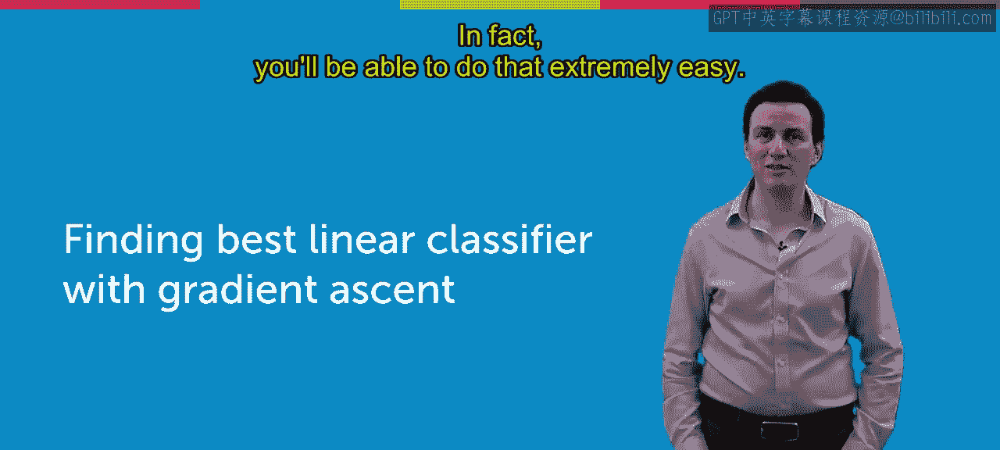
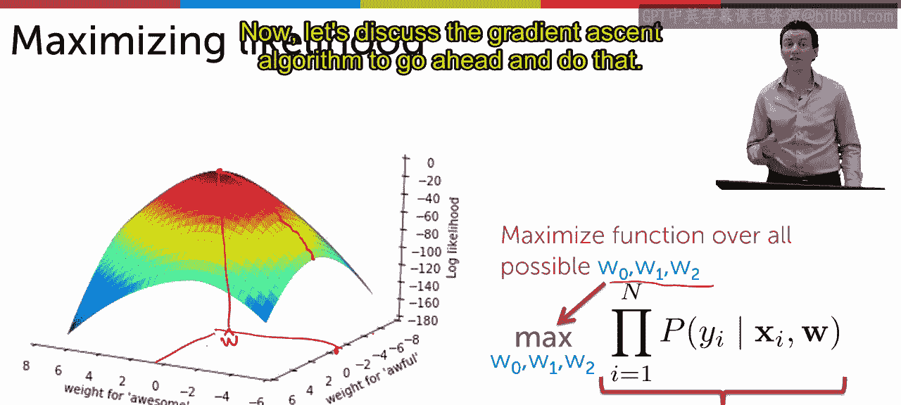

# 华盛顿大学《机器学习（分类，聚类和检索，第3-4课⧸共4课）｜Machine Learning》中英字幕 p30 29_使用梯度上升法找到最佳线性分类器.zh_en -BV1Sr421F7N7_p30-

。

Now that we learned about the likelihood function， the thing that we're trying to maximize。

 let's talk about the gradient ascent algorithm that tries to make it as large as possible。

In this section， we're going to go through a little bit of math， a little bit of detail。

 But in the end， the gradient decent algorithm for learning a logistic regression classifier is going to be extremely simple and extremely intuitive。

 So even if kind of the likelihood functions are little fuzzy for you and。😊。

And the gradient stuff is not totally clear， but in the end。

 the algorithm they're going to implement is going to be something that only requires a few lines of code。

 and in fact， you'll be able to that extremely easily。😊。

Good， so we defined the model wants to fit， the logistic ratio model。

 we talked about the quality metric trick， the likelihood function。

 now we're going to define that gradient decent algorithm which is our machine learning algorithm that tries to make that likelihood function as large as possible and find our famous WHt that fits our data really well。

😊，Now we can go back to this picture that we've seen a few times where we have multiple lines that have likelihood function and we're trying to find the one that has best likelihood。

 this line here with w0 equals 1 w1 equals 05 and w2 equals minus 1。

5 and we now know that the likelihood function is exactly this function up here。

 the product over my data point of the probability of the true label。

 given the input input sentence that we have。😊，And so I'll also take this L and optimize it。With。

Graient。Assent。That's what we're going to go after right now。So as a quick， quick quick review。

 we have our function likelihood function and want to find the parameter values that take this likelihood function so this is the w0 W1 W2 which is a function of three parameters in this little example over here and we're trying to find the maximum over all possible parameters w0 w1 and w2 and as infinite many of those so if you try to enumerate it will would be impossible to try them all but gradient set is going of this magically simple but one four algorithm where you start from some point over here in the parameter space which might be the weight for off0 the weight for awesome is minus6 and you slowly climb up the hill。

😊，In order to find the optimum。The top of the hill here， which is gonna be our famous W Hat。

 that might say that。The wait for awesome is。It's probably going to be a positive number。

 so maybe somewhere like this， say 0。5 and the weight for awful is maybe minus1。Now in this plot。

 I've only shown two of the coordinates， W andW2， I didn't show W0 because it's really hard to plot in four dimensional space。

Four dimensions。 So I'm just showing you three out of those four dimensions。

Now let's discuss the gradientcent algorithm to go ahead and do that。

