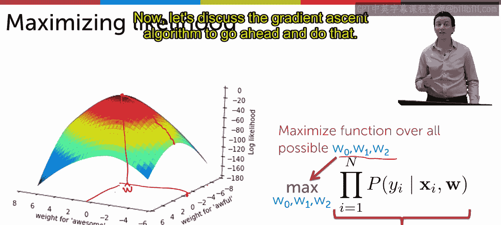

# 机器学习（分类，聚类和检索）：第3-4课：使用梯度上升法找到最佳线性分类器


在本节课中，我们将学习如何使用梯度上升算法来最大化逻辑回归模型的似然函数，从而找到最佳的分类器参数。我们将从数学原理入手，最终得到一个极其简单且直观的算法实现。

---

上一节我们介绍了用于评估模型质量的似然函数。本节中，我们来看看如何通过梯度上升算法来最大化这个函数，从而找到最优的模型参数 **W**。

## 梯度上升算法概述

梯度上升是一种优化算法，用于寻找使目标函数（此处为似然函数）值最大的参数。其核心思想是：从参数的某个初始猜测值开始，反复朝着函数值增长最快的方向（即梯度方向）迈出一小步，直至收敛到最大值点。


想象我们站在一个参数构成的山坡上，似然函数值就是海拔。我们的目标是爬到山顶（最大值）。梯度方向就是最陡的上山方向。

## 算法原理与步骤

以下是梯度上升算法的具体步骤：

1.  **初始化参数**：为参数向量 **W**（例如 `w0, w1, w2`）选择一组初始值。这可以是随机值或全零。
2.  **计算梯度**：计算当前参数下，似然函数 **L(W)** 关于每个参数的梯度（偏导数）。梯度向量 `∇L(W)` 指向函数值增长最快的方向。
3.  **更新参数**：沿着梯度方向，以一定的步长（学习率 `η`）更新参数。更新公式为：
    **W_new = W_old + η * ∇L(W_old)**
    这里的 `+` 号是因为我们在做“上升”（最大化）。如果是梯度下降（最小化），则使用 `-` 号。
4.  **迭代**：重复步骤2和步骤3，直到参数的变化非常小，或达到预设的迭代次数。

## 逻辑回归的梯度计算

对于逻辑回归模型，其条件概率公式为：
**P(y_i | x_i, W) = σ(y_i * (W^T x_i))**
其中 `σ(z) = 1 / (1 + exp(-z))` 是sigmoid函数，`y_i ∈ {-1, +1}`。

对数似然函数（通常更易于优化）为：
**log L(W) = Σ_i log( σ(y_i * (W^T x_i)) )**

其对参数 **W** 的梯度经过推导后，形式非常简洁：
**∇ log L(W) = Σ_i [1 - σ(y_i * (W^T x_i))] * y_i * x_i**

这个公式有直观的解释：对于每个数据点 `i`，如果模型预测的概率 `σ(...)` 很低（即预测错误），那么 `[1 - σ(...)]` 项就很大，梯度更新会朝着 `y_i * x_i` 的方向显著调整参数 **W**，以修正这个错误。

## 算法实现伪代码

基于上述推导，学习逻辑回归分类器的梯度上升算法变得非常简单：

```
初始化 W = [0, 0, ..., 0]
设置学习率 η (例如 0.01)
设置最大迭代次数 T

for t in 1 到 T:
    初始化梯度向量 grad = [0, 0, ..., 0]
    for 每个训练样本 (x_i, y_i):
        计算 score = W^T * x_i
        计算 prob = σ(y_i * score)  # 预测当前样本正确的概率
        grad += (1 - prob) * y_i * x_i  # 累加梯度
    W = W + η * grad  # 更新参数

返回 W
```

## 总结



本节课中我们一起学习了梯度上升算法的核心思想及其在逻辑回归中的应用。我们从最大化似然函数的目标出发，推导出了参数更新的梯度公式。最终，我们得到了一个清晰、直观且易于实现的算法：它遍历数据，根据模型当前的预测误差来调整参数，逐步逼近最优分类器。尽管背后的数学推导可能略显复杂，但最终的算法实现仅需寥寥数行代码，这正是机器学习强大魅力的体现。