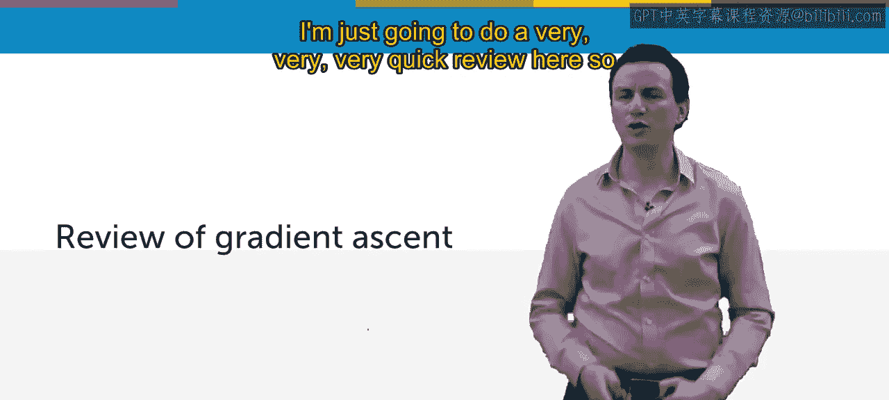
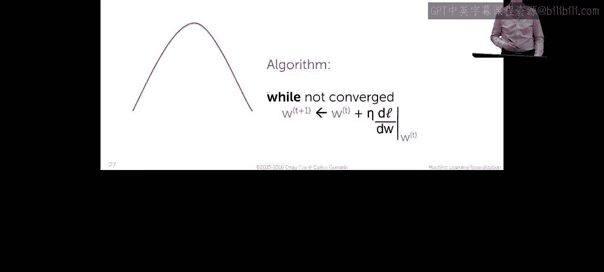
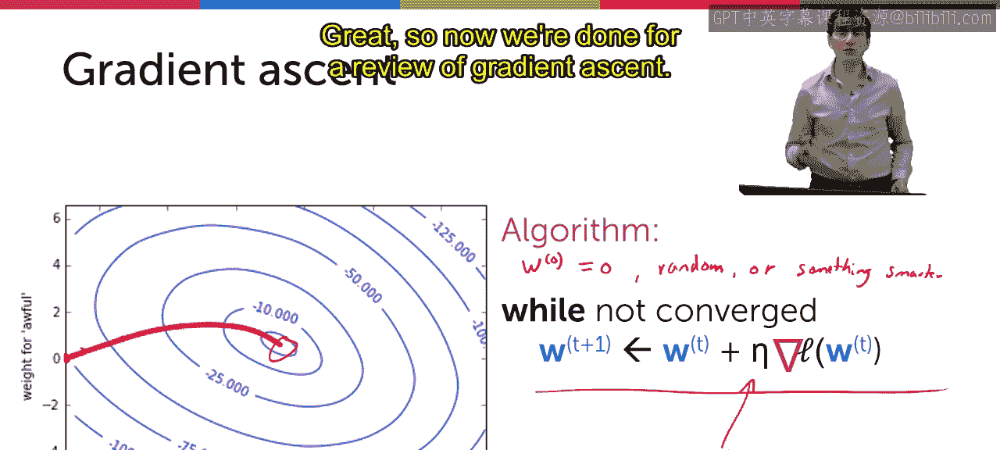

# 华盛顿大学《机器学习（分类，聚类和检索，第3-4课⧸共4课）｜Machine Learning》中英字幕 p31 30_梯度上升法回顾.zh_en -BV1Sr421F7N7_p31-

。

We'll start with a very quick review of gradient asscent in the regression class Emily went into quite a lot of detail explaining the gradient asscent algorithm。

 where it comes from in the detail， so I really recommend you go back to that if you want to kind of remind ourselves of where it all comes from。

 I'm just going to do a very very very quick review here so that kind of we remember the fundamentals。

😊。

You can think about the gradient ascent algorithm as a kind of a hill climbing algorithm。

 so if you look at the picture on the left here， if you only had one parameter W。

 you can imagine starting at some point， let's say WT in the T iteration and then moving a little bit uphill to the next parameter。

W。T plus one。And the amount you move from one to the other has to do with this term over here。

 which is the derivative of our likelihood function with respect to the parameter W。

And it's a computer that the current parameter WT。 Now， remember。

 we have this little extra coefficient parameter Eta， which we call the step size。

Little later in the module， we're going to discuss how that step size actually gets picked and what effect it has。

 So imagine it's given。 So you're gonna move by eight at times the step size。 And so you move here。

 then you move a little bit and you keep moving， moving， moving， moving uphill。

 and eventually you get to the top of the hill to the optimum， which maybe we're gonna to call。

W star for right now。And this is our goal to get to that very， very top of the hill。

Now that we're seen kind ofhi climbing in the abstract way， getting to that top of the hill。

 So we step up until we hit the top here， which is w star。

 We can talk about when we know we're done in theative algorithm。 when have we converged。

 So you may remember that at the optimum for convex functions。

 and what we dealing with today is a convex function。 let me talk quite a bit detail what that means。

 but just in general， we'll have the derivative with respect to w of our likelihood is going to be equal to0 at the optum here。

 because kind of that curve flattens out。Now， if we could get to the point where the derivative is equal to 0。

 we'd be absolutely done。😊，However， we're never going to get there exactly。

 So we're going to stop when the derivative is small enough。 So we stop when the derivative。

With respect to parameter W computed to current parameter， W T。

So we'll stop when the derivative is smaller than some tolerance parameter epsilon。And you know。

 set that to some small number， 0。001 or something depends on your problem。

 you'll explore the ce in your homework， but。keep going， you won't get exactly to the top。

 or you're going to get pretty close to the top， and that would be your W hot。

 So we'll continue going up and up and up until our derivative is sufficiently small。

Now that was for one dimensional space， but we have now a large dimensional space because we can have thousands of coefficients we're trying to fit。

So instead of computing a one dimensional derivative we need what's called a gradient and the gradient is just a stacking here of the derivative of L with respect to the first parameter W0。

 the partial derivative of L with respect to the second parameter W1。

 all the way to the derivative L， the partial derivative with respect to the last parameter WD。😊。

And so this is a D plus  one dimensional vector。For when you have d features and in our case here。

 if we start from this point and the derivative is taking this way。

 the gradient is going to be something like this may be， and that's what the gradient correspond to。

And then we're just going to follow the gradient all the way。To the top of the hill。

In a little bit more detail， more pictorially。 we're gonna start from some point。

 and there are many heuristics for what you start。 But let's say that we start over here。

 And we're just gonna follow the gradient。 And so on the right side， I'm。

 I'm showing we called the contour contour。Pluss。And so it corresponds to the level sets or the contours of this line。

 So if I start on the left side over here， it's kind of like starting over here。

 I take a gradient step and I can keep following it。Until I get to the optimum here。

 which is going to be our W star and that corresponds to climbing the s。

Until it gets to the top of the hill。Which is going to be your double star。And again。

 everyone wants to quite a bit detail on Conour plots and how they relate to that 3D plot。But。

 that's our goal。So finally， as a reminder， here's what the gradientcent algorithm looks like。

You start from some point W0。 And so you might say the w is equals 0 or random。

Parameter or something else。And you just keep following the gradient。

Until the magnitude of the gradient is sufficiently small。

So that's our algorithm that's going to take us to the optimum。And it's exempplified over here。

 and the Eta here is our famous step size。Great， so now we're done for a review of gradient asend。

