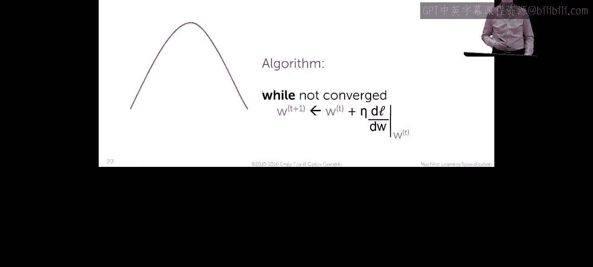
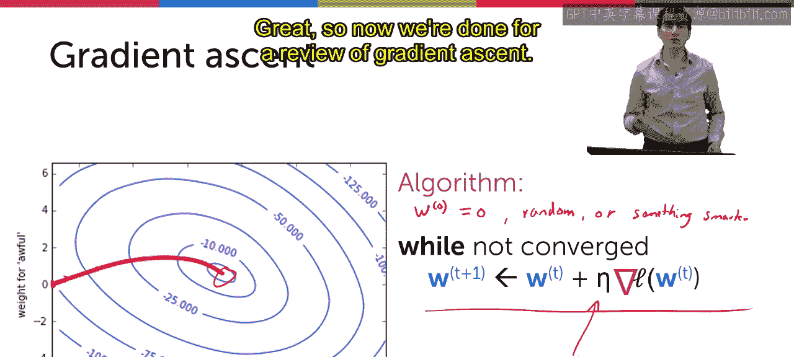

# 机器学习（分类，聚类和检索）：第3-4课：梯度上升法回顾 🧗

在本节课中，我们将快速回顾梯度上升法的核心概念。梯度上升法是一种用于寻找函数最大值的优化算法，在机器学习中常用于最大化似然函数。我们将从直观的山地爬升比喻开始，逐步理解其数学原理和算法步骤。

---

## 山地爬升的直观理解 🏔️

上一节我们介绍了优化问题的背景，本节中我们来看看梯度上升法的直观解释。

你可以将梯度上升法视为一种“爬山”算法。观察左侧的图片，假设我们只有一个参数 **W**。想象从某个起点（例如第 **T** 次迭代的参数 **W_T**）开始，然后沿着山坡向上移动一小步，到达下一个参数 **W_{T+1}**。

移动的距离与以下项有关：
**W_{T+1} = W_T + \eta \cdot \frac{dL}{dW} \bigg|_{W=W_T}**

其中，**\frac{dL}{dW}** 是似然函数 **L** 关于参数 **W** 的导数在当前点 **W_T** 处的值。**\eta** 是一个额外的系数，我们称之为**步长**。在本模块稍后部分，我们将讨论如何选择步长及其影响。现在，假设步长是给定的。

你不断向上移动，最终会到达山顶，即最优解，我们暂时称之为 **W***。我们的目标就是到达这个山顶。

---

## 收敛条件与停止准则 🎯

现在我们已经从抽象层面理解了爬山过程，即到达山顶 **W***。接下来，我们可以讨论在迭代算法中如何知道何时停止，也就是何时收敛。

你可能记得，对于凸函数（我们今天处理的就是凸函数），在最优点处，似然函数关于 **W** 的导数将等于0，因为曲线在那里变得平坦。

**\frac{dL}{dW} = 0**

然而，我们永远无法精确地达到导数为0的点。因此，我们会在导数足够小时停止迭代。具体来说，当在当前参数 **W_T** 处计算的导数的绝对值小于某个容差参数 **\epsilon** 时，我们就停止。

**\left| \frac{dL}{dW} \bigg|_{W=W_T} \right| < \epsilon**

你可以将 **\epsilon** 设置为一个小数，例如 0.001，具体取决于问题。你将在作业中探索其影响。这样，虽然无法精确到达山顶，但可以非常接近，得到的解记为 **Ŵ**。

---

## 从一维到多维：梯度的概念 📈

以上讨论的是一维空间。但在实际中，我们通常处理高维空间，因为我们可能需要拟合成千上万个系数。

因此，我们不再计算一维导数，而是需要计算所谓的**梯度**。梯度是所有偏导数组成的向量：

**\nabla L(W) = \left[ \frac{\partial L}{\partial w_0}, \frac{\partial L}{\partial w_1}, ..., \frac{\partial L}{\partial w_D} \right]^T**

这是一个 **D+1** 维的向量（假设有 **D** 个特征）。在图中，从某点出发，梯度方向可能如箭头所示。我们的目标就是沿着这个梯度方向一直向上，直到山顶。

更形象地说，我们从某个初始点（选择初始点有多种启发式方法）开始，例如图中左侧的点。然后我们沿着梯度方向移动。右侧的图展示了所谓的**等高线图**，它对应着似然函数的不同水平集。

从左侧的点开始，相当于在三维图中从山脚出发。我们沿着梯度方向一步步移动，直到到达最优点 **W***，这对应于爬到了山顶。

---

## 梯度上升算法总结 📝

以下是梯度上升算法的完整描述：

1.  **初始化**：从某个初始点 **W_0** 开始。例如，可以设 **W_0 = 0** 或随机初始化。
2.  **迭代更新**：重复以下步骤，直到梯度的模长足够小。
    **W_{t+1} = W_t + \eta \cdot \nabla L(W_t)**
    其中，**\eta** 是步长。
3.  **收敛判断**：当梯度向量的模长 **||\nabla L(W_t)||** 小于预设的容差 **\epsilon** 时，算法停止。

这就是将我们带向最优解的算法，其过程在图中得到了示例。

---

本节课中我们一起学习了梯度上升法的核心思想：通过沿着函数梯度（最陡上升方向）迭代更新参数，以最大化目标函数（如似然函数）。我们回顾了其山地爬升的直观比喻、收敛的判定条件，以及从一维导数到多维梯度的扩展，并总结了完整的算法步骤。理解这些基础是后续应用梯度上升法解决逻辑回归等分类问题的关键。