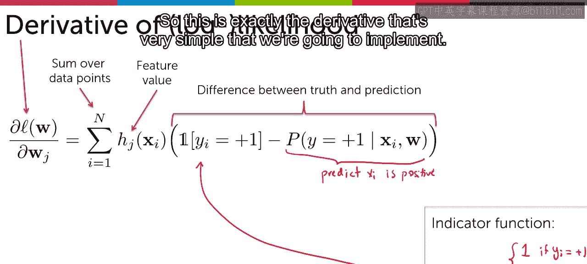

# 华盛顿大学《机器学习（分类，聚类和检索，第3-4课⧸共4课）｜Machine Learning》中英字幕 p32 31_Logistic回归的学习算法.zh_en -BV1Sr421F7N7_p32-

。

Okay， this is exciting。 reminded ourselves of gradient descent。 And what that looked like。

 We we figured out the logistic regression model is we talked about maximum likelihood functions and estimation。

 and we explore quite a bit of that math。 Now， let's dive in and look at the actual learning algorithm for logistic regression。

 That learning algorithm is gonna to be extremely simple。😊，And so spite of the math we seen。

 we had come up with an algorithm that you could implement just a couple lines of code。

To this final gradient ascent algorithm for logistic regression。

 all we have to do is define a derivative with respect to each parameter of Wj So what's the derivative for likelihood function of respect to WJ by the way。

 this derivatives side note to going to be of the log of the likelihood function。

 the log likelihood and I'll explain a little bit more why that is in an advanced section of this module later on option one but just think about as a derivative with the likelihood for now。

😊，Now the derivative of the likelihood is going to be equal to the sum over the data point。

 so we're going to consider each data point has a contribution to a derivative some when we want to make Wj big some going to make Wj smaller。

 but we're gonna sum over the data points of the difference between what's called the indicator function。

 that the data point is plus one， So indicator of whether the data point is positive。

 so I'm going to specify it at the bottom here。So let's go our ink。

So this indicator function simply says output 1。If。Y I is truly a positive example， and output 0。If。

Why I is a negative example。 So that's the indicator is。 So this is this。Definition over here。

 So is this a positive example。 And the second term。

 there's a difference between that and whatever my model predicts。What that。

How much my model does file predict that X I is positive？In other words。

 if this is the difference between the truth， is this a positive example and the likelihood that might model science to be in a positive example。

And we're going to weigh it by the feature value xj。 So this， for example， is a number of awesomes。

 So if data point has many， many awesomes， then it has more contributions to the derivative because that coefficient is going to be multiplied by。

 say，20 awesomes。 If it has zero awesomes， then there's no contribution here。

 because whether the coefficient is high or low， it doesn't make any difference to this data point。

 So that's why we weighed that way。😊，So this is exactly the derivative that's very simple that we're going to implement。

