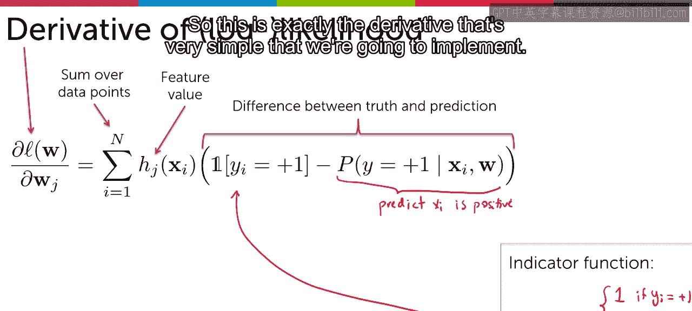

# 机器学习（分类，聚类和检索）：第3-4课：Logistic回归的学习算法 🧠


在本节课中，我们将要学习Logistic回归模型的学习算法。我们将回顾梯度下降法，并推导出Logistic回归的梯度上升更新规则。这个算法非常简洁，只需几行代码即可实现。

上一节我们介绍了最大似然估计和相关的数学推导。本节中我们来看看如何将这些理论转化为一个具体、可执行的学习算法。

## 梯度上升算法

Logistic回归的学习算法是梯度上升。其核心是计算对数似然函数关于每个参数 \( W_j \) 的导数。这个导数公式非常简单。

以下是导数公式的组成部分：

*   **求和**：对所有数据点求和。每个数据点对导数的贡献不同，有些会使 \( W_j \) 增大，有些则使其减小。
*   **差值项**：计算真实标签与模型预测之间的差值。具体是“指示函数”与“模型预测为正例的概率”之差。
    *   **指示函数**：如果数据点 \( Y_i \) 的真实标签是正例（+1），则输出1；如果是负例，则输出0。
    *   **模型预测**：模型认为数据点 \( X_i \) 属于正例的概率 \( P(Y=1|X) \)。
*   **特征权重**：将上述差值乘以对应特征 \( X_j \) 的值。这意味着，如果某个特征值很大（例如“awesome”一词出现20次），它对参数更新的影响就更大；如果特征值为0，则对该参数的更新没有贡献。

因此，关于参数 \( W_j \) 的导数公式为：
\[
\frac{\partial \ell}{\partial W_j} = \sum_{i=1}^{N} ( \mathbf{1}[Y_i = +1] - P(Y=1|X_i) ) \cdot X_{ij}
\]
其中，\( \mathbf{1}[Y_i = +1] \) 是指示函数，\( P(Y=1|X_i) \) 是模型的预测概率，\( X_{ij} \) 是第 \( i \) 个样本的第 \( j \) 个特征值。

得到导数后，梯度上升的更新规则就是按照这个导数的方向调整参数：
\[
W_j \leftarrow W_j + \eta \cdot \frac{\partial \ell}{\partial W_j}
\]
其中 \( \eta \) 是学习率，控制每次更新的步长。

## 算法实现

这个算法的实现极其简单。以下是其核心步骤的伪代码描述：

```python
初始化权重 W
for 迭代次数 in range(总迭代次数):
    计算梯度 = 0
    for 每个数据点 i in 所有数据点:
        计算预测概率 P_i = 1 / (1 + exp(-W·X_i))
        计算误差 = (真实标签 Y_i) - P_i
        梯度 += 误差 * 特征向量 X_i
    W = W + 学习率 * 梯度
```

可以看到，尽管背后的数学推导可能较为复杂，但最终的学习算法只需要几行循环和计算即可实现。



本节课中我们一起学习了Logistic回归的梯度上升学习算法。我们回顾了梯度下降的概念，推导出了关键的导数公式，并看到了如何将其转化为一个简洁的迭代更新过程。这个算法高效而强大，是许多分类任务的基础。