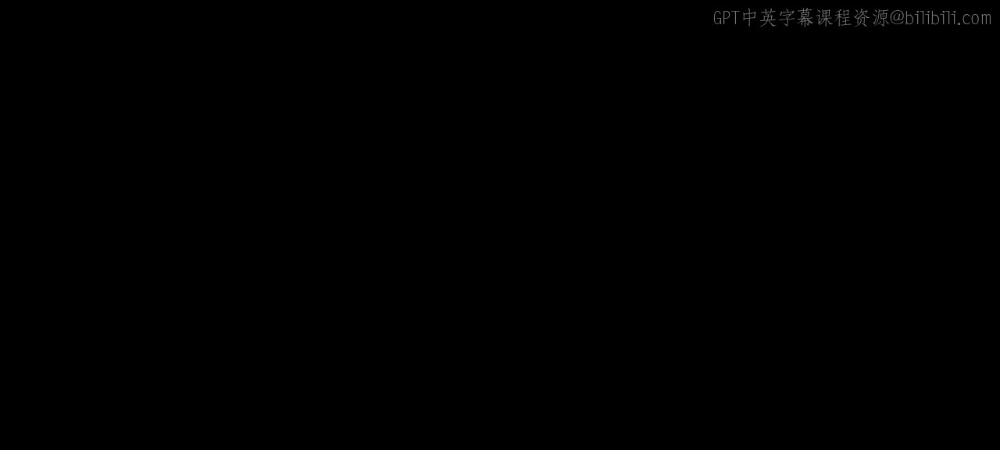
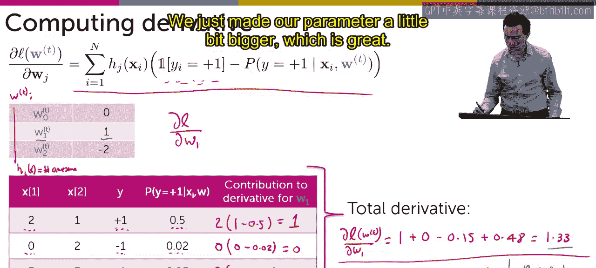

# 华盛顿大学《机器学习（分类，聚类和检索，第3-4课⧸共4课）｜Machine Learning》中英字幕 p33 32_计算Logistic回归导数的例子.zh_en -BV1Sr421F7N7_p33-

。

So let's see a little example。 we're going to go through by hand and show what the derivative would be for a particular parameter。

 We have a model and it says that so far at iteration T W0 is equal to 0。

 W1 is equal to 1 and w2 equal to minus-2。 This is our current estimate。WT。

And the question is how we're going to modify it， how we're going to compute the derivative。

 and we're going to compute the partial derivative of the likelihood function。

With respect to the parameter。W1。And the parameter to W1 is going to multiply the first feature。

 which is H1 of x， which in our case is number of awesomes。

So what is the contribution that each one of these data points will have to the derivative with the equation above。

That's what we're trying to do。 So if you look at the question number for each one of these。

 we're going to make a prediction according to the current model as to whether that data point is actually a plus one。

 So for the first one which has two awesomes and one awful we get the true labels plus one。

 but a model only assigns 0。5 probability to it， so not perfect。😊。

What contribution does that have to the derivative， Well， let's just go through the equation above。

 So H1 of X I is the number on the left here。 It's 2。

 and it multiplies the difference between the indicator function。 Is this a positive example。 Yes。

 it is a positive example and。The probability that we get from data， which is 0。5。

So the contribution here is2 times1 minus 0。5， which is exactly equal to1。

Let's look at the next data point。The next data point， the H1 of x has value 0。

So in this case W1 is not important to it， but now just let's go through。

 this is multiplying the indicator， is this a positive example in this case is's not。

 so it's zero minus the probability that the model signs for this would be a positive label。

 which in this case is 0。02。And the total here contribution is going to be 0。

 It's interesting for this particular data point， the model gets extremely right。

 says the probability's positive is very， very， very， very， very small，0。02。

 which means this very likely to be a negative example， which， in fact， it is as two offers0 awesome。

😊，Now， let's look at the third example。 It's a bit of unusual example。

 It has three awesomes and three awfuls， and it is actually a negative example。

 And the model thinks it is pretty likely to be a negative example。 So it's 0。

05 probably to be positive。 So 95%。😊，Chances of being negative。

 So what's the contribution as to derivative。 Okay， so let's look at H1 of x in this case， is 3。

It multiplies the difference between the indicator that it is a positive example。

 so in this case is's not， so it's 0 minus the probability assigned to the positive example which is 0。

05。 If you multiply this together you get minus 0。15。

So that's the contribution contribution is negative to the gradient。 Now for the final example。

 you have four awesomes， one off， so4 is h1 of x is a positive example。

 so the indicator has value 1 and the probability the model thinks is positive is 0。88。

So the contribution here is 4 and multiplly 1 minus 0。88， which is 0。12 times 4，0。48。Great。

 and so the total derivative is this going to be the sum of each one of these contributions added up together。

 So the derivative。😊，Of L。Computed at WT。With respect to the parameter W1。

 it's just going to be the sum。Of these four contributions。 So 1 plus 0-0。15。Plus，0。48。

 which is equal to if you add it all together，1 point。3，3。

And now I'm going to do a little change of colors transformation here。 Let's go to a color。

 Let's write the update rule for the parameter W1， we compute this derivative。 Let's do the update。

 So W1 at the next iteration， iteration t plus1 is going to be equal to W1 at iteration T。Plus。

 Eta the step size that multiplies the derivative。Of the likelihood function at WT。

With respect to the parameter W1， which is the one we're updating here。Now， let's suppose。

We set ata to be 0。1。 It's a bit for a large number， but it makes our updates here those simple。

 So what does this update rule says， W1 at iteration T plus1 is w1 ateration T， which was1。

Plus Eta 0。1 that multiplies the derivative we just computed right here， 1。33。

Which means that the new parameter is going to be equal to 1。133。

 We just made a parameter a little bit bigger。

Which is great。