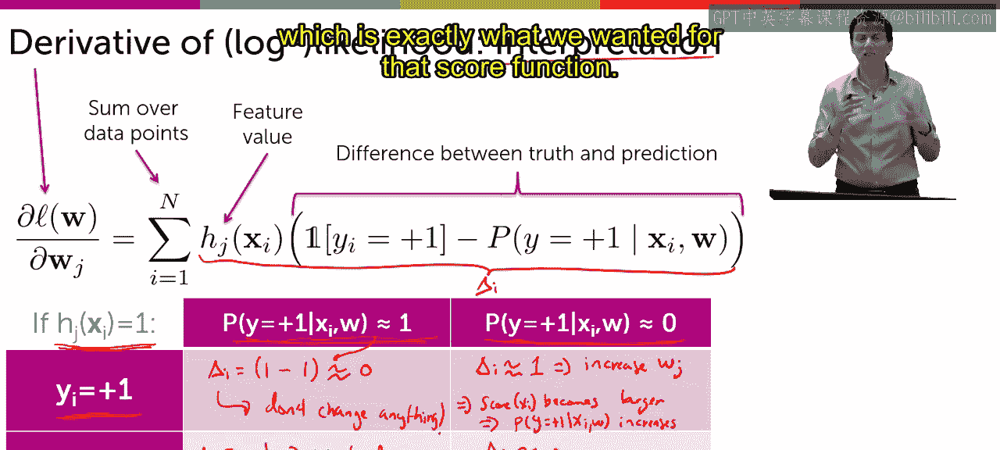

# 华盛顿大学《机器学习（分类，聚类和检索，第3-4课⧸共4课）｜Machine Learning》中英字幕 p34 33_解释Logistic回归的导数.zh_en -BV1Sr421F7N7_p34-

。

Alright， we saw a numeric example of how those derivatives get computed。

 It just really simple computations。 Now let's go back and interpret a little bit of what the derivative means。

 So let's say we have a particular parameter。😊，They were trying to update WJ。

 and we have a particular data point X。 when look at its contribution。 and it turns out that for X。

 H J of X has value 1。To say that that's what happened。

So what is the contribution that this data point has on the total derivative。

 So if you call this contribution here。Delta I， and I chose H J of X I to be  one。

 because then we don't have to worry too much about a feature value。

 We can just focus on that difference。 Let's interpret that difference。

So let's first look at the case where why I。Is positive。 It's a positive training example and。

Our model， is pretty sure that it iss a positive training example。

 so it says the probability of y equals plus one， it's approximately equal to one。😊。

So let's interpret what happens。 So in this case， Delta I is going to be。

Equal to the difference between one。The， the indicator functions is post and the probability here。

 which is approximately  one。 So this whole thing is going to be approximately 0， in other words。

The data point is positive。 The model thinks it's a positive data point。

 So the contribution here is 0 means。😊，Don't change。Anything。From the perspective of this parameter。

 you shouldn't change anything。Which makes sense。 You get it right。

 But let's see what see what happens if you're getting completely wrong。

 So this is the second case where it's a positive training example。

 but the probability that y cos plus  one is approximately 0。We're getting this training example。

 totally wrong， in this case。Delta I is the difference between。The indicator。

 which has value 1 and the probability here predict probability has value 0。

 And so it's approximately one。 So Delta I is really big。And so what does this imp。

 this implied that this data point wants us to increase。The coefficient W J。

 the one that we're just trying to increase， says push the derivative up。

 add this little delta that makes it more positive。

And remember that if X H J is a positive number and its multiplied by a bigger coefficient。

 because we just made it a little bigger， that implies that the score。Of H。Becomes larger。

 and that implies， in a sense， the probability that y is equal to plus one given X I and W increases。

 but that is extremely intuitive。So if we're getting the data point really wrong。

 we get this positive delta I we're going to increase my parameter。

 which' going to increase my score， which makes in the next step the net accelerationeration。

 the probability of this data points is positive。😊，Higher。So we're going in the right direction。Now。

 let's go go this through this a little quicker。 We can look at the case where Y I is negative。

 and you just get the same thing with flip sign。 So， for example， if Y I is negative。

 but I'm getting the prediction right， So this is a negative data point。

 We'll see that deelta I is approximately equal to 0， which implies。You know， don't change anything。

 Make sense。 I got everything right。 Why would I change anything。 However， in the。

 in the case where the data point were negative。But the prediction I made was the positive data point。

 Then Delta I would be the difference between the indicator。

 which in this case is 0 and the probability， which is approximately 1。

 So this Delta I would be negative， would be approximately -1， which would lead。WJ。To decrease。

Which would imply that the score。Of X， I。Decreases。

And it leads to the probability of y equals plus 1， given X I and W to decrease。Yay。

 if it's a negative data point and we get it wrong。

 we decrease the coefficient to make that probability of it being positive smaller and increase the probability of being negative。

So cool， we've gone through a little bit of interpretation of how this gradient helps us push id the coefficients。

Bigger for positive training examples and more negative， smaller。🎼For negative driven examples。

 which is exactly what we wanted for that score function。

