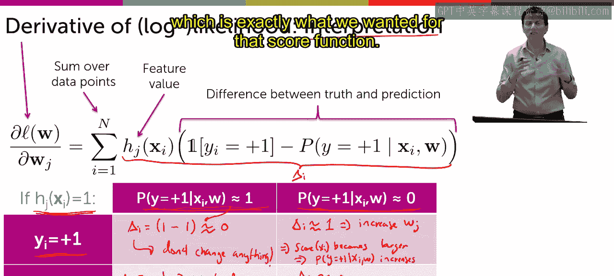

# 机器学习（分类，聚类和检索）：3-4：解释Logistic回归的导数


在本节课中，我们将深入探讨Logistic回归中导数的含义。我们将通过分析不同情况下的导数贡献，来理解梯度如何指导模型参数更新，从而让模型学习得更准确。

上一节我们通过一个数值例子看到了导数是如何计算的。本节中我们来看看这些导数的实际意义。

## 理解单个数据点的贡献

假设我们正在更新某个特定参数 **WJ**，并且有一个特定的数据点 **X**。我们关注这个数据点对总导数的贡献。为了简化分析，我们假设该数据点的特征 **HJ(X)** 值为1，这样我们可以专注于分析预测概率与实际标签之间的差异。

我们将这个贡献称为 **ΔI**。其计算公式为：
```
ΔI = (Indicator[YI = +1] - P(Y = +1 | XI, W)) * HJ(XI)
```
由于我们设 **HJ(XI) = 1**，因此贡献简化为：
```
ΔI = Indicator[YI = +1] - P(Y = +1 | XI, W)
```

接下来，我们分析几种不同情况。

## 情况分析

以下是几种典型场景，帮助我们理解 **ΔI** 如何影响参数更新。

### 情况一：正确预测正例
*   **场景**：数据点标签 **YI** 为正（+1），且模型以很高的概率（接近1）预测其为正。
*   **贡献分析**：此时 **ΔI ≈ 1 - 1 = 0**。
*   **含义**：贡献接近0。这意味着从参数 **WJ** 的角度看，这个被正确分类的数据点“建议”不需要进行任何更改。模型已经做对了。

### 情况二：错误预测正例
*   **场景**：数据点标签 **YI** 为正（+1），但模型以很低的概率（接近0）预测其为正，即完全预测错误。
*   **贡献分析**：此时 **ΔI ≈ 1 - 0 = 1**。
*   **含义**：贡献是一个较大的正数。这个被错误分类的正例“希望”我们**增加**参数 **WJ** 的值。因为增加 **WJ** 会提高得分 **Score**，从而在下一步迭代中增加模型预测该数据点为正例的概率 **P(Y = +1 | XI, W)**。梯度下降正是在朝这个正确的方向推动参数。

### 情况三：正确预测负例
*   **场景**：数据点标签 **YI** 为负（例如，-1 或 0），且模型以很低的概率预测其为正（即，以高概率预测其为负）。
*   **贡献分析**：此时指示函数 **Indicator[YI = +1] = 0**，预测概率 **P(Y = +1 | XI, W) ≈ 0**，因此 **ΔI ≈ 0 - 0 = 0**。
*   **含义**：贡献同样接近0。被正确分类的负例也“建议”参数 **WJ** 无需改变。

### 情况四：错误预测负例
*   **场景**：数据点标签 **YI** 为负，但模型以很高的概率（接近1）预测其为正。
*   **贡献分析**：此时 **ΔI ≈ 0 - 1 = -1**。
*   **含义**：贡献是一个较大的负数。这个被错误分类的负例“希望”我们**减小**参数 **WJ** 的值。减小 **WJ** 会降低得分，从而降低模型预测该数据点为正例的概率，同时增加其预测为负例的概率。

## 核心机制总结

本节课中我们一起学习了Logistic回归梯度的直观解释。通过分析单个数据点在各种情况下的贡献（**ΔI**），我们揭示了梯度下降法更新参数的内在逻辑：

*   对于**正例**，如果预测错误（概率低），梯度会推动相关参数**增大**，以提高其被预测为正的概率。
*   对于**负例**，如果预测错误（概率高），梯度会推动相关参数**减小**，以降低其被预测为正的概率。
*   对于**预测正确**的样本，其梯度贡献接近**零**，对参数更新的影响很小。



这正是我们期望得分函数学习到的模式：让正例的得分更高，负例的得分更低。梯度计算为这种学习过程提供了精确的数学指导。