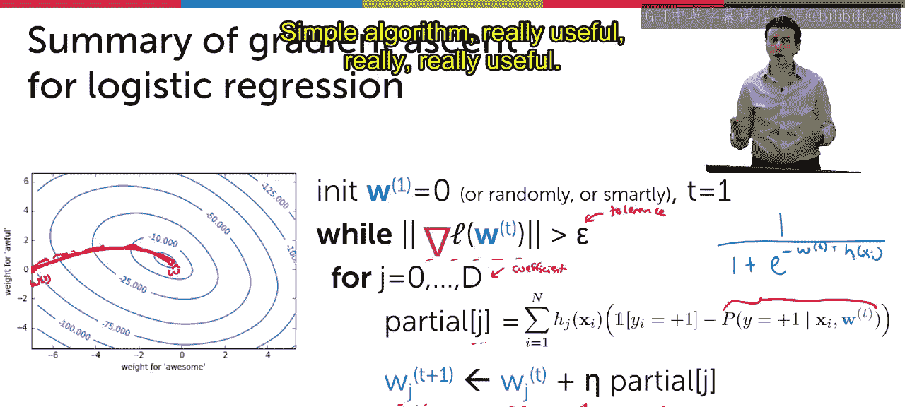

# 华盛顿大学《机器学习（分类，聚类和检索，第3-4课⧸共4课）｜Machine Learning》中英字幕 p35 34_Logistic回归梯度上升法总结.zh_en -BV1Sr421F7N7_p35-

。

And now we have the complete gradient ascent algorithm for logistic regression。

 extremely simple extremely useful and very cool。 So we're going to start from some point。

 say w0 and we're just gonna to follow the gradient here until we get to the optimum here。

 which we're gonna be our estimate w hat and we're going to stop when the norm of the gradient is sufficiently small with respect to our tolerance parameter to epsilon。

 just like we discussed in the regression case。😊，And every time we take an iteration， we go。

Fature by feature or coefficient by coefficient， compute that partial derivative with respect to coefficient J。

 so what is the derivative with respect that for that coefficient and then we just update the coefficient WJ at T plus1 to be WJT plus the step size times this derivative that we just computed。

So this is notation for the derivative L at T with respect to the parameter Wj。

And at the core of the derivative， the only little computation that we have to do is this one over here。

 which is computing the probability that the data point has value plus one with the parameters WT。

 So what's that equal to。Well， this is just exactly the logistic regression model。

 So I'm going to do a change of color transformation here and just do this in blue。

 So it'll stand out。 This last little bit is just one over。1 plus e to the minus。W。

 which in is whatever is a iteration team。Transpose。嗯。Hge of X， I。So I just compute that prediction。

 whatever my model thinks I subtract to the indicator is a positive example multiply by the feature value and there you go some of the data points。

😊，Simple algorithm， really useful， really， really useful。

