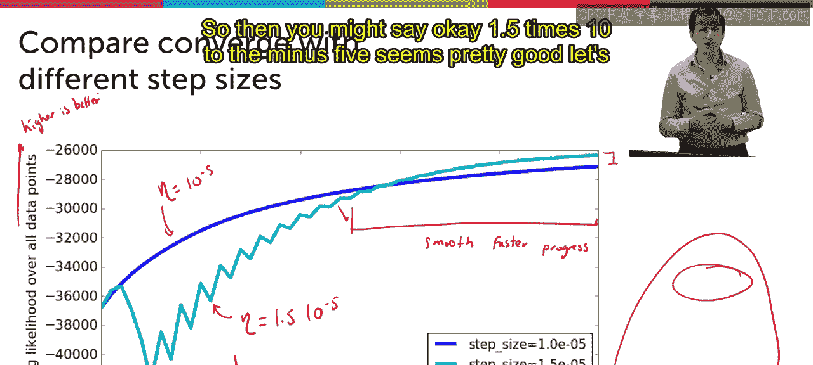

# 华盛顿大学《机器学习（分类，聚类和检索，第3-4课⧸共4课）｜Machine Learning》中英字幕 p36 35_选择步长.zh_en -BV1Sr421F7N7_p36-

。

So far when we talked about gradient descent ingredient ascent。

 we had the step size parameter Eta that we just assumed to be given。

 let's talk a little bit about how to choose that step size parameter Eta and spoiler alert this is really hard。

 it requires lots of tuning and one of the annoying things about gradient descent approach we're going to talk about a few heuristics of how we might want to do that。

😊，Now one of the most important things you can do when you're trying to pick the step size is to build what's called a learning curve and this is what I'm showing right here so in the X axis we have the iteration number which in our gradientcent algorithm we call T so this is one iteration two iterations and so on and then for each iteration or maybe you do this every 10 iterations or every few iterations here every iteration you measure the log likelihood over all of the data so this is basically the log of the product over my data points one through n of the probability of Yi given。

X， i。And the current estimate at iteration T of the parameters。

 So this is your quality metric when I measure the quality metric after each iteration after each update and you'll see that the quality metric is getting bigger and bigger and bigger in a pretty smooth way。

 which is nice we start from a lower number about minus- 37000 remember we talked about this numbers being negative and then they go up and up and up as we if we had more iterations and this for a particular step size value。

😊，Aam。Equals right here， which is。equals to 10 to the minus5。

 So it's a relatively small step size and that's how we get this curve over here。

 which looks pretty decent and it keeps going up。 Now how do it end up with Eta10 to the minus5 Basically we're going to do is try a bunch of different parameter ata and try to hone in to a good one and to understand what can happen with parameter data which is too small or too large。

 let's observe those learning curves and by observing them， you get an idea。

 get a sense of the possible behaviors to observe in your data and then use that to pick a good parameter。

Now for 10 to the minus5， I called it a little small because。As you can see。

 the curve is still going up after 50 durations。 So maybe one thing to think about is that we need to do。

More than。50 iterations in this case。So that's another thing to observe。

 not only have we repeat Keta we thinking when are we done。

 what's the stopping criterion and here the curve is still going up so we should keep going。Now。

 what would happen if you pick a native that's too small？So now let's observe two curves。

The top one is the one we just observed where the eta has value 10 to the minus5。

 and the green curve is Eta is 10 times smaller， Eta is 10 to the minus6。And what we observed。

 there is two smooth curves， but the attention minus5 gos much quicker and gets to a higher likelihood value。

 So here again， reportinging plotting L of WT。😊，Get into a higher likelihood value than the1 to 10 to minus6。

1096 is still going。 It's just a really small step size。 So it climbing up the hill。

That we had in really， really， really， really small steps， small steps， small steps。

 So it's gonna to take a long time to get to the top of the hill。 Eventually will。

 but it's going to take a long time。 So you see， if you were to try the two parameters and plot。

 you see the tens of minus-5 is probably a better parameter than 10 to -6。So that's a good thing。

 So you got 1 to minus5。 So it pretty good。 Maybe you want to try something a little bit larger。

 So if you try something larger， you're taking bigger steps。Towards the top of the hill。

So here I'm comparing what happens if I try eta step size1 to minus5。

As opposed to this other cion curve， which is Eta being 1。5。Times 10 to the minus5。

 So here we're picking a parameter which is 50% larger。And you see， it's really interesting。

 really interesting behavior and observe this behavior a lot in practice。

 So this is this early phase。😊，Here。So， you get some early。Oscillation。But once you start getting。

 so in the beginning， it doesn't do something so good。

 But once you start getting towards the top of the hill， you see that towards the end。

 the larger parameter values tends to make more progress。 So smooth。So this has Cion has smooth。Fast。

Faster progress。At the end， and you see that it starting to get even higher values of likelihood。

 So higher quality。 remember that higher here is better。As we get more iterations。

 so it's kind of interesting if your parameteral is bigger， not too big or bigger。

 you might see some oscillations at the beginning， but it tends to smooth out and do well。😊。

So then you might say， okay。1。5 times 10 to minus5 seems pretty good。

 Let's try something even a bit larger。

