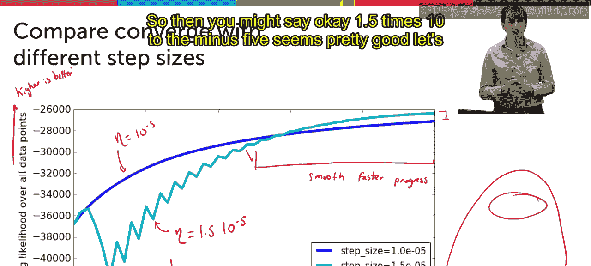

# 机器学习：3-4：选择梯度下降的步长

在本节课中，我们将学习如何为梯度下降算法选择步长参数（η）。这是一个需要仔细调整的关键步骤，我们将介绍几种实用的启发式方法。

## 概述

到目前为止，我们在讨论梯度下降（或上升）时，都假设步长参数 η 是给定的。本节我们将探讨如何选择这个参数。需要提前说明的是，这通常很困难，需要大量的调优。我们将介绍几种启发式方法来应对这个挑战。

## 构建学习曲线

选择步长时，最重要的一件事是构建所谓的“学习曲线”。下图展示了一个例子：

在X轴上，我们标出了迭代次数（在梯度下降算法中我们称之为 `t`），例如第1次迭代、第2次迭代等。对于每次迭代（或者每10次迭代），我们计算在整个数据集上的对数似然值。其公式如下：

**L(w_t) = log( ∏_{i=1}^{n} P(y_i | x_i, w_t) )**

这个值衡量了在第 `t` 次迭代时，当前参数估计的质量。我们可以在每次参数更新后测量这个质量指标。从图中可以看到，质量指标以一种相当平滑的方式变得越来越大，这是理想的情况。我们从大约 -37000 的较低值开始（记住这些值是负数），随着迭代次数的增加，它会不断上升。这条曲线对应一个特定的步长值：**η = 10^{-5}**。这是一个相对较小的步长，我们得到了这条看起来相当不错的上升曲线。

## 如何确定步长

我们通常的做法是尝试一系列不同的 η 值，并试图找到一个好的值。为了理解步长过小或过大会发生什么，让我们观察不同的学习曲线。通过观察这些行为，你可以对数据中可能出现的模式有所了解，并据此选择一个好的参数。

对于 **η = 10^{-5}**，我们称之为“偏小”，因为曲线在50次迭代后仍在上升。这意味着我们可能需要执行超过50次迭代。这也引出了另一个观察点：我们何时停止？什么是停止准则？在这里，曲线仍在上升，所以我们应该继续迭代。

## 步长过小的情况

现在，让我们观察两条曲线。顶部蓝色曲线是我们刚刚观察过的 **η = 10^{-5}** 的情况。绿色曲线对应更小的步长 **η = 10^{-6}**。

我们观察到两条都是平滑的曲线，但 **η = 10^{-5}** 的曲线上升更快，并且达到了更高的似然值。**η = 10^{-6}** 的曲线仍在上升，只是步长非常小。可以想象，它正在以非常、非常小的步幅爬山，最终会到达山顶，但需要很长时间。通过尝试两个参数并绘图，你可以看到 **η = 10^{-5}** 可能是比 **η = 10^{-6}** 更好的参数。

## 尝试稍大的步长

既然 **η = 10^{-5}** 看起来不错，也许可以尝试稍大一点的步长。更大的步长意味着向山顶迈出更大的步伐。

这里我们比较 **η = 10^{-5}** 和 **η = 1.5 × 10^{-5}**（即大了50%）的情况。观察到的行为非常有趣，在实践中也经常看到。

在早期阶段，较大的步长会导致一些**振荡**。但一旦开始接近山顶，你会发现到了后期，较大的参数值往往能取得更快的进展。这条橙色曲线在后期进展更平滑、更快，并且开始达到更高的似然值（质量更高）。这很有趣：如果你的参数稍大（但不是太大），可能在开始时看到一些振荡，但之后往往会趋于平稳并表现良好。

## 尝试更大的步长

那么你可能会说，**η = 1.5 × 10^{-5}** 看起来不错，让我们尝试再大一点。

上图展示了当步长变得过大时会发生的情况。红色曲线对应 **η = 10^{-4}**，这是一个更大的步长。你可以看到，曲线出现了剧烈的振荡和不稳定，似然值没有持续增长，反而上下波动。这表明步长过大，导致算法在最优解附近“跳跃”而无法收敛。这是一个需要避免的情况。

## 总结

本节课中，我们一起学习了如何为梯度下降选择步长参数 η。关键方法是构建并观察**学习曲线**，通过比较不同 η 值下的曲线行为来做出选择。步长过小（如 **η = 10^{-6}**）会导致收敛缓慢；步长适中（如 **η = 10^{-5}** 到 **η = 1.5 × 10^{-5}**）通常能稳定地提升目标函数；而步长过大（如 **η = 10^{-4}**）则会引起振荡和不收敛。实践中，需要通过反复试验和调整来找到适合特定数据集和模型的“最佳”步长。