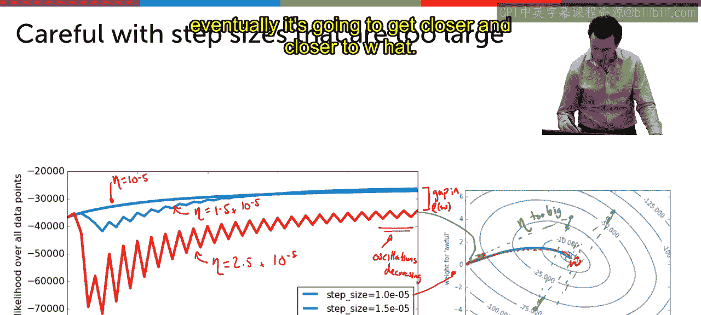
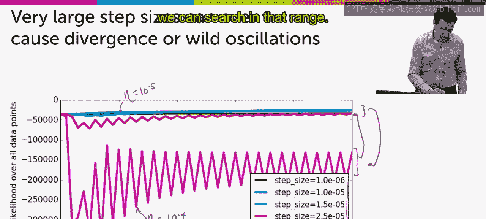

# 华盛顿大学《机器学习（分类，聚类和检索，第3-4课⧸共4课）｜Machine Learning》中英字幕 p37 36_对过大步长要小心.zh_en -BV1Sr421F7N7_p37-

。

So now let's try a little bit larger and compare and see what happens。 So remember。

 we have our first curve， the blue curve where Eta was 10 to the -5。

 Then we have the can curve where Eta was 50% larger。 So 10 to。1。5 times 10 to the minus-5。

 And now I tried even larger parameter。 So this is the red line。 This is Eta equals 2。

5 times10 to the  minus-5。 So this is。You know， 2。5 times bigger than the blue line and what we see we see bigger oscillations in the beginning and the early oscillation phase goes on for a long time as you see the oscillations are decreasing towards the end。

嗯。But不了。Decreasing， but。We still picked the parameter loop too big。

 we started to see the oscillations。 it's not converging。 there's a gap， significant gap。

In the likelihood function， L of W。 So the red one，2 times2。5 times cents to 5 is too big。

So let's understand a little better why those oscillations come about。

 So if I were to use the blue very smooth step size。

 what happens is I start from a starting point and I take this little steps and I'm kind of following this nice smooth curve all the way to my desired parameter W hat。

If you pick a step size， there is too big。II look at a gradient here and it's looking pretty good direction in the beginning。

 So let me change colors。 They just make it super obvious。

 So I'm going to use green to denote this step size， which is too big。 so I start here。

 I find a gradient direction， but I take a step that's too big boom。

 I went to somewhere really far away over here。 So。It took at Eta。 That was too big。

And now I compute the gradient here and it's in this direction and boom。

 I took a step size thats too big I ended up here over here and then I compute a gradient and I get something in this direction and we I take a step size that is too big I end up here and I step size that's too big and so on and you keep oscillating back and forth with this really big steps Now in this case in the red in the red line 2。

5 times sensor minus-5 you see this oscillations are decreasing。

 So eventually it's going to get closer and closer to W hat。

But you have to be careful。

Now let's see what happens when we pick it。😊，I a a parameter。 though is2，2， too large。

 What I've done here is taken a much bigger parameter。 So I picked Eta。

Which has step size 10 to the -4。 Remember the ones were ordered 10 to -5。 as you can see。

 they're increasing。 This is 10 to the -4。 So 10 times bigger than this blue line here。

 which is 8 to 10 to the -5。first thing that you observe is is why all the oscillations。

 this parameter is too big， things are going everywhere doesn't seem to be converging and。

The likelihood value is much， much lower than of the other parameters。

The other way to look at it is look we thought the difference between the red parameter which was we thought was too big。

 the blue parameter which was better or the XN one was a big gap but look at the gap between this cell curves look really small because we had to make that scale much bigger to show this wild oscillating one。

 so 10 to the minus4 was too big。So here's what I've learned， We've learned that 10 to minus6。

 too small，10 to minus4 is too big。Now we have a range between the two big and too small。

 and we can search in that range。

