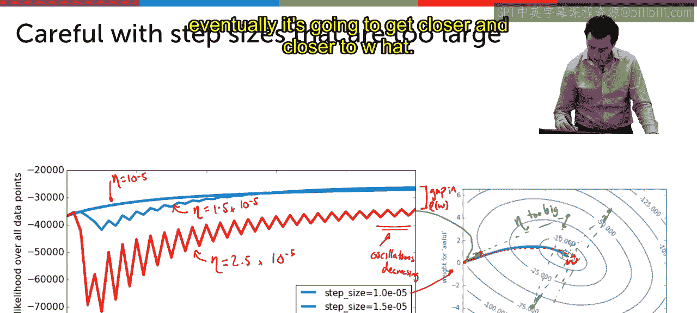
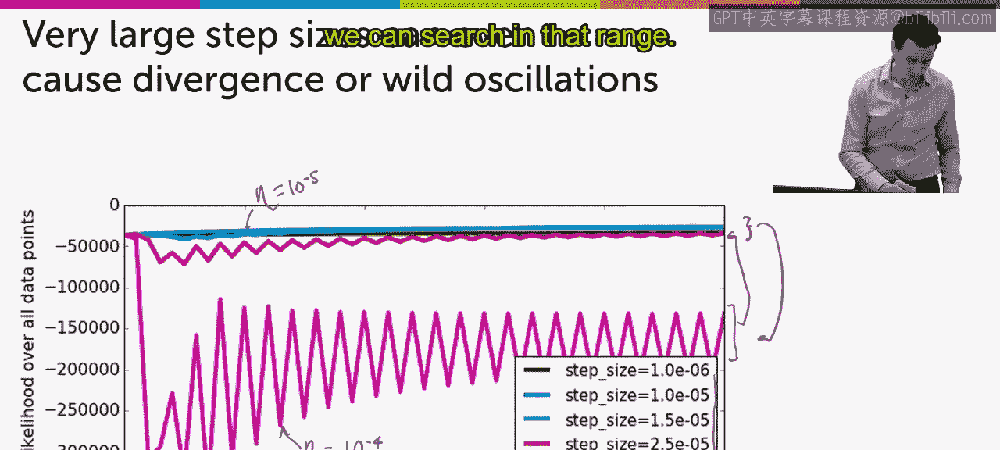

# 机器学习：3-4：对过大步长要小心 ⚠️

在本节课中，我们将探讨梯度下降算法中步长（学习率）选择的重要性。我们将通过对比不同步长下的收敛情况，理解为什么过大的步长会导致问题，并学习如何选择合适的步长范围。

---

上一节我们介绍了步长（学习率）对梯度下降收敛速度的影响。本节中，我们来看看当步长设置得过大时会发生什么。

首先，我们回顾一下之前的实验结果。我们有一条蓝色曲线，其步长（Eta）为 `10^-5`。然后有一条青色曲线，其步长比蓝色曲线大50%，即 `1.5 * 10^-5`。

现在，我们尝试一个更大的参数。红色曲线对应的步长为 `2.5 * 10^-5`，这是蓝色曲线步长的2.5倍。我们观察到，在迭代初期出现了更大的振荡，并且这种振荡阶段持续了很长时间。虽然振荡在后期有所减小，但算法并未完全收敛。在似然函数 `L(W)` 的值上，红色曲线与最优值之间存在显著差距。因此，`2.5 * 10^-5` 这个步长太大了。

---

为了更好地理解振荡产生的原因，让我们进行一个直观的比喻。

如果使用蓝色曲线对应的、非常平滑的步长，我们会从一个起点出发，沿着一条平滑的曲线，通过一系列小步长逐渐接近目标参数 `W_hat`。

然而，如果选择的步长过大，情况就不同了。假设我们用绿色来表示这个过大的步长。我们从起点开始，计算梯度方向，这个方向在初期看起来是正确的。但由于步长太大，我们一步就跨到了一个很远的地方。然后，我们在新的位置重新计算梯度，方向可能指向另一边，再次因为步长过大而跨到另一个遥远的位置。如此反复，我们就会在目标值附近来回振荡。

在红色曲线（`2.5 * 10^-5`）的例子中，我们看到振荡是逐渐减小的。这意味着最终它可能会越来越接近 `W_hat`，但我们必须非常小心。

---

现在，让我们看看当步长设置得更大时会发生什么。

这里我们尝试了一个更大的步长参数：`Eta = 10^-4`。请注意，之前的步长数量级是 `10^-5`，而这个是 `10^-4`，比最初的蓝色曲线步长大10倍。

我们观察到的第一件事是剧烈的振荡。这个参数显然太大了，迭代路径看起来杂乱无章，完全没有收敛的迹象。并且，其达到的似然函数值远低于其他参数设置下的结果。

从另一个角度看，我们之前认为红色参数（`2.5 * 10^-5`）已经太大了，它与蓝色参数（`10^-5`）之间有巨大差距。但为了展示这个疯狂振荡的紫色曲线，我们不得不把坐标轴尺度调得更大，相比之下，红色和蓝色曲线之间的差距看起来就很小了。这进一步证明 `10^-4` 这个步长是过大的。

---

以下是我们的发现总结：

我们了解到：
*   `10^-6` 太小，收敛过慢。
*   `10^-4` 太大，导致剧烈振荡且不收敛。

现在，我们有了“太大”和“太小”之间的一个范围。我们下一步可以在这个范围内进行搜索，以找到最佳的步长。

---

本节课中我们一起学习了步长（学习率）对梯度下降算法收敛性的关键影响。过小的步长导致收敛缓慢，而过大的步长则会引起振荡，甚至阻碍收敛。一个合适的步长应能平衡收敛速度和稳定性，确保算法平滑、稳定地逼近最优解。在实践中，我们通常需要通过实验，在“太大”和“太小”之间找到一个合适的值。