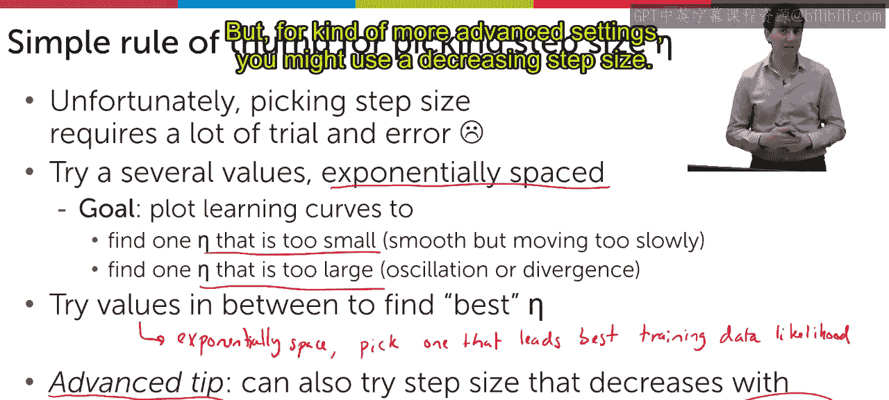

# 华盛顿大学《机器学习（分类，聚类和检索，第3-4课⧸共4课）｜Machine Learning》中英字幕 p38 37_选择步长的经验法则.zh_en -BV1Sr421F7N7_p38-

。

So this， here's the rule of thumb of how you can pick the learning the subsize Eta when when you're doing gradient and thecent。

Unfortunately there is really like there is some theory behind things they might want to do。

 but it's kind of hard to apply those in practice， here's the most practical thing you do you try several values of the parameter exponentially spaced between each other like 10 to minus4 to 10 to the minus6 that's kind of exponentially spaced。

And the goal is plot the learning curves to find a data that is。Too small。

So the curve is moving too slowly， too slowly， too slowly， and you find an there is too large。

 it's wild oscillations and it's diverging even。😊，And now we have a big value and a small value。

And then you can try values in between。Again， exponentially space。Sped。嗯。Big one。That。

Leads to the best training likelihood。And that's how you do it。Pret simple heuristic。

 but it's basically something that you all have to do if you're implementing this from scratch。

Now note that we've so far we've looked at only fixed step size。

 every iteration we use the same step size， like 10 to the minus5 everywhere。Here's an advanced step。

嗯。In theory and often in practice， it's good to pick step sizes that decrease over the iterations。

 So in the beginning you take really big steps because you're very far away from the optimum。

 but towards the end you take much smaller steps， smaller little steps you just hone in to that perfect value。

 So if you imagine you take the contour plots in the beginning you're taking big steps like this。

 but to be able to get to the optimum you take very little steps towards the end and that's how you kind of hone in to the optimum here W hot。

So what does that equation for the step size look like and there are various ways of defining them it's going to give you one pre practical example which often works well。

 so you pick a step size。That depends on the iterations or iteration T。 You're going use Ata T。

And the way you're going to write it is by writing eight to 0。

Some constantly you tune using the same kinds of ideas that are described above and find the minimum。

 the maximum the range in between， and then you divide that by the iteration number T。That's it。

 So iteration1， use ata 0， iteration 2 use ata 0 over2。

 iteration 3ta 0 over 3 over4 over 5 and so on。 And that way。

 the step size keeps getting smaller and smaller and smaller。

 So this is an advanced step for the applications that we're going to discuss in this module constant step size will do just fine for you。

 But for kind of more advanced settings， you might use a decreasing step size。

