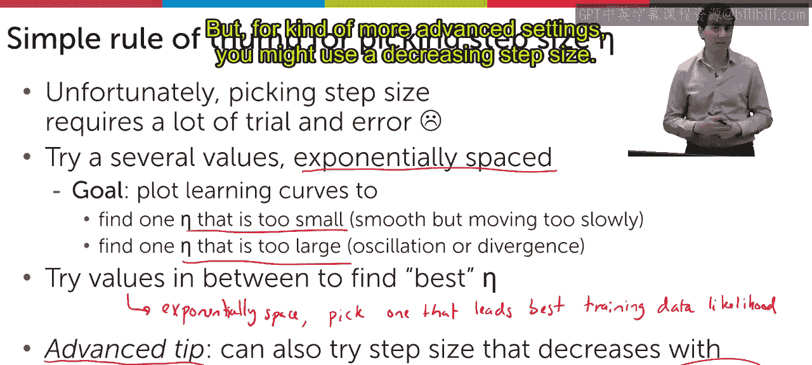

# 机器学习（分类，聚类和检索）：第3-4课：选择步长的经验法则 🎯

在本节课中，我们将学习如何为梯度下降算法选择合适的学习率（步长）。学习率是决定模型收敛速度和效果的关键参数。我们将介绍一个实用的经验法则，并探讨固定步长与递减步长的区别。

---

## 选择步长的经验法则

上一节我们介绍了梯度下降的基本概念。本节中，我们来看看如何选择一个有效的学习率。

理论上存在一些指导原则，但在实践中往往难以直接应用。以下是一个最实用的方法。

以下是选择学习率的具体步骤：

1.  **尝试多个指数间隔的值**：首先尝试一系列以指数间隔分布的学习率值，例如从 `10^-4` 到 `10^-6`。
2.  **绘制学习曲线**：针对每个尝试的学习率，绘制目标函数值（如训练似然）随迭代次数变化的曲线图。
3.  **识别边界**：通过曲线图，找出导致学习过程“**太慢**”（曲线下降极其缓慢）的过小值，以及导致“**振荡甚至发散**”（曲线剧烈波动或不降反升）的过大值。
4.  **在边界内进一步搜索**：在找到的过大值和过小值所确定的范围内，再次尝试一系列指数间隔的学习率值。
5.  **选择最佳值**：最终，选择那个能带来**最佳训练似然**（即目标函数值最小或收敛最稳定）的学习率。

这是一个简单的启发式方法，但如果你需要从头实现梯度下降，这基本上是必须进行的步骤。

---

## 进阶话题：递减步长

到目前为止，我们讨论的都是固定步长，即每次迭代都使用相同的值，例如始终使用 `10^-5`。这是一个进阶步骤。

理论上，并且实践中也常常如此，使用随着迭代进行而**递减的步长**是有益的。在开始时，我们距离最优解较远，可以迈出较大的步伐；而在接近最优解时，则需要非常小的步伐来精确调整，最终收敛到最优解 `W_hat`。

那么，递减步长的公式是什么样的呢？定义方式有多种，这里给出一个在实践中通常效果良好的实用例子。

你选择一个依赖于迭代次数 `t` 的步长，记为 `η_t`。其定义方式如下：

`η_t = η_0 / t`

其中，`η_0` 是一个常数，你可以使用前面描述的经验法则来调试和确定其合适的值范围（找到其最小有效值和最大有效值）。然后，在每次迭代时，将 `η_0` 除以当前的迭代次数 `t`。

这意味着：
*   第1次迭代：使用 `η_0`
*   第2次迭代：使用 `η_0 / 2`
*   第3次迭代：使用 `η_0 / 3`
*   以此类推...

通过这种方式，步长会变得越来越小。对于本模块将要讨论的应用场景，**固定步长**已经足够。但在更高级的设置中，你可能会考虑使用这种**递减步长**策略。

---

本节课中我们一起学习了如何为梯度下降选择学习率。我们掌握了一个通过尝试指数间隔值并观察学习曲线来寻找合适固定步长的实用经验法则。此外，我们还了解了递减步长这一进阶概念，它通过随时间减小步长来帮助模型在后期更精细地收敛。对于初学者，掌握固定步长的选择方法已足够应对大部分基础问题。