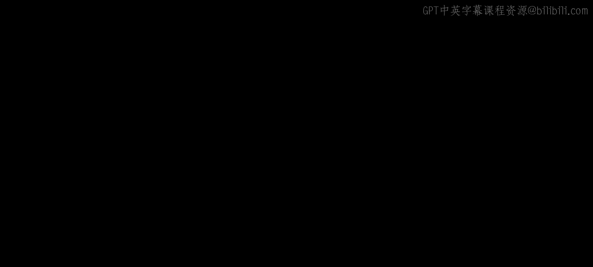
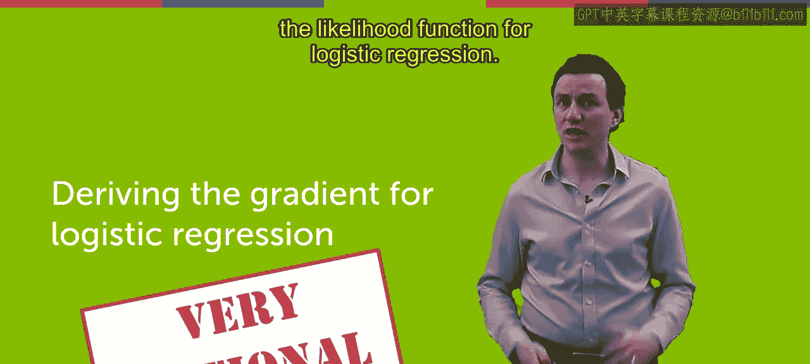
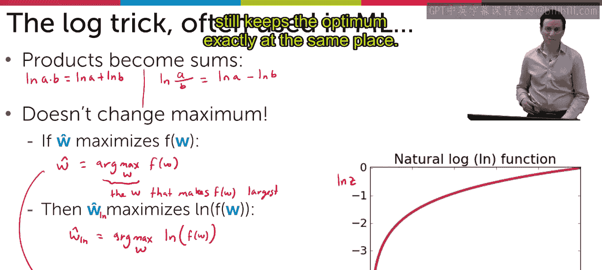

# 华盛顿大学《机器学习（分类，聚类和检索，第3-4课⧸共4课）｜Machine Learning》中英字幕 p39 38_非常可选：推导Logistic回归梯度的对数技巧.zh_en -BV1Sr421F7N7_p39-

。

Very good。 So we've now seeing the simple gradient ascent algorithm for logistic regression。

 how we update our parameters， how we implement it。

 And we talked a little bit about how to set that step size parameter。

 bests step size parameter and what impact it has on the progress of our algorithm。

 Now I'm going to take a little bit of time to show you how to derive the derivative of the likelihood function for logistic regression。

 how that gradient is computed。 The material we going to talk about here is quite mathematical iss really PhD level material。

 and it can be a little。😊，Annoying and for some folks might be exciting to go through every detail for others this could be something that you skip and it doesn't change anything So up to you。

 you're warned but it's there for when you want to learn more about it。

 So we're going to jump in to deriving the gradient for the likelihood function。😊。

For logistic regression， again， PhD level material。 Here we go。

As we said， our goal is to pick the coefficients W that maximize the likelihood function and that is the product of our data points so the probability of Y I given Xi and W now it turns out that all the math that we need to do becomes quite a lot simpler if you take the log of that likelihood function and I'm going to call that LL of W and this is the natural log LN。

😊，Natural。Log of that product。Now， it turns out that for most machine learning。

 especially for probabilistic stuff， you often take the log and usually makes your mouth a lot simpler。

 So logs are your friends。 So let me do kind of a quick review of the log natural log function log L M。

 And that is the function here that I'm showing。 So on the you might have on the X access some value Z on the Y axis。

 This is what the log of z looks like。 And you see that is something that actually at 0 be minus infinity it grows quickly at first。

 and then kind of much much much slower later。 This is what the log does。

 And the reason that it's useful is that that big product that we had actually becomes a sum。

 So in general， if you have the log of a times B。 that is equal to the log a。😊，Plus， log。

And similarly， if you have the log of a over B， that is the log of a minus the log of B。

Here's a side note。 I remember in high school I think I learned about log function and that the log of a times B log a times plus log B。

 and I thought， oh my God this is the most useless thing I've ever seen why theyre spending time teaching it and it really took about six years before I saw it was actually useful for something and it's actually extremely useful for machine learning funny side note。

 but anyway log has some very interesting properties。 the other property it has is that。😊。

If you take a function F and you compute its maximum， taking the log doesn't change anything。So。

If you don't note， W hat。Here to be， we're going to call it the a max。Over W of F of W。

And in this notation here， just means。The W that。Makes。F of W。Largest。

And if we were to take the log of that function， let's call W hat。

underscore underscoreco L N to be the thing that maximizes the log of F of W。So W hat L N is the A。

Rrg max over W of the log。Of F， of W。Because log is what's called a monotonic。

 positive monotonic function this doesn't change the optimum， this transformation。

 So it turns out that W hat is going to be equal to WH LN。 So what we did in the previous slide。

 which is take the log of the likelihood function， still keeps the optimum exactly the same place and is going to make our math quite a bit easier。

