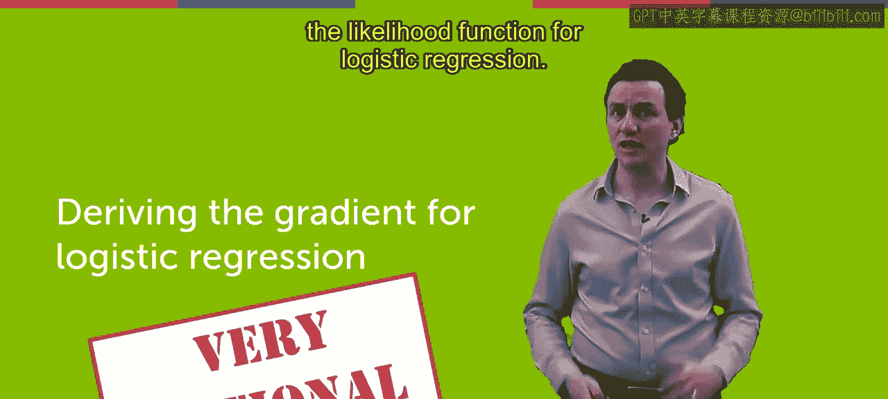
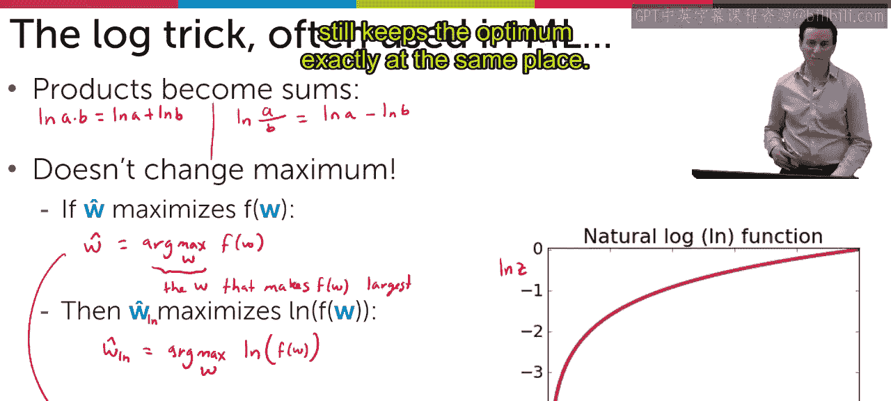

# 机器学习（分类，聚类和检索）：第3-4课：非常可选：推导Logistic回归梯度的对数技巧 📝


在本节课中，我们将学习如何推导逻辑回归似然函数的梯度。这是一个数学性较强的主题，但理解其推导过程能帮助我们更深入地掌握逻辑回归的工作原理。我们将从回顾对数似然函数开始，逐步推导出梯度公式。

---

上一节我们介绍了逻辑回归的梯度上升算法及其实现。本节中，我们将深入探讨如何计算似然函数的梯度，即其导数。

## 对数似然函数 📈



我们的目标是找到系数 **W**，以最大化似然函数。该函数是数据点概率的乘积：`P(y_i | x_i, W)`。然而，对似然函数取自然对数（记作 `LL(W)`）可以大大简化后续的数学运算。

对数函数 `ln(z)` 具有以下重要性质：
*   它是一个单调递增函数。
*   它将乘法转换为加法：`ln(a * b) = ln(a) + ln(b)`。
*   它将除法转换为减法：`ln(a / b) = ln(a) - ln(b)`。

由于对数函数是单调的，最大化原始似然函数 `L(W)` 与最大化其对数值 `LL(W)` 会得到完全相同的解 **W**。因此，使用对数似然函数不会改变最优结果，但能使计算过程更简单。

以下是使用对数简化计算的关键步骤：

1.  **从乘积到求和**：原始似然函数是多个概率的乘积。取对数后，乘积项转换为求和项，这更易于进行微分等操作。
2.  **保持最优解不变**：因为 `ln(x)` 是单调函数，所以 `argmax_w L(W) = argmax_w ln(L(W))`。

## 梯度推导 🧮

现在，我们开始推导对数似然函数 `LL(W)` 关于参数 **W** 的梯度。梯度是一个向量，其每个分量是 `LL(W)` 对 `W` 中每个参数的偏导数。

推导过程涉及链式法则和对数函数的导数性质。核心步骤如下：

1.  将对数似然函数 `LL(W)` 写为所有数据点对数概率之和的形式。
2.  对求和式中的每一项应用链式法则进行求导。
3.  利用逻辑函数（Sigmoid函数） `σ(z) = 1 / (1 + e^{-z})` 的导数性质：`σ'(z) = σ(z) * (1 - σ(z))`。
4.  将对数概率的导数与逻辑函数的导数结合，并进行化简。

经过推导，最终得到的梯度公式简洁而优美。对于单个数据点 `(x_i, y_i)`，其对梯度的贡献为 `(y_i - P(y_i=1 | x_i, W)) * x_i`。将所有数据点的贡献相加，就得到了完整的梯度。

以下是梯度公式的向量化表示，适用于高效计算：

```python
# 假设 X 是特征矩阵，y 是标签向量，W 是参数向量，sigmoid 是逻辑函数
# 计算预测概率
predictions = sigmoid(X.dot(W))
# 计算梯度
gradient = X.T.dot(y - predictions)
```

## 总结 🎯




本节课中，我们一起学习了如何推导逻辑回归的对数似然函数梯度。我们首先看到，通过对似然函数取对数，可以将复杂的乘积运算转化为求和运算，从而简化求导过程。接着，我们逐步推导，并最终得到了一个清晰、易于计算的梯度表达式 `(y_i - P(y_i=1 | x_i, W)) * x_i`。理解这个推导过程，不仅有助于我们实现梯度上升算法，也为我们深入理解逻辑回归模型提供了坚实的数学基础。