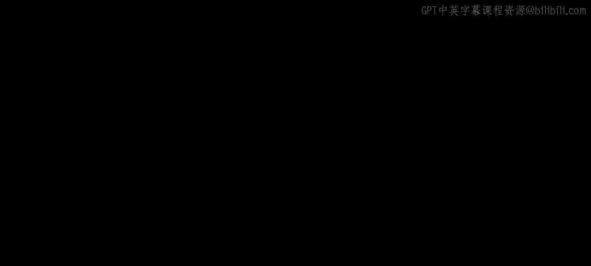
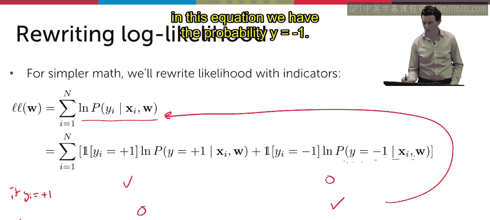

# 华盛顿大学《机器学习（分类，聚类和检索，第3-4课⧸共4课）｜Machine Learning》中英字幕 p40 39_非常可选：表达对数似然.zh_en -BV1Sr421F7N7_p40-

。

How do we see that the log can be an important function。

 We're going apply to the likelihood and show that we're going to have to express in terms of the log likelihood to computer gradient。

 This continues to be part of that very， very optional。😊。

PHD level only derivation that we're doing here。Now let's revisit the likelihood function that we discussed and see how the log plays a role。

 So the key here is that the log of the sum is the sum of the logs that we discussed and in our case。

 if you have the log of the product of I equals1 through n of some function， let's call it F。i。

Then that is equal to the sum over I equals1 through n of the log of Fs。

 So the log of the product is the sum of the logs。 And so in our case。

 what we're going to get is that the log likelihood function is going to be the sum。

Of I equals one through n of the log of the probability of Y， I given X， I and W。

Now if you're thinking about derivatives， youll see exactly why the log was useful。

 the log of the derivative of a product is really a complicated thing。

 but once we take in the log the derivative of the sum is just the sum of the derivatives and so that's going to simplify all the math that we have to do and that's the core reason that we take the log there's there are a few other technical reasons but that's one very important one。

😊，Okay so that was strict number one， take the log trick number two is to introduce indicator functions just like we showed in the derivative that we had before。

 so if we take the log likelihood function so this is the sum of the log the probability of YI given X I and W。

 that can be written as the sum of two terms。The indicator that Y is plus 1 has the probability of Yi equals plus 1。

Plus， indicate y is -1 times the probability y equals -1。 So in other words， if， if it's。If。

Y I is plus  one。 Then the first term comes to play， and the second term becomes 0。 But if。

Y I is equal to -1。 then the first term becomes0。 then the second term becomes active。

 And so we see that because of this， we get exactly the equation above。

 but the indicators are going to make our life a lot simpler throughout the derivatives and all the operations that we need to do。

Here's an interesting thing in our so far we've only talked about the probability y cos plus one。

 but in this equation we have the probability y cos minus1。

Interesting。