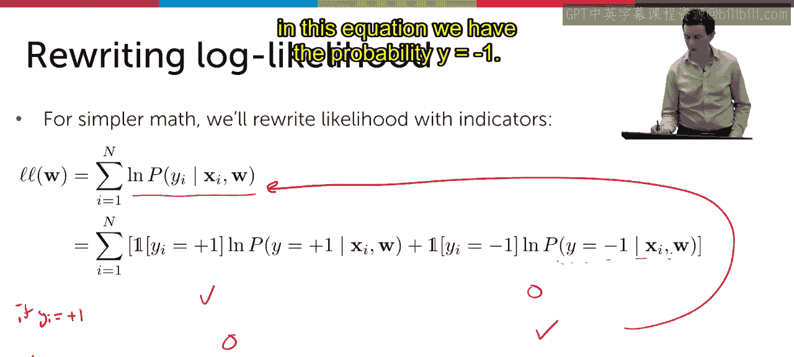

# 机器学习（分类，聚类和检索）：第3-4课：非常可选：表达对数似然

在本节课中，我们将探讨一个对后续数学推导至关重要的概念：对数似然。我们将看到，通过对似然函数取对数，可以极大地简化梯度计算等操作。本节内容属于高级推导部分，但我们会用简单直白的方式解释其核心思想。

## 对数函数的重要性

上一节我们介绍了似然函数的概念。本节中，我们来看看为什么对数函数在处理似然函数时如此重要。

关键在于，我们通常需要计算似然函数的梯度以进行优化。直接对原始的似然函数（一个乘积形式）求导非常复杂。而对数函数可以将**乘积转化为求和**，从而简化求导过程。

具体来说，对于一组函数 `F_i` 的乘积取对数，其结果等于每个函数对数的和。用公式表示如下：

`log(∏_{i=1}^{n} F_i) = ∑_{i=1}^{n} log(F_i)`

在我们的分类问题中，似然函数是每个数据点预测概率的乘积。应用上述对数性质，我们可以得到**对数似然函数**：

`log likelihood = ∑_{i=1}^{n} log( P(y_i | x_i, w) )`

这样，原本复杂的乘积导数就变成了简单的求和导数，因为和的导数等于导数的和。这是我们在机器学习中经常使用对数似然的核心原因之一。

## 引入指示函数

在定义了对数似然之后，为了进一步简化表达式，特别是处理二分类（+1和-1）的情况，我们引入**指示函数**。

指示函数 `I(condition)` 在条件为真时等于1，否则等于0。利用它，我们可以将对数似然函数中的每一项 `log( P(y_i | x_i, w) )` 拆解为两个明确的部分。

以下是具体的拆解方式：

*   当真实标签 `y_i = +1` 时，该项等于 `I(y_i=+1) * log( P(y_i=+1 | x_i, w) )`。
*   当真实标签 `y_i = -1` 时，该项等于 `I(y_i=-1) * log( P(y_i=-1 | x_i, w) )`。

因此，整个对数似然函数可以统一写成：

`log likelihood = ∑_{i=1}^{n} [ I(y_i=+1)*log(P(y_i=+1)) + I(y_i=-1)*log(P(y_i=-1)) ]`

这种表达方式的优势在于，它清晰地分离了两种类别的情况，使得后续求导时，我们可以分别处理 `P(y=+1)` 和 `P(y=-1)` 的概率公式，让数学推导更加条理清晰。

## 总结

本节课中，我们一起学习了两个关键的数学技巧，它们为后续逻辑回归等模型的推导奠定了基础。

首先，我们了解了**取对数**的重要性，它将概率的乘积转换为对数的和，从而让梯度计算从处理复杂的乘积法则简化为处理简单的求和。

其次，我们引入了**指示函数**，它将二分类问题中对数似然项的书写统一化，明确区分了不同类别的情况，为下一步的求导做好了准备。

掌握这些表达形式，是理解许多机器学习模型（尤其是基于概率的模型）训练过程的核心。