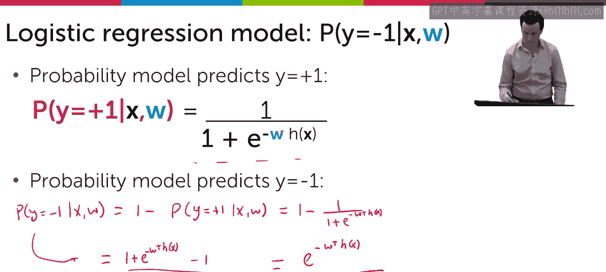

# 华盛顿大学《机器学习（分类，聚类和检索，第3-4课⧸共4课）｜Machine Learning》中英字幕 p41 40_非常可选：推导给定x时y=1的概率.zh_en -BV1Sr421F7N7_p41-

。

We've now seen how to compute the log likelihood， but before continuing。

 we're going to have to express the probability y equals minus-1 because we've only so far expressed probability y equals plus1。

 This is still part of that very， very optional PhD level， only derivation of the gradient。

So this is only for those who are really interested。

That we need to take a moment to derive what is the probability to the y cos -1 If the following up here is the probability of y equals plus 1。

 So let's just derive that。 So the probability that y is equal to -1 given x and W。

It's just1 minus the probability that y is equal to plus 1。Given X and W。

 thats just because probability is add up to one。 So let's plug that in。 That's 1-1 times。1 plus。

E to the minus W transpose h of x。So I just plugged the in with the definition of probabilityative y equals plus1。

Now， if we multiply both elements by one plus e to the minus W transpose x， we get。

The probability that y is equal to -1 is。So I'm multiping both terms by one plus。E to the minus。

W transpose h of x。 So the one is one plus e to the。Minus W transpose。H of x。 And then you get a -1。

So the whole thing here simplifies to e to the minus w transpose h of x divided by1 plus e to the minus W transpose h of x。

Pretty cool， very simple， here we go。