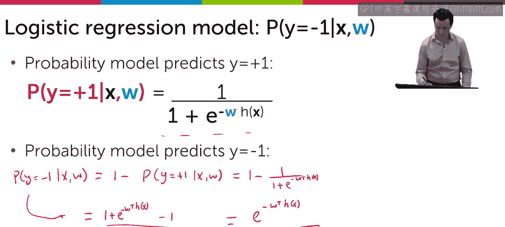

# 机器学习：分类、聚类与检索：3-4：非常可选：推导给定x时y=1的概率

在本节课中，我们将学习如何推导逻辑回归模型中，给定特征x时，目标变量y等于-1的概率。这是计算对数似然函数梯度的一个非常深入的步骤，主要面向对此特别感兴趣的进阶学习者。

上一节我们介绍了如何计算对数似然函数。本节中，我们来看看如何表达y等于-1的概率，因为我们目前只定义了y等于+1的概率。这部分内容属于非常深入的可选推导。

我们需要推导出，在已知x和参数W的情况下，y等于-1的概率。已知y等于+1的概率公式如下：

**P(y=+1 | x, W) = 1 / (1 + e^{-W^T h(x)})**

由于概率之和必须为1，因此y等于-1的概率就是1减去y等于+1的概率。以下是推导步骤：

**P(y=-1 | x, W) = 1 - P(y=+1 | x, W)**

将y=+1的概率公式代入：

**P(y=-1 | x, W) = 1 - 1 / (1 + e^{-W^T h(x)})**

为了简化这个表达式，我们对两项同时乘以分母 **(1 + e^{-W^T h(x)})**：

**P(y=-1 | x, W) = [ (1 + e^{-W^T h(x)}) - 1 ] / (1 + e^{-W^T h(x)})**

分子中的1相互抵消，最终得到简洁的公式：

**P(y=-1 | x, W) = e^{-W^T h(x)} / (1 + e^{-W^T h(x)})**

推导过程清晰明了，结果也非常简洁。

本节课中，我们一起学习了如何从y=+1的概率出发，推导出逻辑回归模型中y=-1的概率。这个结果是后续进行梯度计算的重要基础。