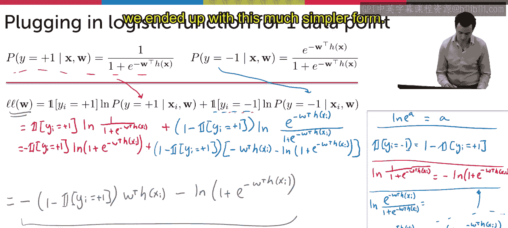

# 华盛顿大学《机器学习（分类，聚类和检索，第3-4课⧸共4课）｜Machine Learning》中英字幕 p42 41_非常可选：将对数似然重写为更简单的形式.zh_en -BV1Sr421F7N7_p42-

。

We've now seen how to express the probabilitybil of y co plus  one and probability y cos minus1 and we're going to plug those into the log likelihood before we take its gradient。

 there is still part of that very， very optional derivation that we're doing of the gradient of logistic regression。

Now we have probability y equals plus1， probability y equals minus-1。

 we can go ahead and plug those in to our log likelihood function and with the indicators and all that good stuff。

 let's see what happens。So I'm going to go ahead and plug in these definitions of the probability of y equals plus1 y is equal to minus1 it's a log likelihood。

 it turns out the log likelihood is going to simplify to a pretty cool term and we're going to take the derivative it and derive the derivative that we're hoping for so here we go。

😊，So I'm just gonna first plug in the probability of y is equal to plus one into the first term。

 So we're gonna have that the log likelihood function is the indicator。

That y is I is equal to plus one。 And so we're only going to deal with one data point for now。

 and then we're going to sum over the data points later。 So of the log of that ratio。

 So1 over1 plus e to the minus w transpose h of X I。

 this is the particular data point we're dealing with。So that was easy。 That was the first one。Now。

 for the second term here。We need to plug in the probability y equals minus-1。

 but it's a little bit annoying for a derivation that we have an indicator the Yi is plus1 and another indicator the Yi is minus-1。

 so we're going to take this indicator that Y equals minus-1 and substitute it with something else so let's do a change of colors transformation here。

And just remind ourselves that the indicator that Y I is equal to minus-1。

This takes value1 when y is cos minus-1。Can be written as1 minus the indicator。That， why。Okay。

ThatYi is equal to plus 1。So if you think about it， when y equals minus-1 if y is minus-1。

 then the left side here is 1 and the right side is also1。 if y equals minus-1。

 the left side is0 and the right side is 0。Let's plug that in what we just learned。

 And so from the first term here， we get one minus。Indicator。That。Y I is equal to -1。

And we're going to plug in the definition of the probability that y equals minus-1。

 So that's log of e to the minus w transpose h of X I divided by1 plus e to the1 plus e to the minus w transpose h of X I。

有。Great， so now we have our two terms and now we're going to move a couple things around and simplify the equations pretty significantly。

 so let's go ahead and do that。😊，Okay， let's go back to our change your colors transformation。

 We're dealing with the first term。 The first term is the red term。

 So let's go back to the red term and。Let's see what the log。

Of one over one plus e to the minus w transpose h of X i looks like。

And the log of one over something turns out to be minus。The log of something。

And the something here is1 plus e to the minus w transpose h of X。So plugging that in。

 we get the indicator。That Yi equals plus1。The multiplies。

Minus the log of one plus e to the minus w transpose H。 So we're gonna write here。

 log of1 plus E to the minus W transpose H of X I。And put the money sign out here。

I was for the first term。So now let's look at that famous second term。And expand it out。

So let's go back to our blue。 And so the， the coefficient here stayed the same1 minus the indicator that Y I is。

That should say positive， so Y I is positive。Sorry about that。Of the log of that ratio。

 So let's explore what that log of the ratio looks like。

So the log of e to the minus w transpose h ofxi。Divided by1 plus e to the minus w transpose h ofxi。

And so what does that look like？That looks like it's the log of the ratio。

 So it's the difference of the log。 So it's the log。Of E to the power of minus W transpose h of X I。

Minus the log of one plus。Es a power of minus W transpose。Hge of X， I。That's no two things。 First。

 the second term is exactly what we had up here。So things are starting to look very similar and what is the log of the first term and here's another log trick log of e to the something。

 say E to the a is exactly equal to a。 so in this case the log of e to the minus w transpose H is just minus w transpose H of Xi。

So plugging that in。We get our coefficient that multiplies minus w transpose h of X。Minus。

The same term as the other side log of。1 plus e to the minus W transpose age of X。Okay。

 going little slowly。 And now you can shake things around， move things。 lots of stuff cancels out。

 I'm not going go through that in in detail， but you're welcome to do it。

 I'm just gonna do a change of color transformation。 go to purple。

 which is the color I love and just write out what the answer is。😊，And the answer here becomes。

Lg likelihood to be written as， for particularly the point as minus。

One minus the indicator that it is a positive example。So y I equals plus 1。

That multiplies W transpose h ofxii。Minus。The log of that crazy term 1 plus e to the minus W transpose h of X I。

有。So we started from the log likelihood function， we went through a bunch of derivations and maths。

 which you can explore if you want， and we ended up with this much simpler form。😊。

And now we're going to take a simple form and take its derivative。

