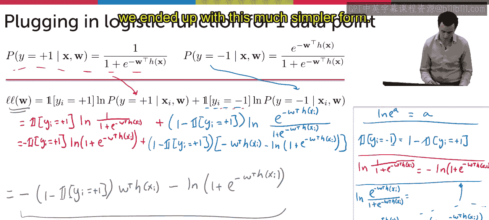

# 机器学习：3-4：将对数似然重写为更简单的形式

在本节中，我们将学习如何将逻辑回归的对数似然函数进行重写和简化。我们将从之前推导出的正负类概率公式出发，通过一系列代数变换，得到一个更简洁、更易于后续求导的形式。

---

上一节我们介绍了正类（y=+1）和负类（y=-1）的概率公式。本节中，我们将把这些公式代入对数似然函数，并进行化简。

首先，我们回顾一下概率公式：
*   **正类概率**：`P(y=+1) = 1 / (1 + e^{-w^T h(x)})`
*   **负类概率**：`P(y=-1) = e^{-w^T h(x)} / (1 + e^{-w^T h(x)})`

现在，我们将这些公式代入针对单个数据点 `(x_i, y_i)` 的对数似然函数中。

以下是代入和化简的步骤：

**步骤一：代入正类概率项**
第一项是当 `y_i = +1` 时的贡献。我们直接代入正类概率公式：
`LL_i = 1[y_i=+1] * log( 1 / (1 + e^{-w^T h(x_i)}) )`

**步骤二：处理负类概率项**
第二项是当 `y_i = -1` 时的贡献。我们首先用 `1[y_i=+1]` 来表示指示函数 `1[y_i=-1]`，因为两者是互补的：
`1[y_i=-1] = 1 - 1[y_i=+1]`
然后代入负类概率公式：
`LL_i += (1 - 1[y_i=+1]) * log( e^{-w^T h(x_i)} / (1 + e^{-w^T h(x_i)}) )`

**步骤三：展开并化简对数项**
接下来，我们分别展开两个对数项。
1.  对于第一项，利用对数性质 `log(1/a) = -log(a)`：
    `log( 1 / (1 + e^{-w^T h(x_i)}) ) = -log(1 + e^{-w^T h(x_i)})`
    因此第一项变为：`-1[y_i=+1] * log(1 + e^{-w^T h(x_i)})`

2.  对于第二项中的分式，利用对数性质 `log(a/b) = log(a) - log(b)`：
    `log( e^{-w^T h(x_i)} / (1 + e^{-w^T h(x_i)}) ) = log(e^{-w^T h(x_i)}) - log(1 + e^{-w^T h(x_i)})`
    进一步化简，因为 `log(e^a) = a`：
    `= -w^T h(x_i) - log(1 + e^{-w^T h(x_i)})`
    因此第二项整体变为：`(1 - 1[y_i=+1]) * ( -w^T h(x_i) - log(1 + e^{-w^T h(x_i)}) )`

**步骤四：合并同类项**
现在我们将两项相加并合并含有 `log(1 + e^{-w^T h(x_i)})` 的项。
*   来自第一项：`-1[y_i=+1] * log(1 + e^{-w^T h(x_i)})`
*   来自第二项：`-(1 - 1[y_i=+1]) * log(1 + e^{-w^T h(x_i)})`

将这两部分相加：
`[-1[y_i=+1] - (1 - 1[y_i=+1])] * log(1 + e^{-w^T h(x_i)}) = -1 * log(1 + e^{-w^T h(x_i)})`

**步骤五：得到最终简化形式**
合并所有项后，针对单个数据点 `i` 的对数似然简化形式为：
`LL_i = - (1 - 1[y_i=+1]) * w^T h(x_i) - log(1 + e^{-w^T h(x_i)})`

我们可以进一步观察这个形式。`(1 - 1[y_i=+1])` 在 `y_i = +1` 时为0，在 `y_i = -1` 时为1。因此，这个简化形式清晰地表明：
*   当样本为负类（`y_i = -1`）时，对数似然包含 `-w^T h(x_i)` 项。
*   无论样本类别如何，都包含 `-log(1 + e^{-w^T h(x_i)})` 项。

---

本节课中我们一起学习了如何将逻辑回归的对数似然函数从包含两个指示函数的复杂形式，重写为一个更紧凑、更优雅的简化形式。这个形式为 `LL_i = - (1 - 1[y_i=+1]) * w^T h(x_i) - log(1 + e^{-w^T h(x_i)})`。这个简化后的表达式将大大方便我们在下一节中进行梯度计算。