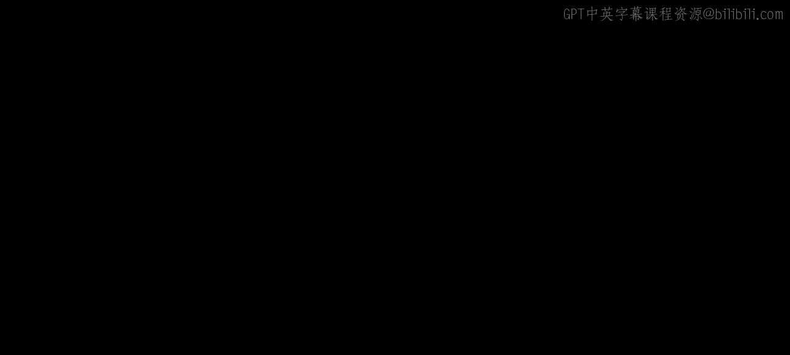
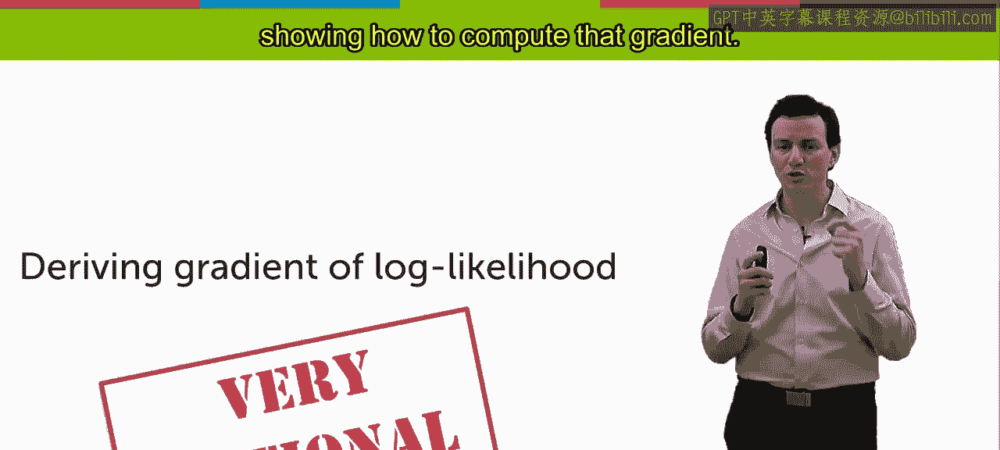
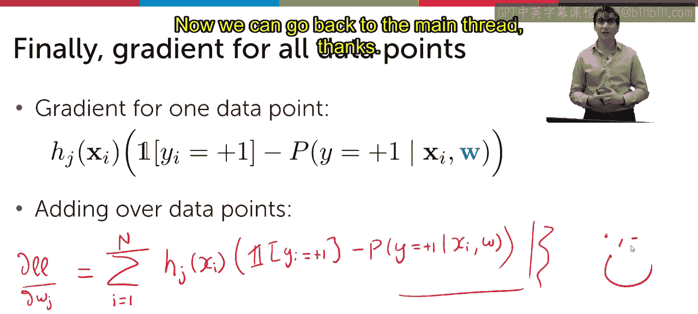

# 华盛顿大学《机器学习（分类，聚类和检索，第3-4课⧸共4课）｜Machine Learning》中英字幕 p43 42_非常可选：推导对数似然的梯度.zh_en -BV1Sr421F7N7_p43-

。

This is taking a little while， but we're ready ready for that final step in this very optional， very。

 very optional derivation， you don't have to watch it it for those who are super interested finishing it off and showing how to compute that gradient and so this is just the endga here。

😊。

Very good， we took the log likelihood function for a single data point and showed that it can be written in this particular form。

 and now we're going to take the derivative of that with respect to parameter WJ。😊。

That's the last thing that we'll do here。 So what's the partial derivative of the log likelihood function with respect to a parameter W J。

So this is the sum of two terms。 So it just becomes the derivative of the sum。

 So let's look at the first term。 So-1 minus the indicator function。 that is independent on W J。

 So that can be pulled out。 And so you just get minus。1 minus the indicator。呃。Y I is equal to plus 1。

And whatever the partial derivative is with respect to WJ。Of W transpose H of X I。And that's okay。

 And now we have the second term。 So in the second term， we're gonna use。Blue。

 so it's change of colors transformation。 So it's going to be minus。

The partial derivative with respect to the parameter of WJ of log of1 plus e and minus W transpose。

Age of X， I。Now this is a little scary。Lots of partial derivatives， lots of logs。

 But it turns out that the answer will be really simple。 So I'm gonna。

 I'm gonna walk you through this。And then we'll get to that beautiful solution at the end。

 So let's take that first term。 what is the partial derivative with WJ of W transpose H of Xi。

What is that equal to？Well， the w transpo age is really the sum of every possible term。

 every possible feature of the coefficient times the feature。😊，Most of the terms don't depend on WJ。

 there's only one term in the terms of WJ， and that's exactly Hj。

 so that derivative is just going to be Hj of X， so I'm not doing that very explicitly。

 but you can convince yourselves at home。Now， let's look at the second term。

 So the second term is where the beauty of the universe comes to play。

 You're going end up with a extremely simple， extremely beautiful。😊，So。😊，The question here is。

 what is the partial derivative with respect to WJ of this crazy function log of one plus。

E to the minus W transpose h of X。No。Let me warn you that deriving this takes many steps and I'm not going to go through all of them。

 you have to use the fact that the derivative of the log of some function is derivative that function by that function it's like a bunch of different math steps that you may not remember and'm just to push out what the result is。

😊，And the result is minus Hj of Xi note that is just like up here， there's an Hj of Xi。

That multiplies a really exciting， beautiful term。E to the power of minus W transpose h of X I。

Divided by one plus。E to the minus W transpose H of X。Please take a moment to enjoy。

The beauty of the logistic Russian model。I going to change colors here because it's just too much fun。

Now， what is this term here？이 고추。The probability。That y is equal to minus1 when the input is X and you're using parameter w。

That's how that probability showed up in the derivative in the first place。

You went through a lot of math and then you got that probability back。So the result。

 if you plug these two terms in are for the first term， the red term here， you get。Minine this。

1 plus， oops。1 minus。The indicator。That y I is plus  one。Times H J。Of X， I。And from the second term。

 the blue term here。You get minus， and then。There is another minus。

And so you end up with a minus minus a plus。H J of X I that multiplies the probability that y is equal to minus-1。

 given X， I and W。Now I'm to skip a few steps that you're going to do at home。

 one of the core things that is plugging in the probability that y cos plus 1 is1 minus the probability y equals minus1 and just moving a bunch of stuff around。

 but you'll end up with exactly what we're hoping for。

 which is the derivative of the log likelihood with respect to parameter J is simply Hj of X I。

That multiplies。The difference between the indicator。That。Yi is equal to 1。

 so it's a positive example minus the probability that y is equal to plus 1 given the input X and the parameters w。

And this is exactly what I showed you earlier as what the answer was。So that is really， really cool。

Now we're almost done， so for one data point we have that the derivative of the contribution to the derivative is Hj。

Of time is the difference between the indicator and the actual value。 Now。

 if you want to compute the derivative of the likelihood function for all。

Of the data points respect to WA， all you have to do is sum。So you just sum over the data point。

 So sum over I equals one of the n of the term above。 So H J of X I。

That multiplies the difference between。The indicator of Y I equals plus  one。Mine is the probability。

Y I equals plus1， given X， I and W。Very cool。 for those brave enough to have gone through this advanced material。

 I really comm you。 this is exciting things。 It is how that derivative gets computed。

 and it's also how many other derivatives in machine learning are computed。

 So this is just one example of that。 And so I hope you enjoyed it。

 now we can go back to the main thread。😊。

Thanks。🎼。