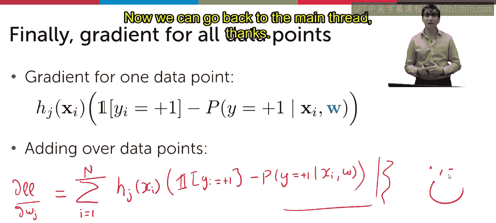

# 机器学习（分类，聚类和检索）：第3-4课：非常可选：推导对数似然的梯度


在本节中，我们将深入探讨逻辑回归模型对数似然函数梯度的推导过程。这是一个进阶主题，旨在展示如何通过数学计算得到梯度公式。我们将从单个数据点的对数似然函数出发，逐步推导其关于参数 **w_j** 的偏导数。

---


## 概述

我们将要学习如何计算逻辑回归模型的对数似然函数关于模型参数 **w_j** 的梯度。推导过程涉及对复合函数求导，最终会得到一个简洁而优美的结果。理解这个推导有助于深入掌握逻辑回归的训练原理。

---

## 对数似然函数的表达形式

上一节我们介绍了单个数据点的对数似然函数。本节中我们来看看它的具体形式。

对于单个数据点 **(x_i, y_i)**，其对数似然函数可以写成以下形式：

```
L_i(w) = [1 - I(y_i = +1)] * (w^T h(x_i)) - log(1 + exp(-w^T h(x_i)))
```

其中 **I(y_i = +1)** 是指示函数，当 **y_i = +1** 时为1，否则为0。**h(x_i)** 是特征函数。

---

## 对参数 w_j 求偏导

现在，我们将对这个对数似然函数 **L_i(w)** 关于特定参数 **w_j** 求偏导数。由于函数是两项之和，其导数也是两项导数之和。

以下是计算步骤：

首先，处理第一项。第一项是 `[1 - I(y_i = +1)] * (w^T h(x_i))`。指示函数部分与 **w_j** 无关，可以视为常数因子提出。因此，第一项关于 **w_j** 的偏导数为：

```
∂/∂w_j { [1 - I(y_i=+1)] * (w^T h(x_i)) } = [1 - I(y_i=+1)] * ∂/∂w_j (w^T h(x_i))
```

而 **w^T h(x_i)** 关于 **w_j** 的偏导数就是特征 **h_j(x_i)**，因为 **w^T h(x_i) = Σ_k w_k * h_k(x_i)**，只有 **w_j * h_j(x_i)** 这一项依赖于 **w_j**。

所以第一项的导数为：
```
[1 - I(y_i=+1)] * h_j(x_i)
```

---

接下来，处理第二项。第二项是 `- log(1 + exp(-w^T h(x_i)))`。我们需要计算其关于 **w_j** 的偏导数。

这是一个复合函数的求导过程。经过一系列链式法则计算（具体步骤在此省略），我们可以得到结果：

```
∂/∂w_j { - log(1 + exp(-w^T h(x_i))) } = h_j(x_i) * [ exp(-w^T h(x_i)) / (1 + exp(-w^T h(x_i))) ]
```

请注意，表达式 `exp(-w^T h(x_i)) / (1 + exp(-w^T h(x_i)))` 恰好等于模型预测 **y = -1** 的概率，即 **P(y_i = -1 | x_i, w)**。

---

## 合并两项结果

现在，我们将第一项和第二项的导数结果合并。

第一项（红色部分）贡献了：
```
- [1 - I(y_i=+1)] * h_j(x_i)
```

第二项（蓝色部分）贡献了：
```
+ h_j(x_i) * P(y_i = -1 | x_i, w)
```

通过代入关系 **P(y_i = +1 | x_i, w) = 1 - P(y_i = -1 | x_i, w)** 并进行代数整理，最终可以简化为：

```
∂L_i(w) / ∂w_j = h_j(x_i) * [ I(y_i = +1) - P(y_i = +1 | x_i, w) ]
```

这个结果非常直观：梯度等于特征值 **h_j(x_i)** 乘以真实标签（指示函数）与模型预测概率之间的差值。

---

## 扩展到整个数据集

以上是针对单个数据点的梯度。对于包含 **n** 个数据点的整个数据集，总的对数似然函数关于 **w_j** 的梯度就是所有数据点贡献的梯度之和。

因此，完整的梯度公式为：

```
∂L(w) / ∂w_j = Σ_{i=1}^{n} h_j(x_i) * [ I(y_i = +1) - P(y_i = +1 | x_i, w) ]
```

---

## 总结



本节课中我们一起学习了逻辑回归模型对数似然函数梯度的完整推导过程。我们从单个数据点的函数形式出发，分别对两项求导，最终得到了简洁的梯度表达式：**特征值乘以（真实标签与预测概率之差）**。这个结果不仅优美，而且是逻辑回归使用梯度下降法进行训练的核心。对于勇于探索这一进阶内容的学者，我们表示赞赏，因为此类推导在机器学习中非常常见，是理解模型底层机制的关键。