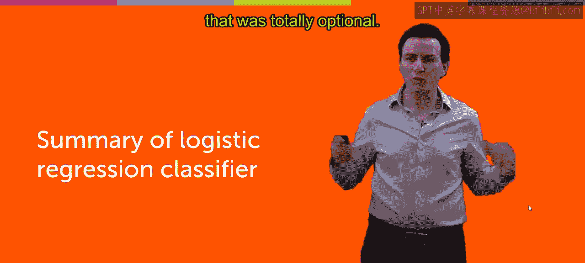
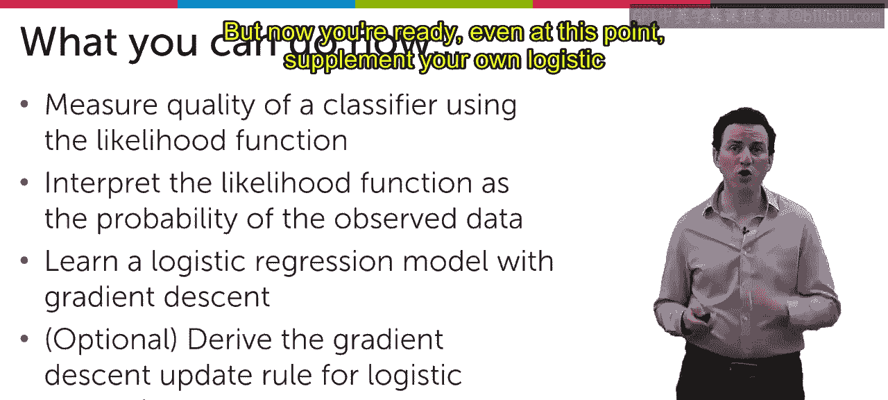

# 华盛顿大学《机器学习（分类，聚类和检索，第3-4课⧸共4课）｜Machine Learning》中英字幕 p44 43_学习Logistic回归分类器的回顾.zh_en -BV1Sr421F7N7_p44-

。

And now we're back so we computed the we defined the likelihood function for logistic regression。

 we computed its derivative， we talked about a simple gradient ascent algorithm for finding the best parameters and for those who went through that full kind of slow mathematical devation is over where that gradient come from but that was totally optional we can go back and summarize where we are。

😊。

So now learning problem， we have some training data。

 we through this some feature extract that gets us h of x and with thelog correctional model。

 this is the probability that is a positive review is 1 over 1 plus e to the minus w transpose h。😊。

AndThen we define a quality metric， which is the likelihood function。

 and we use gradient ascent to optimize it to get WH。

 and the gradient ascent algorithm is pretty simple and pretty intuitive。😊。

Now you're able to define what the quality metric is for logistic regression。

 you can interpret that likelihood function as being kind of the probability that you get the training data right and you want to maximize that we talked about the gradient ascent algorithm that does it with really simple updates and we had this optional section where we derived the gradient ascent algorithm from scratch。

Next we're next module， we're going to take this one step further and explore the idea of regularization and overfitting logistic regression which is a really important thing in practice so that's where we're going to go in the next module but now you're ready even at this point to implement your own logistic regression algorithm from scratch which is super exciting。

😊。

