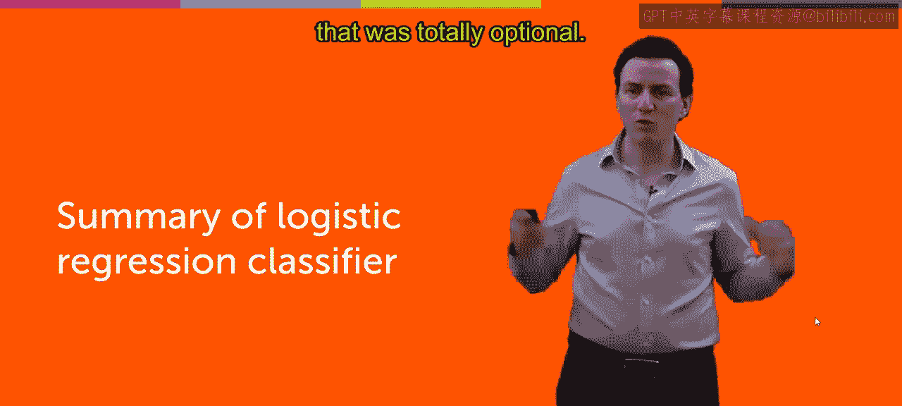
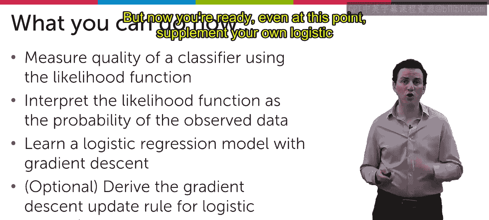

# 机器学习（分类，聚类和检索）：第3-4课：学习Logistic回归分类器的回顾


在本节课中，我们将回顾Logistic回归分类器的核心学习过程。我们将总结如何定义模型、构建质量度量指标（似然函数），以及如何使用梯度上升算法来找到最佳参数。最后，我们会简要展望下一模块将讨论的正则化与过拟合问题。

---

## 模型定义与学习问题

上一节我们介绍了Logistic回归模型的基本形式。本节中，我们来看看如何从训练数据中学习这个模型的参数。

我们拥有一些训练数据。通过一个特征提取函数，我们可以得到特征向量 **h(x)**。在Logistic回归模型中，一个评论是正面（标记为1）的概率由以下公式给出：

**P(y=1 | x) = 1 / (1 + e^{-w^T h(x)})**

其中，**w** 是我们需要学习的权重参数向量。



---

## 质量度量：似然函数

为了评估参数 **w** 的好坏，我们需要定义一个质量度量指标。对于Logistic回归，我们使用**似然函数**。

这个似然函数可以被解释为：在给定当前参数 **w** 的情况下，模型预测结果与训练数据中真实标签一致的概率。我们的学习目标就是**最大化**这个似然函数。

---

## 优化算法：梯度上升

我们使用**梯度上升**算法来优化似然函数，从而找到最佳的参数 **w** 和 **h**。

梯度上升算法的思想非常直观且实现简单：它沿着函数增长最快的方向（即梯度方向）反复更新参数，以逐步逼近最大值点。

以下是梯度上升算法的核心更新步骤：

```python
# 伪代码示例
while not converged:
    w = w + learning_rate * gradient_of_likelihood(w, data)
```

我们有一个可选的深入章节，详细推导了这个梯度公式的来源。理解这个推导有助于深入掌握算法原理，但对于应用而言，直接使用梯度上升更新规则即可。

---

## 当前进展总结

至此，你已经能够：
1.  定义Logistic回归模型。
2.  理解并定义用于评估模型的质量度量指标——似然函数。
3.  应用直观的梯度上升算法来优化这个指标并学习模型参数。

即使在这个阶段，你已经具备了从头开始实现自己的Logistic回归算法所需的所有知识，这非常令人兴奋。

---

## 下一模块展望

在接下来的模块中，我们将在此基础上更进一步，探索**正则化**与**过拟合**的概念。

这在机器学习实践中至关重要，能帮助我们的模型在未知数据上表现得更好。这将是我们下一阶段的学习方向。



---


本节课中，我们一起回顾了Logistic回归分类器的完整学习流程：从模型定义、似然函数构建到梯度上升优化。你已经掌握了实现该算法的核心要素，并为学习更高级的模型改进技术（如正则化）打下了坚实的基础。