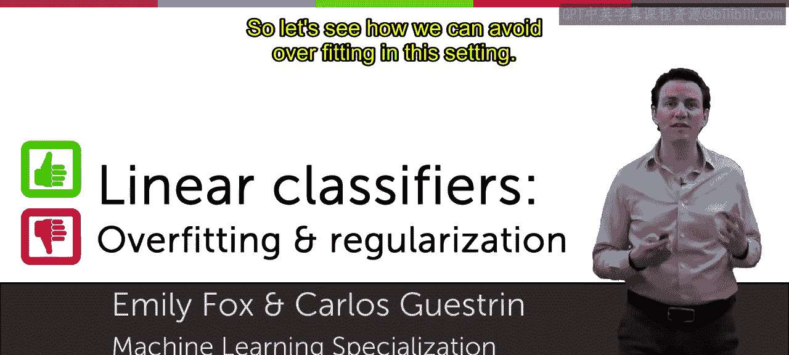
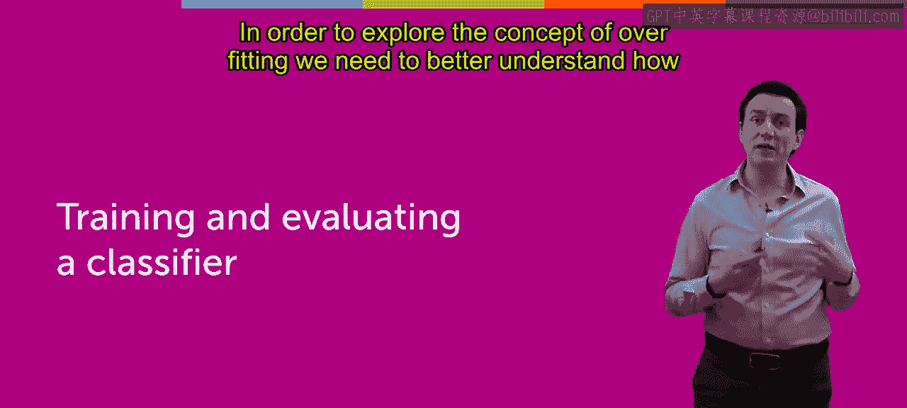
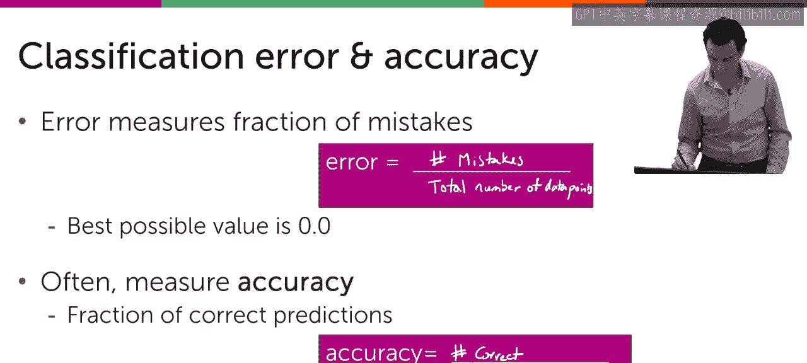

# 华盛顿大学《机器学习（分类，聚类和检索，第3-4课⧸共4课）｜Machine Learning》中英字幕 p45 44_评估分类器.zh_en -BV1Sr421F7N7_p45-

。

We have now seen linear classifiers in particular logistic regression as a really core example of those and how to learn them from data using gradient descent algorithms。

 so we're now ready to build those classifiers， however when we're go to practical settings we have to think about overfitting which is a really significant problem in machine learning and in particular for logistic regression can be really troublesome。

😊，So let's see how we can help avoid overfitting in the setting。

In order to explore the concept of overfitting， we need to better understand how we measure error in classification in general。

So for a classifier we typically start with some data which has been labeled。

 let's say as positive or negative reviews， then we split that data into a training set which we use to train our model and a validation set which we then take the results of that learn model and use it to evaluate our classifier so let's talk a little bit about the evaluation of a classifier in general。

😊，As we discussed in the first course， we measure a classifier's performance using what's called classification error。

 so for example if I give a sentence， the sushi was great and it's labeled positive and I want to measure my error in that sentence where I do is I feed the sentence into my classifier so the sushi was great。

 but I hide that label so that the classifier doesn't get to know whether the sentence was labeled as positive or negative in the training data。

😊，And then I compare the output y hat of my classifier with the true label， in this case。

 they both agree， so the classifier is correct， so I add one to the correct column。😊，However。

 if I take another sentence， so for example， I take the sentence， the food was okay。

 which in the training set was labeled as a negative example。

 but you know this is a little bit of an euphemism from America， is it positive。

 is negative people say okay when they mean。Pad stuff。 And so if you feed to the classifier。

 classifier might not be familiar with that kind of cultural jargon。 And so when you hide the label。

 the classifier might say， oh， why hat is positive。

 but truly was a negative label and the classifiers then made a mistake。

 So now we put plus one in the mistake column。 So in general。

 we're gonna go example by example in our validation set and measure which ones we got right and which ones we made the mistake。

😊，And now we can measure what's called the error or classification error in our data。

 So let me turn my pen on here。 and I'm going to use white here。 So it's pretty simple。

 The error measures the fraction of data points where we made mistakes。

 So it's the ratio between the number of mistakes。That I made。And。The total。Number。off。Data points。

Sometimes we'll also talk about accuracy as well， which is1 minus the number of the error。

 so here we talk about stuff the number of mistakes。

 it's the number of data points where we got them correct。Divided by the total。Number of data points。

Very good。