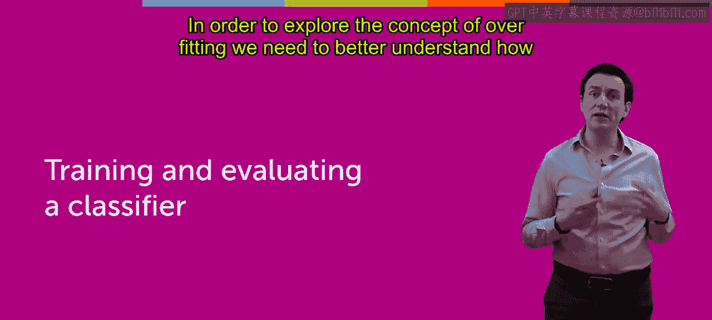
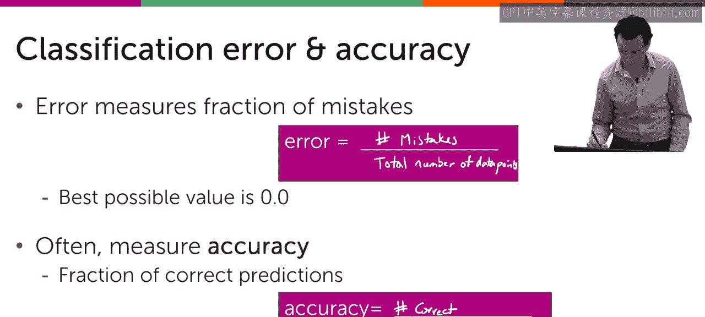

# 机器学习（分类，聚类和检索）：第3-4课：评估分类器与过拟合

在本节课中，我们将学习如何评估分类器的性能，并探讨机器学习中一个核心问题——过拟合。我们将从分类误差的计算开始，理解为何需要区分训练集和验证集，并初步了解如何帮助逻辑回归等模型避免过拟合。

## 评估分类器性能

上一节我们介绍了逻辑回归作为线性分类器的核心示例及其梯度下降学习过程。本节中，我们来看看如何衡量一个分类器的好坏。

为了探索过拟合的概念，我们首先需要更好地理解在分类任务中如何测量误差。

对于一个分类器，我们通常从一些已标记的数据开始，例如标记为正面或负面的评论。然后，我们将这些数据分为两部分：**训练集**用于训练模型，**验证集**用于评估训练好的模型。接下来，我们详细讨论分类器的通用评估方法。

正如在第一门课程中讨论的，我们使用**分类错误率**来衡量分类器的性能。以下是评估过程：

1.  对于一个给定的句子（例如“寿司很棒”），其真实标签为正面。
2.  我们将这个句子输入分类器，但隐藏其真实标签，因此分类器不知道它在训练数据中的标记。
3.  然后，我们比较分类器的预测输出 $\hat{y}$ 与真实标签。如果两者一致，则分类正确；否则，分类错误。

我们将在验证集上逐个示例进行此操作，统计正确和错误的数量。

现在，我们可以计算数据上的**错误率**或**分类错误率**。其公式很简单：

**错误率** = （错误分类的数据点数量） / （数据点总数）

有时我们也会讨论**准确率**，它是1减去错误率：

**准确率** = （正确分类的数据点数量） / （数据点总数）

## 过拟合问题与应对思路

了解如何评估性能后，我们现在可以转向一个实际构建分类器时必须考虑的重要问题：过拟合。过拟合是机器学习中一个非常显著的问题，对于逻辑回归来说尤其麻烦。

那么，让我们看看在这个背景下如何帮助避免过拟合。在后续课程中，我们将深入探讨具体的正则化技术。本节课的重点是建立评估框架并理解过拟合的基本概念。

---

**本节课总结**

本节课中，我们一起学习了分类器性能评估的基础。我们介绍了将数据分为训练集和验证集的重要性，并定义了分类错误率和准确率的计算公式。此外，我们初步探讨了过拟合问题，认识到它是模型在实际应用中需要解决的关键挑战，为后续学习正则化等解决方案奠定了基础。