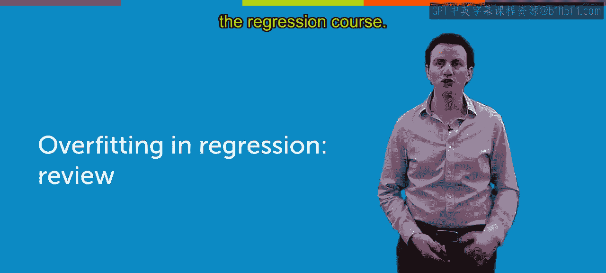
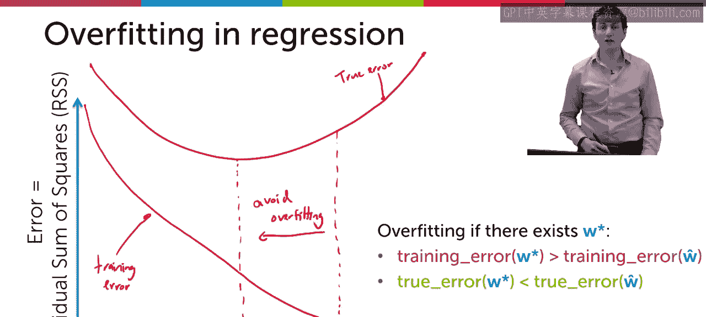
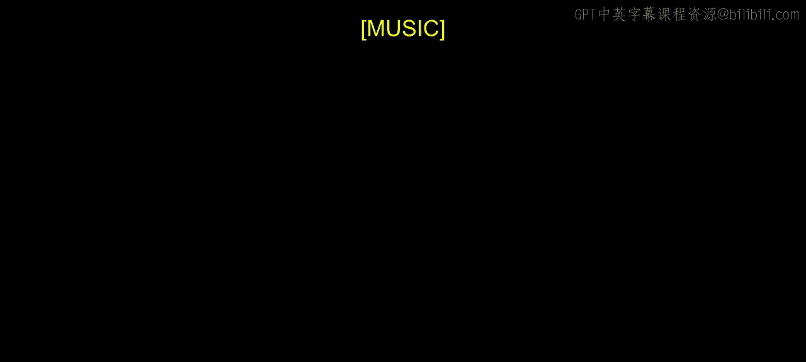

# 华盛顿大学《机器学习（分类，聚类和检索，第3-4课⧸共4课）｜Machine Learning》中英字幕 p46 45_回归中过拟合的回顾.zh_en -BV1Sr421F7N7_p46-

。

Now that we talked about classification error， we can explore the notion of overfitting in classification。

 but before we start， let's review what we talked about when we discuss overfitting in the regression course。

Going back to the regression course， we had this running example where we're trying to predict the price of the house in the y axis。

 given some features to the house in this case in the x axis is the square feet or size of the house and we see on the left here a really nice smooth curve that helps us predict what's the price for a house given its square feet。

😊，However， if instead of using a second degree polynomial like we did on the left。

 we use a higher order polynomial， we might get a really crazy wiggggly line that fits the training data extremely well。

But doesn't generalize beyond the training data to data in the test set or in the truth in the real world。

 and so in this case， we say that the model F here has overfits the training data。

Now in classification we're going to have the same kinds of problems and we're going to have to try to address it what happens when you learn a model which is too good on the training data has this training error that' is too low。

 but doesn't do well on the true error。Now let's pre some of these over 15 plots which we discussed quite a lot in the regression course。

 so here in the X axis I'm showing the model complexity。

 the model on the left is a very simple constant model while the model on the right is a craz polynomial。

 very high degree。So if you look at the training error， when you use a concept model。

 it doesn't do really well on the training data， but if you use this crazy he polynomial。

 it might get zero training error and somewhere in between you get training error that is decreasing like this。

And eventually goes to 0。 So this is my。Trainer。And the problem with training error goes to zero is if you look at the underlying model。

 it doesn't do well on other houses， so the true error。

Is very high when you don't have a lot of data。 So when when your model is very simple。

 but it's also very high when your have model very complex。 and the true error function。

Has this kind of characteristic process goes down and it goes up。So， this is the。Throughrue error。

So overfitting is going to happen when we pick something that's too good in the training data。

 so it's somewhere over here， but it doesn't do well with respect to true error。😊，So in other words。

 you get some W hat over here that has very low training error but high true error while there exist some other。

Severalero parameters， we can call them W star， which might not have done as well in the training data。

 but man they did much better as a performance in the true error。

And so we want to try to avoid picking these highly perform models in the training data。

 that don't do well in the real world。So we want to shift from the right here to the left to avoid overfitting。

Now this was for the regressionional setting， next we're going to talk about it in the classificational setting。

😊。

