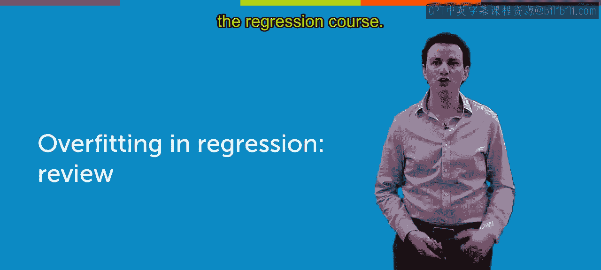
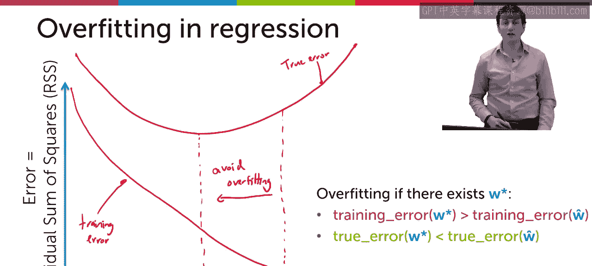
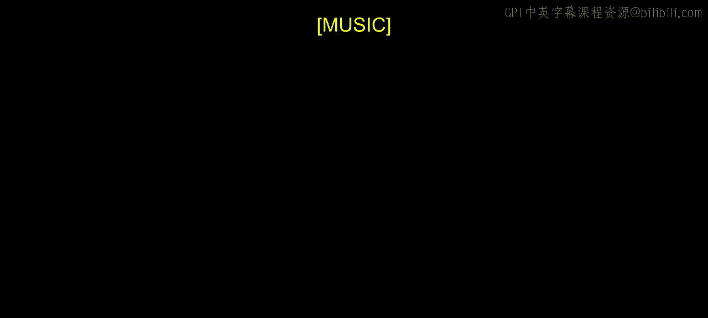

# 机器学习（分类，聚类和检索）：第3-4课：分类中的过拟合回顾 🧠

在本节课中，我们将要学习机器学习中的一个核心概念——过拟合。我们将首先回顾在回归问题中过拟合的表现和影响，然后探讨这一概念如何迁移到分类问题中。理解过拟合对于构建泛化能力强的模型至关重要。

## 回归中的过拟合回顾 📈

上一节我们介绍了分类误差，现在可以探讨分类中的过拟合概念。但在开始之前，让我们先回顾一下在回归课程中讨论过的过拟合问题。

在回归课程中，我们有一个运行示例：尝试预测Y轴上的房屋价格，给定房屋的某些特征。在这个例子中，X轴是房屋的平方英尺数或面积。我们在左侧看到一个非常平滑的曲线，它帮助我们根据房屋面积预测其价格。

然而，如果我们不使用左侧那样的二阶多项式，而是使用更高阶的多项式，我们可能会得到一条非常疯狂、曲折的线。这条线对训练数据的拟合极好，但无法泛化到测试集中的数据或真实世界的数据。

在这种情况下，我们说这里的模型 **F** 对训练数据**过拟合**了。

在分类中，我们将遇到同样类型的问题，并且必须尝试解决它：当你学习一个在训练数据上表现“太好”（训练误差过低）但在真实误差上表现不佳的模型时，会发生什么。

现在，让我们呈现一些在回归课程中讨论过的图表。在X轴上，我展示了模型复杂度。左侧的模型是一个非常简单的常数模型，而右侧的模型是一个疯狂的、非常高阶的多项式。

以下是训练误差和真实误差随模型复杂度变化的趋势：

*   **训练误差**：当你使用一个简单模型时，它在训练数据上表现并不好。但如果你使用这个疯狂的高阶多项式，它可能会得到零训练误差。在两者之间，训练误差像这样递减，并最终趋于0。因此，训练误差曲线是递减的。
*   **真实误差**：训练误差趋于零的问题是，如果你观察底层模型，它在其他房屋数据上表现不佳。因此，当你没有大量数据时，真实误差在模型非常简单时很高，在模型非常复杂时也很高。真实误差函数具有先下降后上升的特征。因此，真实误差曲线呈U形。

所以，过拟合发生在我们选择了在训练数据上表现“太好”（即位于此处右侧）但在真实误差方面表现不佳的模型时。

换句话说，你得到了一些参数 **Ŵ**，它们具有很低的训练误差但很高的真实误差；而存在另一些我们可以称之为 **W*** 的参数，它们可能在训练数据上表现不那么好，但在真实误差方面的性能却好得多。

因此，我们希望尽量避免选择这些在训练数据上表现极佳但在现实世界中表现不佳的模型。我们希望从右侧向左移动，以避免过拟合。

以上是针对回归场景的讨论。接下来，我们将在分类场景中探讨它。