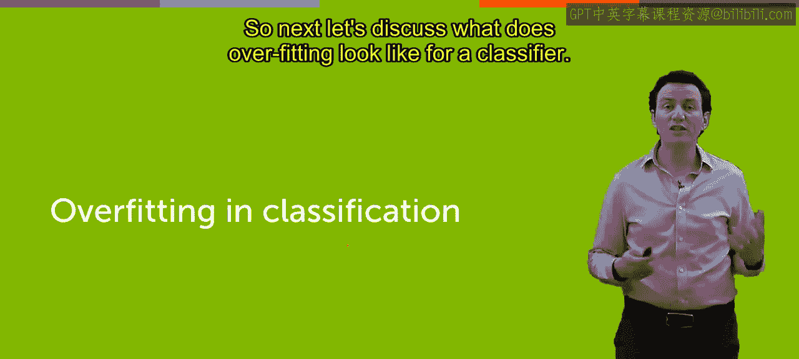
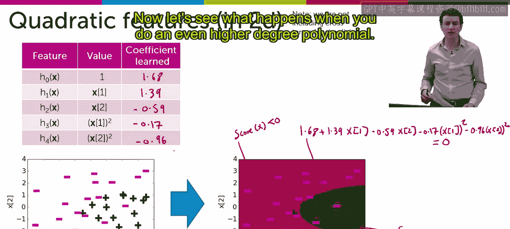

# 华盛顿大学《机器学习（分类，聚类和检索，第3-4课⧸共4课）｜Machine Learning》中英字幕 p47 46_分类中的过拟合.zh_en -BV1Sr421F7N7_p47-

。

So next， let's discuss what does overfitting look like for a classifier。

So we talked about a wide range of classifiers， so for example here I'm fitting a linear classifiers to the data and it's our usual example with predicting the review whether review is positive or negative for a restaurant and so we see that the points below the line have scored greater than zero。

 the points above the line have scored less than zero so below the line and predict is positive above the line I predict is negative and you get this very。

 very simple line in this simple example。😊，For this module。

 I've created a simple data set shown here on the lower left with positive and negative examples。

 and I'm going to fit a bunch of different logistic regression classifiers to it to really observe how overfitting happens in practice。

 So first， I'm going to fit a simple classifier with a linear feature。

 So there's just the constant W 0。😊，The coefficient of x1。

 which is going to be w1 and the coefficient of x2， which is going be W2。

 And if I learn the logistic regression classifier on this data， I get the following results。

 The constant becomes 0。23。 The coefficient of x1 becomes 1。

12 and the coefficient of x2 becomes minus- 1。07。So on the right here。

 I'm showing the resulting decision boundary from this classifier。 so this line here。😊。

Corresponds to that point where 0。23。Plus，1。12。X。1。Minine this w。1 point。

Just start clear that a little bit minus 1。07 x。2。Is equal to 0。

So this is our observation of that transition from the points。

Down here where the score of x is greater than 0 and the points over here where the score。

Of x is less than 0。 So the points above that line I'm predicting as being negative points the points below the line and predicting them to be positive。

And you see some interesting things in this in this simple data set with a just simple linear classifier。

 you see that。And there's a pretty decent job of separating the positives and the negatives。

 but there are a few points here where they're misclassified in the training data。

 so this plus is over here and this minus is over here。And the question is， can I do better。

 can I fit a model with maybe slightly fancir features that does better on the data set？😊。

To fit a better model， I'm going to try now what called quadratic features。

 so I'm going to consider not just1 x1 and x2， but I'm also going to consider x1 squared and x2 squared。

😊，Note that this is not general quadratic features。

 I'm not considering x1 times x2 or the cross terms because then it becomes pretty big later on。

 So I'm just going do this simple quadratic features。 And if I learn the classifier on the same data。

 I get a really cool decision boundary and the decision boundary when I project it into the two dimensional space becomes this kind of curved parabola。

 So the coefficient in this case of the constant becomes 1。68 x1 is 1。39。😊，X2 is minus-0。59。

 Not that these numbers are different in one of the previous slide because the parameters is all updated simultaneously with the quadratic terms。

 And here， the quadratic terms become-0。17-0。96。And using these quadratic terms。

 I get this beautiful quadratic decision boundary over here， which basically says that 1。68。😊，Plus，1。

39。X1。-0。59。X 2。-0。17。X 1。The low cleaner squared minus 0。96。😔，X，2 squared。

This whole thing is equal to  zero。And the points now on the left side of the parabola are the ones that have score of x。

Be less than 0。And the points on the right side here are those where a score of x is greater than0。

 And you get this beautiful curve where， yes， you still make a couple of mistakes。

 but I tell you those mistakes seem okay to me。😊，I feel in the data pretty well。

 you never should expect for real data sets to get everything right。 And in fact。

 as we will see later in this module， getting everything right to be a real big sign of warning for you。

 But I get pretty good fit and it looks beautiful。😊，And note by the way。

 that the coefficients that I learned over here are pretty good， they look like a natural magnitude。

 about 1， 0。5 and so on。 Now let's see what happens when you do an even higher degree polynomial。😊。

