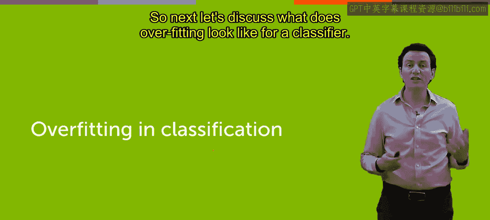
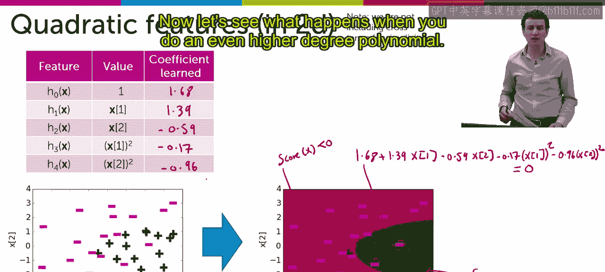

# 机器学习（分类，聚类和检索）：第3-4课：分类中的过拟合

## 概述
在本节课中，我们将要学习分类模型中的过拟合现象。我们将通过一个具体的例子，观察当模型变得过于复杂时会发生什么，并理解如何识别过拟合。

---

## 分类中的过拟合现象

上一节我们讨论了分类器的基本概念，本节中我们来看看过拟合在分类器中具体是什么样子。

我们讨论过多种分类器，例如，这里我们为数据拟合一个线性分类器。这是一个预测餐厅评论是正面还是负面的常见例子。我们看到，直线下方的点得分大于零，直线上方的点得分小于零。因此，直线下方预测为正面，直线上方预测为负面。在这个简单例子中，我们得到了一条非常简单的直线。

为了演示这个模块的内容，我创建了一个简单的数据集，如左下角所示，其中包含正面和负面的例子。我将为其拟合一系列不同的逻辑回归分类器，以实际观察过拟合是如何发生的。

### 拟合线性特征分类器

首先，我将拟合一个使用线性特征的简单分类器。特征包括常数项 `w0`、`x1` 的系数 `w1` 和 `x2` 的系数 `w2`。

如果我在这个数据上学习逻辑回归分类器，会得到以下结果：
*   常数项为 `0.23`。
*   `x1` 的系数为 `1.12`。
*   `x2` 的系数为 `-1.07`。

在右侧，我展示了这个分类器得到的决策边界，即这条直线。它对应于以下公式等于零的点：
`0.23 + 1.12 * x1 - 1.07 * x2 = 0`

这是我们观察到的分界线：直线下方的点，其得分 `score(x)` 大于 0；直线上方的点，其得分 `score(x)` 小于 0。因此，直线上方的点我预测为负面，直线下方的点我预测为正面。

在这个仅使用简单线性分类器的数据集中，我们看到了一些有趣的现象。它在分离正负样本方面做得相当不错，但在训练数据中仍有几个点被错误分类：这个加号在这里，这个减号在这里。问题是，我能做得更好吗？我能否使用更复杂的特征来拟合一个在数据集上表现更好的模型？

### 尝试二次特征

为了拟合一个更好的模型，我现在将尝试所谓的二次特征。我不仅考虑 `x1` 和 `x2`，还将考虑 `x1` 的平方和 `x2` 的平方。

请注意，这不是一般的二次特征，我没有考虑 `x1` 乘以 `x2` 这样的交叉项，因为那样会使模型很快变得非常庞大。所以我只使用这种简单的二次特征。

如果我在相同的数据上学习分类器，会得到一个非常酷的决策边界。当将其投影到二维空间时，决策边界变成了这种弯曲的抛物线形状。

在这种情况下，系数如下：
*   常数项为 `1.68`。
*   `x1` 的系数为 `1.39`。
*   `x2` 的系数为 `-0.59`。
*   `x1` 的平方项系数为 `-0.17`。
*   `x2` 的平方项系数为 `-0.96`。

请注意，这些数字与上一张幻灯片中的不同，因为参数是与二次项同时更新的。

使用这些二次项，我得到了这边这个漂亮的二次决策边界。它基本上表示以下公式等于零：
`1.68 + 1.39 * x1 - 0.59 * x2 - 0.17 * x1^2 - 0.96 * x2^2 = 0`

现在，抛物线左侧的点是那些得分 `score(x)` 小于 0 的点，而右侧的点是那些得分 `score(x)` 大于 0 的点。你得到了这条漂亮的曲线，是的，你仍然会犯几个错误，但我告诉你这些错误在我看来是可以接受的。我对数据的拟合相当好，你永远不应该期望在真实数据集上做到完全正确。事实上，正如我们将在本模块后面看到的，做到完全正确对你来说可能是一个巨大的警告信号。但我得到了相当好的拟合，而且看起来很漂亮。

顺便注意一下，我在这里学到的系数相当不错，它们看起来是自然的量级，大约在 1、0.5 左右。

### 更高阶多项式的影响

现在让我们看看当你使用更高阶多项式时会发生什么。

---

## 总结
本节课中我们一起学习了分类中的过拟合。我们通过一个具体例子，观察了从简单线性分类器到包含二次特征、乃至更高阶多项式特征的分类器的变化过程。我们发现，随着模型复杂度增加，决策边界可以更好地拟合训练数据，但我们也注意到，追求在训练集上“完美”分类可能是一个过拟合的警告信号。理解过拟合的表现形式，是构建泛化能力强的模型的第一步。