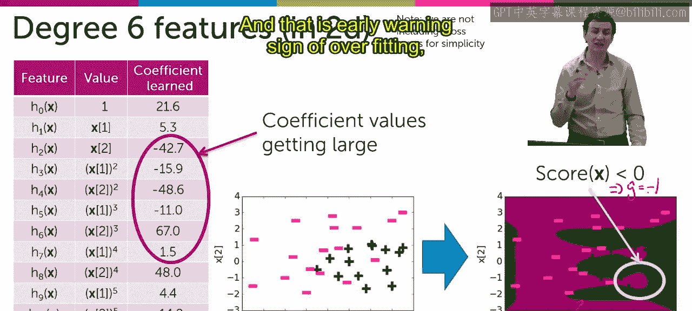
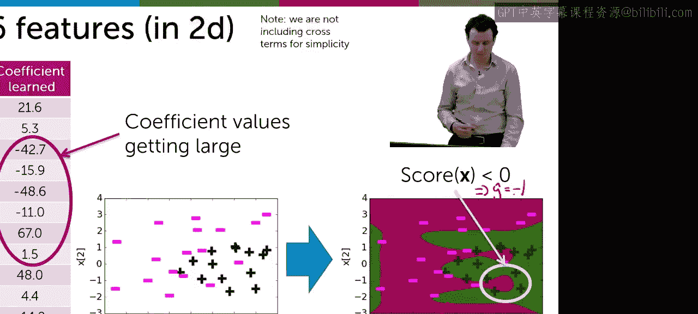
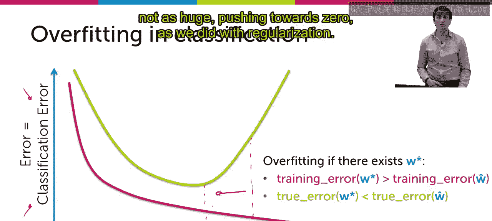

# 华盛顿大学《机器学习（分类，聚类和检索，第3-4课⧸共4课）｜Machine Learning》中英字幕 p48 47_通过高阶多项式特征可视化过拟合.zh_en -BV1Sr421F7N7_p48-

。

Next let's see what happens if we use degree C6 features to fit a logistic regression classifier on the same data set。

 so now our features go all the way up to x2 to the6 and x1 to the6 it's a lot more features a lot more coefficients to be learned from data now if I take this data set and I feed it for logistic regression classifier I get the following decision boundary。

😊，It its the training data extremely well， if you look really carefully。

 it actually gets zero training error。😊，Which would be a warning sign for you， by the way。

 as we mentioned， and if you look at decision boundary， it's extremely complicated。😊，Complex。

Some people might say here is a technical term for it。Crazy。Decision boundary。

So even though it has zero training error， it has some weird artifacts to it。

 so for example I'm highlighting here a region in the space where even though all around it's surrounded by a prediction it's positive right in the middle of that circle。

 it thinks that the score should be less than zero。

 so for that region we're saying that y hat should be minus1。😊。

And if day doesn't make any sense to me because right around that every point is positive one。

 why should I expect the points in the middle there to be minus-1？The data doesn't supported at all。

And in fact， if you look at the magnitude of the coefficients。

 they're starting to get large while the natural parabola had coefficients of around 1 minus 0。5。

 now we're getting coefficients of the order of 42 or more。

 which are 10 to 40 times bigger than the ones they had before。

And that is the early warning side of overfitting， as we discussed in the regression class。

Now let's take that one step further and fit a logistic rational model that uses polynomial features of the group 20。

 So this is going all the way up to x1 to the power of 20 and x 2 to the power of 20。 So really。

 really high order polynomials。😊，If you look at decision boundary， we learn。😊，I mean， come on。

 I'll say that this， I can say it's truly crazy。crazy。It's really， really complicated。

 gets all the data right。But it's highly unsmooth。 And if you look at the learned weight and the coefficients are of the order 3000。

4000-2000。 They're much， much bigger than that simple parabola that we learn。

 It gets all the training data right， but it's clearly overfitting and it's clearly outputting very large estimated polynomials。

😊，A very large estimate coefficients and so。We're going to watch very carefully because the magnitude of the coefficients when we try to avoid overfitting。

So the notion of overfitting classification is very similar to that of regression。

 except that the error now is measured in terms of classification error。😊。

And there might be some set of parameters that we learn here。WH。

 which seemed to do very well on date in the training data maybe even as crazy boundaries while there was some other parameter。

 W star， another set coefficients W star that would have done much better in terms of true error And the question is how do we go and push our learning process to be more like W star than it is to W hat and we'll do that by pushing our parameters to be not as massive。

 it's not as huge pushing towards zero as we did with regression with regularization。

