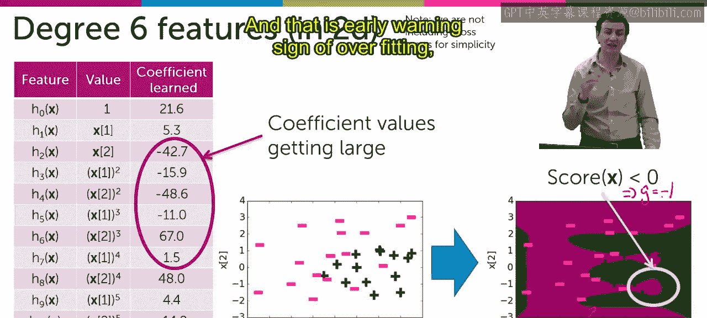
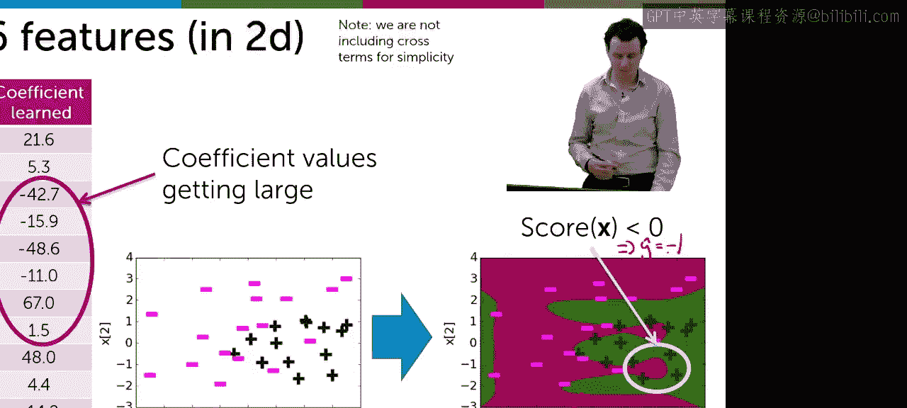
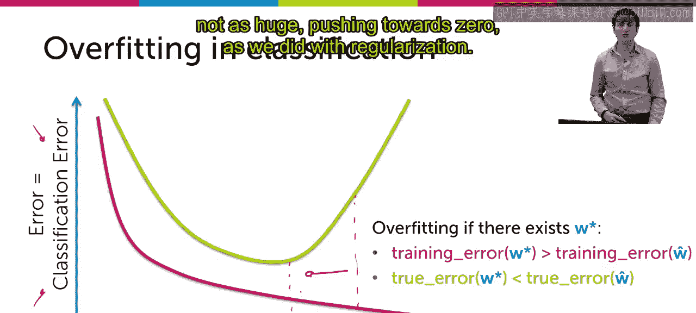

# 机器学习（分类，聚类和检索）：第3-4课：通过高阶多项式特征可视化过拟合

在本节课中，我们将要学习过拟合在分类问题中的表现。我们将通过一个具体的例子，观察当使用不同阶数的多项式特征来拟合逻辑回归分类器时，模型在训练数据上的表现及其决策边界的变化，从而直观地理解过拟合现象。

上一节我们介绍了逻辑回归的基本概念，本节中我们来看看当特征变得非常复杂时会发生什么。

## 使用6阶多项式特征

接下来，我们看看如果使用6阶多项式特征在相同数据集上拟合逻辑回归分类器会发生什么。

现在，我们的特征最高达到 `x2^6` 和 `x1^6`。这意味着特征数量大大增加，需要从数据中学习的系数也更多。如果我将这个数据集输入逻辑回归分类器，会得到以下决策边界。

它在训练数据上拟合得极好。如果仔细观察，它实际上达到了零训练误差。顺便提一下，正如我们之前提到的，这应该是一个警告信号。观察其决策边界，它极其复杂。

有些人可能会用一个技术术语来形容它：疯狂。这个决策边界非常复杂。

因此，尽管它的训练误差为零，但决策边界存在一些奇怪的伪影。例如，我在这里高亮显示空间中的一个区域：即使该区域周围的所有点都被预测为正类，但在那个圆圈的正中间，模型认为分数应该小于零。

对于那个区域，模型预测 `y_hat` 应该是 `-1`。

这对我来说毫无意义，因为其周围的每个点都是正类（`+1`），为什么我会期望中间的点是负类（`-1`）？数据完全不支持这一点。

事实上，如果你观察系数的幅度，它们开始变得非常大。而自然的抛物线模型的系数大约在 `1` 和 `-0.5` 左右，现在我们得到的系数数量级达到了 `42` 或更高，比之前的系数大了 `10` 到 `40` 倍。

正如我们在回归课程中讨论过的，这就是过拟合的早期预警信号。

## 使用20阶多项式特征

现在，让我们更进一步，拟合一个使用20阶多项式特征的逻辑回归模型。

这意味着特征最高达到 `x1^20` 和 `x2^20`。这是非常非常高阶的多项式。观察我们学到的决策边界。

我的意思是，这可以说是真正的疯狂。它真的非常复杂。它正确分类了所有数据，但极不平滑。观察学习到的权重，系数数量级达到了 `3000`、`4000`、`-2000`。它们比我们之前学到的简单抛物线模型的系数要大得多。

它虽然正确分类了所有训练数据，但明显是过拟合了，并且输出了非常大的估计多项式系数。

因此，当我们试图避免过拟合时，需要非常仔细地关注系数的大小。

## 分类中的过拟合概念

分类中的过拟合概念与回归中的非常相似，区别在于现在的误差是用分类错误来衡量的。

我们可能在这里学到一组参数 `W_hat`，它在训练数据上表现得似乎非常好（甚至可能产生疯狂的边界），但同时存在另一组参数 `W_star`，另一组系数 `W_star`，在真实误差方面会表现得更好。

问题在于，我们如何推动学习过程更接近 `W_star` 而不是 `W_hat`？我们将通过推动参数不那么巨大、不那么庞大来实现这一点，就像我们在回归中使用正则化所做的那样，推动参数趋向于零。

## 总结

本节课中我们一起学习了过拟合在分类问题中的可视化表现。我们观察到，随着多项式特征阶数的增加（从6阶到20阶），逻辑回归模型虽然能在训练集上达到零错误率，但其决策边界变得异常复杂且不合理，同时模型系数（权重）的幅度急剧增大。这明确地指示了过拟合的发生。与回归问题类似，控制模型复杂度（例如通过正则化限制系数大小）是避免分类模型过拟合的关键。下一节我们将探讨用于解决这一问题的具体正则化技术。