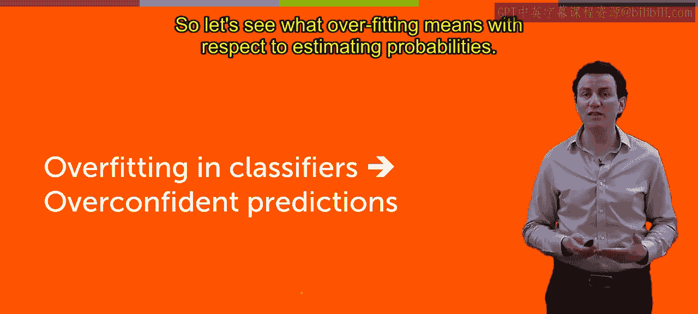
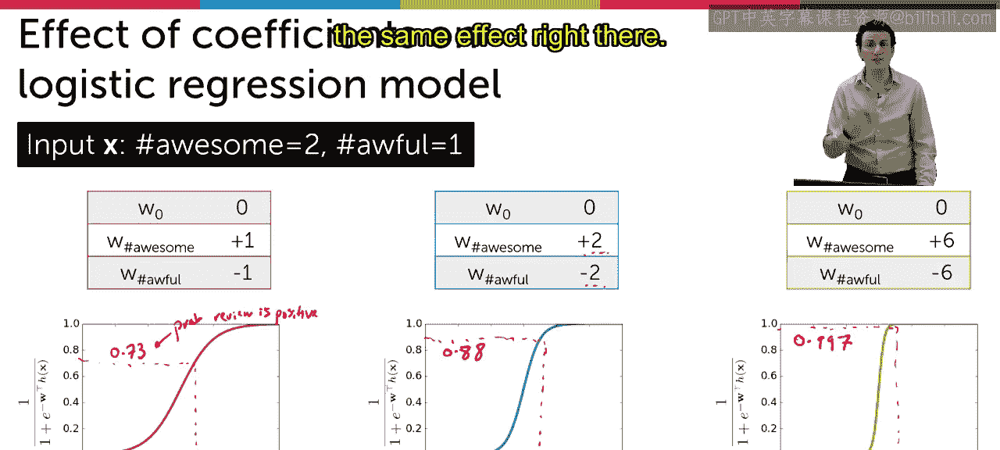

# 华盛顿大学《机器学习（分类，聚类和检索，第3-4课⧸共4课）｜Machine Learning》中英字幕 p49 48_分类器过拟合导致过于自信的预测.zh_en -BV1Sr421F7N7_p49-

。

In classification， the concept of overfitting can be。If it's stranger than it is in regression。

 because here we're not just predicting a particular value a price of a house or even whether review is positive or negative。

 but we're often asking probabilistic questions like what is the probability that this reviews is positive？

So let's see what overfetting means with respect to estimating probabilities。

So as you remember from the previous modules， we talked about the relationship between the score and the data。

 so that's w transpose H， which varies from minus infinity to plus infinity。

 and actualzure estimate probabilities， the probabilitybil of y equals plus1。

 let's say given its input x and W as a sigmoid apply to the score function， W transpose H。

So that's the model we're working with。 and if you remember as we see overfitting。

 we see w is becoming bigger and bigger those coefficient is becoming bigger and bigger and bigger and bigger。

 which means that W transpose H becomes huge， massive and that pushes us either if it's massively positive to saying that the probabilities are exactly one。

😊，Really confident they're one or if they're massively negative， they're confident they're zero。

So overfitting in classification， especially for logistic regressiong。

 can have really devastating effects。 We can yield this really massive coefficients which push W transpose h the score to be very positive or very negative。

 which pushes the sigmma to be exactly one or exactly zero。 And so not only are we。😊，Overfitting。

 but we're really confident about our predictions。 We think that this is exactly a positive review when we should be more uncertain about it。

 So let's observe how that shows up in data。😊，Let's go back to the simple example that we had before where we were just fitting a function a classifier using two features。

 numbers of awesomes and number of offs， let's say the coefficient of awesome is plus one and the coefficient of awful is minus1 and we have an input。

😊，2 awesomes， one awful。 If you look at the difference between number of awful and number of awesomes。

 you have one here because there's one awesome word than these awfuls。

 And so the actual score that we get is。😊，One， which means that the estimated probability。

Of positive review。Is 0。73。Is。Probability。Review。Is positive。And I can live with that。You know。

 I have a review， it has two awesome， two things are awesome about the restaurant。

 one thing was awful， you know， it's more than half probability of being a positive review。

 but not a low more than half。Now if I take the same coefficients， nothing changed the same input。

 but I multiply those coefficients by 2， now I have two awesomes and sorry two awesomes one of still input but the coefficients are plus 2 and minus2。

😊，Now the curve becomes steeper， and so if I look at the same point where the difference between o phones and off was are 1 and I look at my predicted probability。

Now I've increased that tremendously now I see the probability of positive review is about 0。88。

 I'm even more confident that the same exact review is positive。So that doesn't seem as good。

 88% chance that is positive。But let's push the coefficients up more。

 let's say that the coefficient to o is plus 6， the coefficients of half is minus-6。 Now。

 if I look at the same point。😊，The same import， the same difference between awesomes and awfuls。

 and I push that out。I get this。Prety。Scary Z， it says that。

The probability of being a positive route 0。997， I can't trust that， is it really case that 0。

997 probability， their review of two awesomes and one off was positive， that doesn't make sense。

So as you can see， we have the same decision boundary still crossing as zero。

The coefficients are just getting a bit bigger every time。

 but my estimated probability of the review becomes steeper and steeper， more and more likely。

 which is another type of overfi0 that we observe in logistic regression。

 so not only the curves with them weird than。😊，Wiggly。

 but the estimated probabilitybabilities become close to zero and close to one。

So let's look at our data set and see how we observe the same effect right there。

