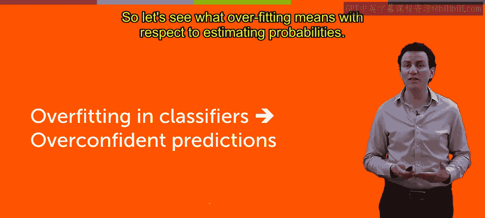
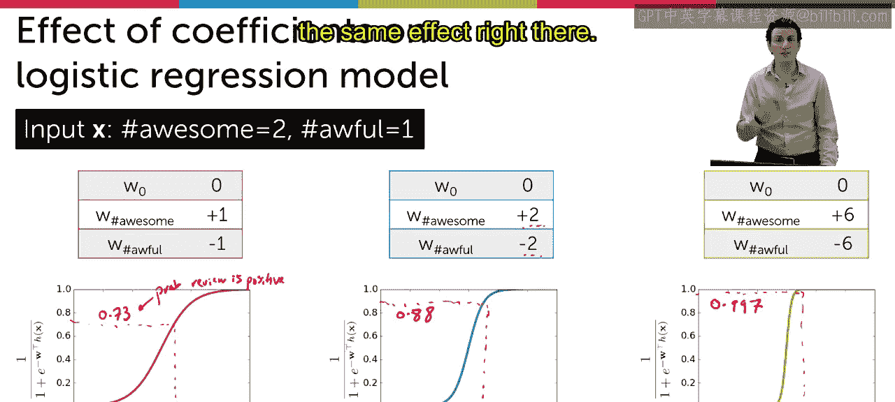

# 机器学习（分类，聚类和检索）：3-4：分类器过拟合与过度自信预测 🔍

在本节课中，我们将探讨分类任务中的过拟合现象，特别是逻辑回归模型如何因过拟合而产生过度自信的概率预测。我们将通过公式和示例，理解系数增大如何导致预测概率趋近于0或1，并观察这一现象在实际数据中的表现。

## 分类中的过拟合概念

上一节我们介绍了回归中的过拟合，本节中我们来看看分类任务中的过拟合有何不同。在分类中，过拟合的概念可能比回归中更为复杂，因为我们不仅预测特定值（如房屋价格）或类别（如评论是正面或负面），还经常回答概率性问题，例如“这条评论是正面的概率是多少？”。

因此，我们需要理解过拟合在概率估计方面的含义。

## 模型与过拟合机制

以下是逻辑回归模型的核心公式：

**概率估计公式**：  
`P(y = +1 | x, w) = σ(w^T h)`  
其中，`σ` 是Sigmoid函数，`w^T h` 是得分函数，取值范围为负无穷到正无穷。

回忆之前模块的内容，过拟合时，系数 `w` 会变得越来越大。这意味着得分 `w^T h` 会变得极大（正或负），从而将Sigmoid函数的输出推向 exactly 1 或 exactly 0。

因此，分类中的过拟合，特别是逻辑回归，可能产生破坏性效果。巨大的系数会将得分推向极端值，导致预测概率趋近于1或0。我们不仅是在过拟合，而且对自己的预测变得过度自信，即使本应对结果持有更多不确定性。

## 简单示例演示

让我们回到之前使用的简单示例，使用两个特征（“awesome”和“awful”的数量）来拟合分类器。

假设初始系数为：`awesome: +1`, `awful: -1`。输入一条评论，包含2个“awesome”和1个“awful”。

**计算过程**：  
得分 `w^T h = (1*2) + (-1*1) = 1`  
预测正面评论概率 `P = σ(1) ≈ 0.73`

这个结果可以接受：评论有两点好评，一点差评，正面概率略高于一半，但并非极度确定。

现在，保持输入不变，将系数放大一倍：`awesome: +2`, `awful: -2`。

**计算过程**：  
得分 `w^T h = (2*2) + (-2*1) = 2`  
预测概率 `P = σ(2) ≈ 0.88`

此时，我们对同一条评论是正面的信心大幅提升至88%。

进一步放大系数：`awesome: +6`, `awful: -6`。

**计算过程**：  
得分 `w^T h = (6*2) + (-6*1) = 6`  
预测概率 `P = σ(6) ≈ 0.997`

概率高达99.7%，这显然不合理。对于一条仅有2个好评和1个差评的评论，如此高的置信度没有意义。

可以看到，决策边界（得分=0）并未改变，但随着系数增大，Sigmoid曲线变得越来越陡峭，预测概率越来越趋近于1（或0）。这是逻辑回归中观察到的一种过拟合现象：不仅决策边界可能变得扭曲，估计的概率也会变得极端。

## 数据集中的现象

以下是在实际数据集中观察到的同类效果图示。

图中展示了随着模型复杂度增加或正则化不足，分类器对训练数据做出过度自信预测的情况。

## 本节总结

本节课中我们一起学习了分类任务中过拟合如何导致过度自信的概率预测。我们了解到，在逻辑回归模型中，过拟合会使系数 `w` 变得过大，从而将得分 `w^T h` 推向极端值。这导致Sigmoid函数输出趋近于0或1，使得模型对预测结果表现出不合理的、极高的置信度。通过简单示例，我们直观地看到了系数增大如何使预测概率从合理值（如0.73）飙升到近乎绝对确定的值（如0.997）。认识到这一点对于理解模型校准、评估模型可靠性以及后续学习正则化技术至关重要。