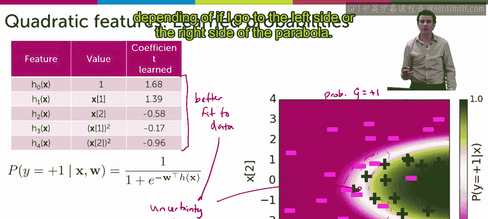
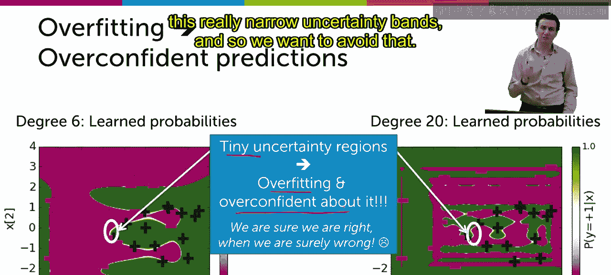

# 华盛顿大学《机器学习（分类，聚类和检索，第3-4课⧸共4课）｜Machine Learning》中英字幕 p50 49_可视化过于自信的预测.zh_en -BV1Sr421F7N7_p50-

。

This is the same data set and the same learned model from a few slides ago。

And when I'm ploting here on the right， it's not just a decision boundary， but it's the probability。

😊，That y hat is equal to plus  one， so it's a probability plot。For all the points over here。

 the probability。Is approximately 0。 so it's approximately zero chances that the points there with。

With minus 5 and4 are positive， well the points over here。Have a probability。Approximately 1。

So the probability of being y equals plus one is approximately 1 in the bottom right corner。

 so all that makes sense。And what makes most sense to me？Is that the region in between。Right here。

 that white region， this is the region where the probability。Is approximately 0。5。

And so we kind of uncertain， I to whether were positive or negative review。 And it's a region。

 It's a pretty wide region of uncertainty。So although the linear classifier the straight line here。

 polynomous degree1 was not a great fit to the data。

 the uncertainty measure makes quite a lot of sense。

 the points over here that were getting misclassified。

 I'm actually uncertain about whether the positive or negative and so I can feel like this classifier is doing something pretty reasonable。

😊，Now let's look at degree2 polynomial fit， so what happens if we use degree2 or polynomial features or quadratic features and learn the same classifier as we learned a few slides ago。

 but again， plot the probability。That y hat equals plus  one。As we saw from a few slides ago。

 we believe that this quadratic fit was actually a better fit to the data。So if you look at it。

 the uncertainty region is narrow。And to me， this makes a lot of sense。

 I have a better fit to the data。 There's less points that I'm uncertain about， and in fact。

 the places where I have uncertainty are exactly the ones in the boundary region where I should have some uncertainty。

 ones where I'm not sure if they're plus 1 and minus-1， they're close to the boundary。

 it makes a lot of sense。 and so this is a really great fit。

 not just in terms of that decision boundary， but also in terms of the probabilities。

 the places where the probability is close with 0。5 are really the ones where I'm really unsure about what's going on。

 and it smoothly decreases or if smoothly increases depending on where I go to the left side or the right side of that parabola。

Now let's see what happens when I use higher order features。 So for example。

 polynomial degree 6 features or polynomial degree20 features。

 we saw that those decision boundaries became really wly and crazy。

 but now if you look at the uncertainty religions you'll see they become really。

 really narrow so youve got a squint to see these because they're really really thin but you can see them over here in that kind of little white band。

 So according to this model， not only is the decision boundary this really crazy line。

 but the only places where I'm unsure about my prediction。😊，And this little， little， little。

 little places thin little bands in between。 So this is tiny uncertainty regions。

 and so I'm overfitting and overconfident about it。

 The way I think about it and I say is that we're sure we're right。And we're surely wrong about that。

 so we're absolutely wrong， but we're sure we're right。And that's really bad。

And so uncertainty is something that's very important in classifiers and by looking at the uncertainty。

 we have another interpretation of overfitting another way the overfitting gets expressed in classification by creating this really narrow uncertainty bands。

 and so we don't avoid that， wet do everything we can't avoid it。😊。

