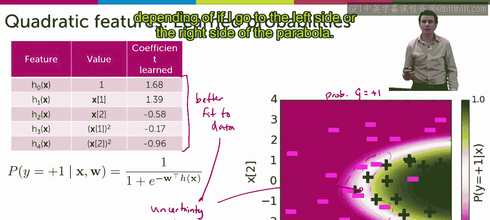
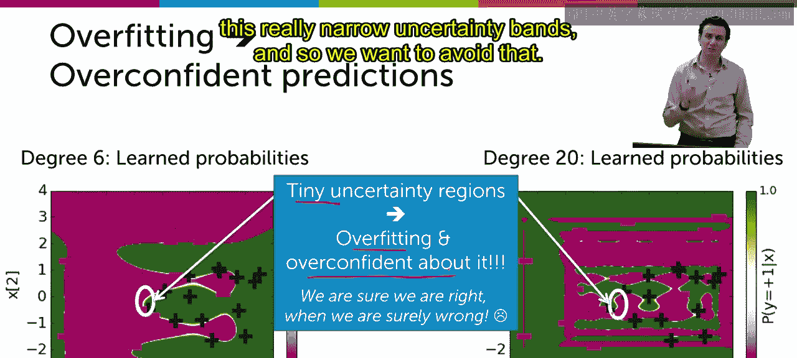

# 机器学习（分类，聚类和检索）：第3-4课：可视化过于自信的预测

在本节课中，我们将学习如何通过可视化分类器预测的概率来理解模型的行为，特别是识别模型何时变得“过于自信”。我们将看到，一个复杂的模型可能在决策边界上表现得很奇怪，并且对其预测表现出不合理的、极高的置信度，这是过拟合的另一个信号。

## 可视化概率图

上一节我们介绍了不同复杂度模型的决策边界。本节中，我们来看看模型预测的概率分布图，这能提供比单纯决策边界更丰富的信息。

下图展示的数据集和模型与之前幻灯片中的相同。右侧绘制的不仅是决策边界，更是模型预测 `y_hat` 等于 `+1`（即正类）的概率图。

*   在左侧区域，概率 `P(y_hat = +1)` 近似为 **0**。这意味着模型几乎肯定位于该区域（例如坐标 `(-5, 4)` 附近）的点是负类。
*   在右下角区域，概率 `P(y_hat = +1)` 近似为 **1**。这意味着模型几乎肯定该区域的点是正类。
*   中间那片白色区域，是概率 `P(y_hat = +1)` 近似为 **0.5** 的区域。在这个区域，模型对于样本是正类还是负类非常不确定。

这个不确定性区域相当宽。尽管这个一阶多项式（线性）分类器对数据的拟合并不完美，但其不确定性度量看起来是合理的。那些被错误分类的点，实际上也落在了模型不确定的区域里，这使得这个分类器的行为显得相当合理。

## 二阶多项式拟合

现在，让我们观察使用二阶多项式（二次）特征学习的分类器的概率图。正如之前所见，我们相信这个二次拟合对数据的拟合效果更好。

以下是使用二阶多项式特征时，模型预测 `y_hat` 等于 `+1` 的概率图。

可以看到，不确定性区域变窄了。这非常合理：因为模型对数据的拟合更好，所以它不确定的点就更少。事实上，那些仍然存在不确定性的地方，恰恰是位于决策边界附近、本就应该难以判断的区域。这个模型不仅在决策边界上拟合得很好，其输出的概率也很有意义：概率接近0.5的区域，正是模型真正不确定的地方；而概率从0.5向0或1平滑过渡的过程，也符合我们的直觉。

## 高阶多项式与过于自信的预测

接下来，我们看看使用更高阶特征时会发生什么。例如，使用六阶或二十阶多项式特征。我们之前看到，这些模型的决策边界变得非常扭曲和奇怪。

现在，如果我们观察它们的不确定性区域，会发现这些区域变得**极其狭窄**。你需要仔细看才能发现图中那些细小的白色条带。

根据这个复杂模型，不仅决策边界是一条奇怪的曲线，而且模型对其预测表示“不确定”的地方，只剩下这些极其细微的条带。这是非常微小的不确定性区域。

这种现象就是**过拟合**，并伴随着**过于自信**的预测。可以这样理解：模型**确信**自己是对的，但实际上它**肯定**是错的。我们错得离谱，却自信满满，这非常糟糕。

因此，不确定性是分类器中一个非常重要的概念。通过观察不确定性，我们获得了理解过拟合的另一个视角：在分类问题中，过拟合的另一种表现就是产生了这种极其狭窄的不确定性区域。我们的目标就是想尽一切办法来避免这种情况。

## 总结

本节课中，我们一起学习了如何通过可视化分类器预测的概率来深入理解模型行为。我们对比了不同复杂度模型（线性、二次、高阶多项式）的概率图，发现一个好的模型会给出合理的不确定性区域，而一个过拟合的复杂模型则会表现出“过于自信”的预测，即其不确定性区域变得异常狭窄。这为我们诊断和避免过拟合提供了又一个有力的工具。