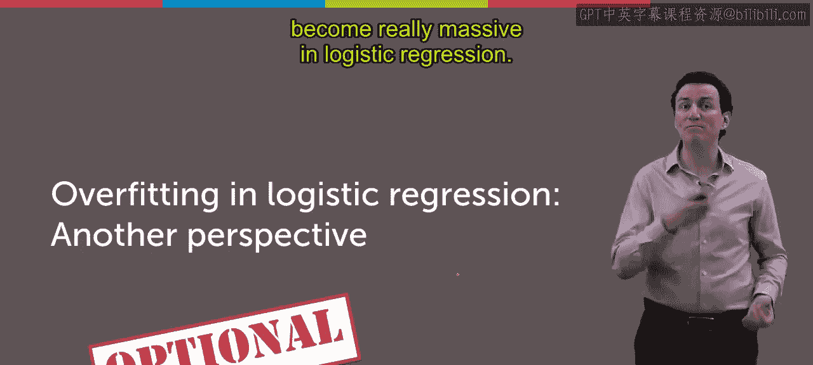
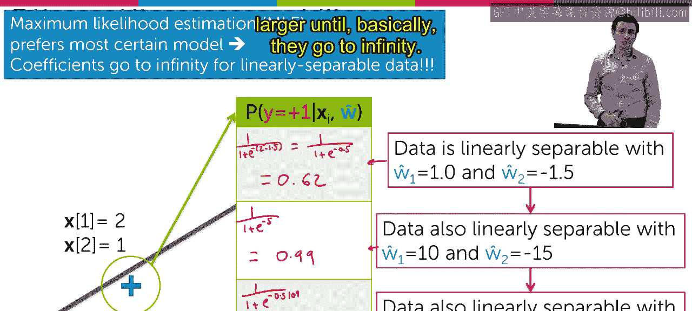
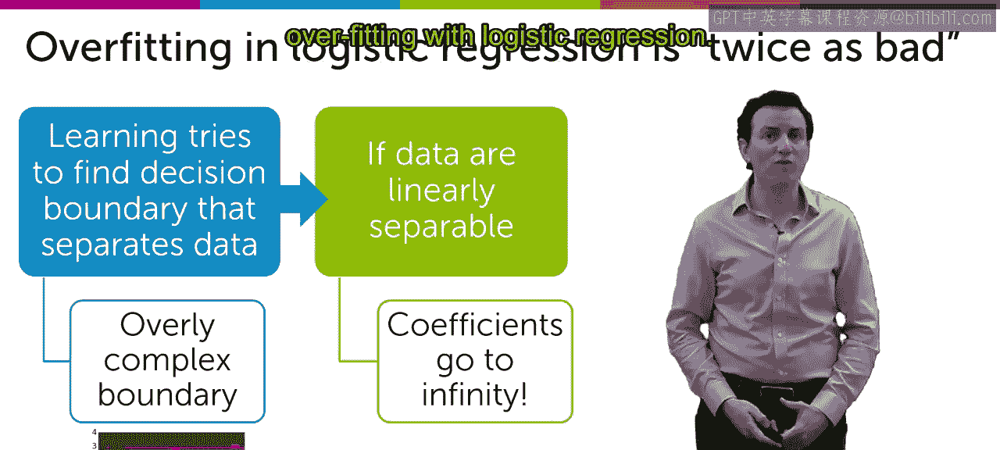

# 华盛顿大学《机器学习（分类，聚类和检索，第3-4课⧸共4课）｜Machine Learning》中英字幕 p51 50_可选：Logistic回归过拟合的另一个视角.zh_en -BV1Sr421F7N7_p51-

。

We've made the next section optional， it's not mathematically too complex。

 but we don't think it is necessary to understand the whole thread of today's module， however。

 for those interested in a little bit more detail or another interpretation why overfitting happens in logistic regression and why it's so bad。

 we've created a few other examples for you to go through。😊。

So this part really explores that and really explains why those parameters become really massive in logistic regression。

😊。

So let's dive into it。To understand a little bit better of why overfitting happens in logistic regression and why the parameters get really big。

 we need to introduce a notion of linear sparability。Now。

 linearly separable data is more or less what you'd expect。

 There exists a line here where everything on the left of the line in this case has score。

Of x less than 0。And everything on the right of the line here has core of x。Greater than0。

 So it separates the positive examples from the negative examples。More generally。

 we say that data is linearly separable where somebody stops you on the street and says。

 what does it mean for data to be linear separable。

 we say it's linear separable if the following is true。

 it's linearly separable if for all positive examples。😊，Score of x。Which is。W hat transpose。

H of x is greater than 0。So it's greater3 greater than zero for all positive examples。

 and then for all negative examples。😊，The score of x。Which is W hat transpose h of x is less than 0。

And so what that means is that we're getting the training error to be exactly zero。

And this is a really important point again if you see training error getting exactly zero you should start getting worried and what you see is that the data is minimally separable that that's exactly happening so you might think oh it's a great thing my data is meanly separable you should be careful because you might be getting into an overfitting situation especially if you have a very complex model and you have perfect training error。

😊，Now I've drawn this in two dimensional space， but if you have d dimensional features。

 let's say10 dimensional features， linear separability corresponds to。😊。

A plane in a thousand dimensional space。Separate， separate。Positive examples from negative。

That's my space。Vice for those who didn't get it。And sos that's a way to think about it in high dimensional spaces and theres the little side note which you're not going into detail。

 but it turns out that。😊，If you keep adding features like polynomouss of degree 20， 50。

 100 and so on eventually， except for some corner cases。

 you're actually going to make your data linearly separable， so you might observe that with enough，😊。

Features， your training error go to zero， which means you fall into exactly this linearly separable case。

 which is a very problematic one。To understand why that space is problematical。

 linearly seative becomes a problem for overfitting。

 let's look at this example over here in this case， the plane 1。0 number of awesomes minus 1。

5 number offerss separates the positive examples from negative examples。😊，Now， what does that mean。

 that means that the plane 1。0。Number of awesome。-1。5 number of offs。

Equs to  zero is the boundary between the positive examples and negative examples。Now。

 what happens if I multiply both sides of that equation by 10？I get 10 number of awesomes。

-15 number of authors。On the left side， I multiply by 10。 and if I multiply 0 by 10， I also get0。

 So it turns out that that bigger coefficient also separates the data in exactly the same way。😊。

And get us guess what if I multiply both sides by1 billion。😊。

I still separate the data in the same way， so1 billion。Times number of awesomes， minus1。

5 billion times number of offs still separates the data。

 And so whether coefficients are small or big， we still have a separating hyperbllate。😊。

So why am I going to get pushed to this bigger coefficients？Well， let's to understand that。

 we have to go back to our probability of our data， so let's pick a particular data point here。

 one that's near the boundary。Which has two awesomes and one awful， I really love that review。

 two awesomes， one awful is a review that I keeps coming back to。Now。

 let's see what happens to our estimate imp probability for this case。😊。

Let's see if what happens when you're using the first set of coefficients learn W1 is 1。0。

 W2 is minus1。5。 So in this case， my estimate of probability is1 over1 plus e to the minus。😊。

So2 times 1。0， which is2。us1。5 times 1， which is-1。5。

 so this is equal to1 over1 plus e to the minus 0。5， which。Turns out to be equal， too。0。62。

Now that makes sense to me is the point close to the boundary。

 there's 62% chance that it's a positive review， but then there's still 38% chance it's a negative review。

 so I feel really good about that prediction。 However。

 since we're doing maximum likelihood estimation， we are pushing probabilities towards extremes we're trying to learn parameters that makes those probabilities bigger。

 So let's this happens when we use the second set of parameters 10 and minus 15。

 So in this case multiply everything by 10。 So the probability is going to be1 over1 plus e to the minus5 instead of each to the minus 0。

5 which is equal to。😊，0。99。Wow， now， even though the point is close the boundary。

 we had 99% confident that's a positive review that ist。Seeing quite right。Well。

 let's see what happens when we look at 1 billion and minus-1。5 billion。 well。

 that ratio becomes one over1 plus e to the minus 0。5。Billion。

And I don't know my calculator couldn't compute that exactly， probably yours scant。

 but I can tell you is basically one。😊，So when parameters become the coefficients become really。

 really big， I'm sure that they put the point right next to boundary has probability one of being a positive review。

 and I don't trust that。 however， maximum likelihood estimation prefers models that are more certain and so it's going to push the coefficients to being infinite following newlyseparable data because it just can。

😊，So it's going to be pushing to be larger and larger and larger and larger until basically they go to infinity。

 So that's a really bad overfi problem that happens in logistic regression。😊。

So just as a summary of this optional section， we'll see that logistic regression overfitting here can be what I call twice as bad。

 We have the same kind of bad situation that we had looking at the seizure boundaries and typically in regression where you have this really complicated functions that you learn and you become。

😊，You know， with really complex decision boundaries that can overfi the data don't generalize well。

 But you also have the second effect where if the data is linearly separable。

 if you have lots of features， data becomes linearly separable or you close it。

 then the coefficients can get really big and eventually you can go to infinity。

 And so you get this massive coefficients and massive confidence about your answers。

 And so you see these two kinds of effects of overfitting with logistic regression。😊。

