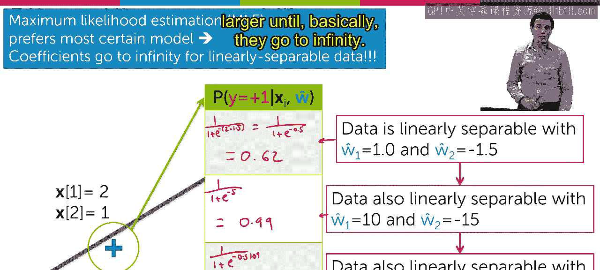
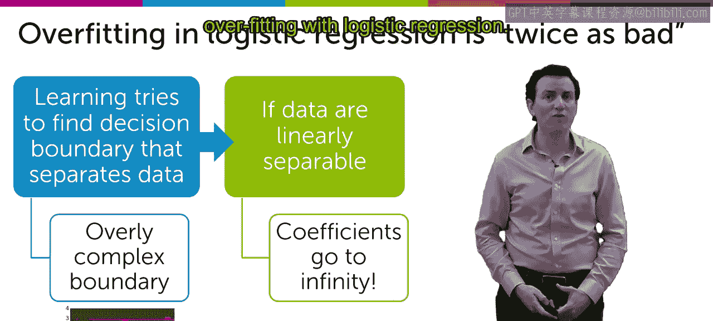

# 机器学习（分类，聚类和检索）：3-4：可选：Logistic回归过拟合的另一个视角 🔍

在本节中，我们将深入探讨Logistic回归中过拟合现象发生的另一个原因。我们将引入“线性可分”的概念，并解释为何在数据线性可分时，模型参数会变得极大，从而导致严重的过拟合问题。

---

## 线性可分性 📈

上一节我们介绍了过拟合的一般概念，本节中我们来看看一个导致Logistic回归过拟合的特殊情况：线性可分数据。

线性可分数据直观上很好理解。它意味着存在一条直线（或在更高维度中是一个超平面），能够完美地将正例和负例分开。具体来说，对于所有正例样本，其得分 `score(x) = ŵᵀh(x)` 大于0；而对于所有负例样本，其得分小于0。

这意味着模型在训练集上的误差**恰好为零**。这是一个重要的警示信号：当训练误差精确为零时，你可能正面临过拟合的风险，尤其是在模型非常复杂的情况下。

在二维空间中，线性可分表现为一条直线。在更高维度（例如10维或1000维）的特征空间中，它则对应一个分离超平面。需要特别注意的是，当你不断添加高阶多项式等复杂特征时，数据往往会变得线性可分，从而更容易陷入训练误差为零的过拟合陷阱。

---

## 线性可分为何导致问题？⚠️

为了理解线性可分为何会导致过拟合，让我们看一个具体的例子。

假设存在一个决策边界：`1.0 * (#awesome) - 1.5 * (#awful) = 0`，它能完美分离正负样本。现在，考虑将这个方程两边同时乘以10，得到 `10 * (#awesome) - 15 * (#awful) = 0`。这个新的边界依然能完美分离数据。事实上，即使乘以10亿，边界 `1,000,000,000 * (#awesome) - 1,500,000,000 * (#awful) = 0` 也同样有效。

这说明，**存在无数组系数（无论大小）都能定义同一个分离超平面**。那么，模型为何会倾向于选择极大的系数呢？答案在于最大似然估计的目标。

---

## 最大似然估计的“偏好” 🎯

要理解系数为何会变大，我们需要回顾数据概率的估计过程。考虑一个靠近边界的样本点，例如包含2个“awesome”和1个“awful”的评论。

以下是不同系数下，模型预测该样本为正例的概率：

*   **使用系数 [1.0, -1.5]：**
    *   概率公式为：`P = 1 / (1 + exp(-(2*1.0 + 1*(-1.5))))`
    *   计算得 `P ≈ 0.62`。这个预测是合理的，因为样本靠近边界，模型给出了62%的置信度。

*   **使用系数 [10, -15]：**
    *   概率公式为：`P = 1 / (1 + exp(-(2*10 + 1*(-15))))`
    *   计算得 `P ≈ 0.99`。此时，尽管样本位置未变，模型却以99%的置信度认为它是正例。

*   **使用系数 [10⁹, -1.5*10⁹]：**
    *   概率公式为：`P = 1 / (1 + exp(-(2*10⁹ + 1*(-1.5*10⁹))))`
    *   计算得 `P ≈ 1.0`。系数极大时，模型会以近乎100%的绝对置信度做出预测。

最大似然估计的目标是最大化所有训练样本预测概率的连乘（似然函数）。它会**偏好那些对训练数据预测“更确定”的模型**。在线性可分的情况下，模型可以通过不断增大系数，使所有训练样本（即使是边界附近的点）的预测概率无限趋近于1或0，从而不断提高训练数据的似然值。理论上，系数会被推向无穷大。

---

## 本节总结 📝

本节课中我们一起学习了Logistic回归过拟合的另一个关键视角。

1.  我们引入了**线性可分**的概念，即存在一个超平面能完美分离所有训练样本，导致训练误差为零。
2.  我们解释了在线性可分情况下，**模型系数有无数种可能的选择**，都能实现完美分离。
3.  由于**最大似然估计倾向于选择预测置信度更高的模型**，它会驱动系数不断增大，以逼近训练样本的极端概率（1或0）。
4.  这导致了Logistic回归中一种“双重”过拟合问题：既可能学习到复杂、曲折的决策边界，也可能在数据线性可分时产生**巨大甚至趋于无穷的模型系数**，并伴随着不切实际的高置信度预测。

因此，当你在Logistic回归中观察到训练精度达到100%或系数值异常巨大时，这很可能是一个强烈的过拟合信号，需要采取正则化等应对措施。