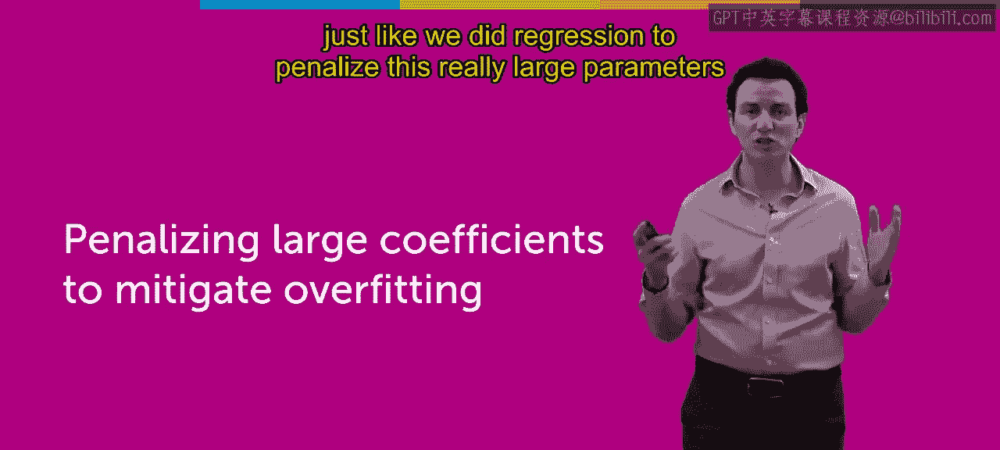
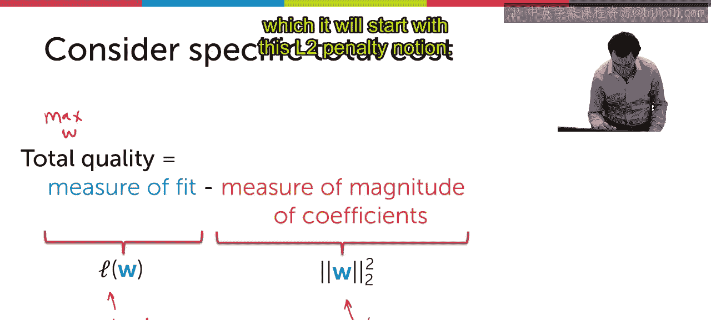

# 华盛顿大学《机器学习（分类，聚类和检索，第3-4课⧸共4课）｜Machine Learning》中英字幕 p52 51_惩罚大系数以缓解过拟合.zh_en -BV1Sr421F7N7_p52-

。

Now we've seen multiple ways that overfiing can be bad for classification。

 especially for logistic regression and how very massive parameters can really really be a thing。

 so what're going to do next is introduce an ocean regularization just like we did in regression to penalize this really large parameters in order to get a more reasonable outcome。

😊。

So we're still talking about the same logistic regression model where we take data。

 we do some feature extraction it， we fit this model one over one plus each of the minus w transpose x。

 but the quality metric for the machine learning the algorithm is going to change to push us away from really large coefficients so in particular we're gonna to balance how well we fit the data with the magnitude of coefficients。

 is's avoid this massive coefficients in the context of logistic regression。

 we're balancing two things to measure total quality。

 the measure of fit which was the data likelihood， the thing that's bigger is better。

 how well we fit the data， and then the magnitude of the coefficients where the coefficients is too big are problematic。

 so we have one thing we want to be big the data likelihood， another thing we want to be small。

 which is the magnitude of coefficients we're going to optimize。

The quality minus this complexity metric here。And so we want to balance between the two。

So what do those mean， let's instantiate them more clearly in the context of logistic regression。

The quality metric and logistic regression is the data likelihood and we talked about it quite a bit in the previous module Now one little side note here that we're going to use in this module is that we don't typically optimize the data likelihood directly。

 we optimize the log of the data likelihood because that makes math a lot simpler and it makes can the gradients behave a lot better。

 we talked about in the optional section in the previous module we talked about this quite a bit and we exploit it in detail if you skip that section just think about the log as a way to make those numbers less extreme so we take the log。

So the metric for quality is going to be the log of the data likelihood。

 and we're want to make that log as big as possible。

So we've seen that the likelihood is going to be what we're going optimize when I try to make big。

 But the same time we're trying to make something small， which is the magnitude of coefficients。

 And there are different metrics for magnitude coefficients， just like we exploitding regression。

 There's two that we're gonna use in this module。 One is the sum of the squares also called the L2 norm。

 the square of L2 norm。 And we're going note by。😊，W2 squared。

 then it's just basically something very simple is the square of the first coefficient plus the square of the second coefficient plus the square of the third coefficient and so on plus the square of the last coefficient。

 Wd squared。That's that's if you use the L2 norm， we can also use the sum of the absolute values also called the L1 norm。

 and it's denoted by。Des here。 and instead being the squares， it's w0 absolute value plus w1。

Absolute value plus W2。 absolute value。All the way to the absolute value of the last coefficient。

Now in the regression course we explore this notions quite a bit。

 the main reason we take the square or the absolute value is that we want to make sure to penalize highly positive numbers and highly negative numbers in the same way so by doing this squaring absolute value we make the output here positive and we going to make this norms as low as possible。

 so both of these approaches are going to penalize large weights。Actually， I should say。

 penalize large coefficients。However， as we saw in the regression class by using the L1 norm。

 and I'm also going to get what's called a spes solution。

So solution spaity doesn't only play a role in regression。

 but it also plays a role in classification， for example。

 and in this module we're going to explore a little bit of both of these concepts and we're going to start with the L2 norm of the sum of the squares。

😊，So now that we've reviewed these concepts， we can now formalize the problem。

 the quality that we're trying to maximize， and so I want to。

Maximize over my choice of parameter ws of the trade off between two things。

 the likelihood of my data and actually， the log of it。 So log of the data。Likelihood。

And some notion of penalty for the magnitude of the coefficients。

 which will start with this L2 penalty notion。

🎼。