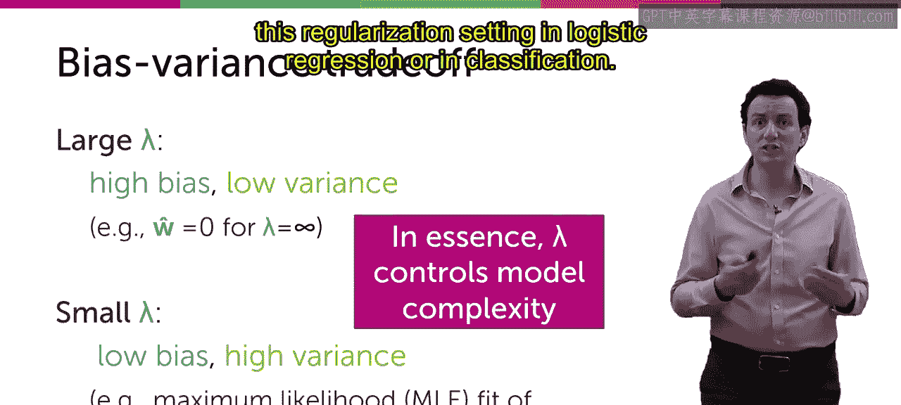

# 华盛顿大学《机器学习（分类，聚类和检索，第3-4课⧸共4课）｜Machine Learning》中英字幕 p53 52_L2正则化Logistic回归.zh_en -BV1Sr421F7N7_p53-

。

Now we have these two terms that we're trying to balance between each other and there's going to be a parameter。

 just like in regression， that helps us explore how much we put emphasis on fitting the data versus how much emphasis we put on making the magnitude look coefficient small and this parameter we call lambda。

Or the tuning parameter or the magic parameter or the magic constant。And so if you think about it。

 there's three regimes here for us to explore when lambda is equal to 0。Let's see what happens。

 So when Lada goes to0， this problem reduces to just optimizing。

So maximizing over W of the likelihood。Only so only the likelihood term。

 which means that we get to the standard。Maximal likelihood solution。I pened。Ml E solution。

So that's probably not a good idea to set it to zero because I dont I have this really bad overfitting problems and not preventing any overfitting Now if I set London to be too large。

 for example， I set it to be infinity， what happens well。The optimization becomes。The maximum over W。

OrOf L of w minus infinity。Times。The norm of the parameters， which means the LW gets drowned out。

 all I care about is that infinity term， and so that pushes me to only care about penalizing the parameters。

About。Palizing。The coefficients， as you say in other the parameters， so penalizing W。Or。

Penalizing the large。Coefffics。Which will lead to just setting all of the ws equal to0。

Everything will be zero also no Ive got a good idea because I'm not fitting the data at all。

 I said all the parameters to zero， not doing anything good， ignoring the data。😊。

So the area that we care about is somewhere in between， so a lambda between 0 and infinity。

 which balances the data fit。Data fit。Against。Mnitude of parameter of the coefficients。Very good。

 so we're going to try to find a lambda that is between0 infinity that fits our data well。😊。

And this process we're trying to find a lambda and we're trying to fit the data with this L2 penalty。

 it's called L2 regularized logistic regression in the regression case we call this Ri regression here it doesn't have a fancy name it's just L2 regularized logistic regression。

Now we might ask at this point， how do I pick Lada？Well， if you took the regression course。

 you should know the answer already。😊，Don I use your training data because as Lada goes to zero you're going to fit the training data better。

 you're not going to be able to pick lambda that way， never， ever use your test data ever。😊。

So you either use a validation set if you have lots of data or use cross validation for smaller data sets。

So in the regression course， we cover this picking the parameter lambda for the regression setting and it's the same kind of idea here。

Use a validation set or use cross validation。Always。

Lambda can be viewed as a parameter that helps us go between a high variance model and a high bias model and try to find a way to balance the bias and variance in terms of the bias very straight off so when lambda is very large。

 we have w is going to zero and so we have large bias Im ignoring the data not fitting in the data very well。

 but you have low variance， no matter where your data is。

 you get the same kind of parameters in the extreme when lambda is extremely large。

 you get zero no matter what data you have。If land is very small。

 you get a very good fit to the training data。So you have low bias。

 but you can have a very high variance if the data changes a low bit。

 you get a completely different decision boundary。And so in essence。

 Lambda controls the bias very trade off for this regularization setting in logistic regression or in classification。

 just like it did in regular regression。

