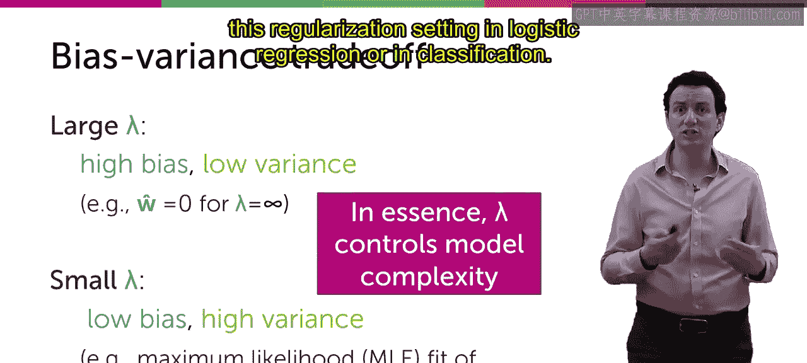

# 机器学习（分类，聚类和检索）：第3-4课：L2正则化Logistic回归

在本节课中，我们将要学习如何通过L2正则化来改进Logistic回归模型，以防止过拟合，并找到模型复杂度和数据拟合之间的平衡点。

---

## 平衡数据拟合与参数大小

上一节我们介绍了Logistic回归模型可能面临的过拟合问题。本节中，我们来看看如何通过引入一个惩罚项来约束模型参数的大小，从而在拟合数据和保持模型简单性之间取得平衡。

我们有两个需要平衡的目标：最大化数据的似然度，以及最小化模型参数的大小。这通过一个参数来控制，该参数决定了我们更侧重于拟合数据，还是更侧重于让参数值保持较小。

这个参数我们称之为 **λ**（lambda），也称为调优参数或正则化常数。

## 探索λ的不同取值

以下是λ取不同值时的情况：

*   **当 λ = 0 时**：优化问题简化为仅最大化似然度。这等同于标准的**最大似然估计（MLE）** 解。这通常不是一个好主意，因为它无法防止任何过拟合问题。
*   **当 λ → ∞ 时**：优化问题变为最小化无穷大乘以参数范数。似然度项被完全淹没，我们只关心惩罚参数。这将导致将所有参数 **w** 设置为0。这同样不是一个好主意，因为它完全忽略了数据，没有进行任何有意义的拟合。
*   **当 0 < λ < ∞ 时**：这是我们关心的区间。在这个区间内，λ在**数据拟合**和**参数大小**之间取得平衡。我们的目标是找到一个合适的λ值，使模型既能很好地拟合数据，又不会过于复杂。

## 模型名称与λ的选择

这个结合了L2惩罚项来拟合数据的过程，被称为 **L2正则化Logistic回归**。

那么，如何选择λ呢？其原则与回归课程中介绍的方法完全相同：

*   **切勿使用测试数据**来选择λ。
*   如果数据量充足，可以使用**验证集**。
*   如果数据集较小，可以使用**交叉验证**。

## 理解偏差-方差权衡

λ可以被视为一个控制模型**偏差**和**方差**权衡的参数：

*   **当λ非常大时**：参数 **w** 趋向于0，模型忽略数据，导致**高偏差**。但无论数据如何变化，模型输出都相似，因此**方差很低**。
*   **当λ非常小时**：模型能很好地拟合训练数据，因此**偏差很低**。但数据稍有变动，就可能得到完全不同的决策边界，因此**方差很高**。

本质上，λ控制着正则化设置下的偏差-方差权衡，这在Logistic回归（或分类）中的作用，与在线性回归中完全一致。

---

本节课中我们一起学习了L2正则化Logistic回归的核心思想。我们了解到，通过引入一个正则化参数λ，并在目标函数中添加参数的L2范数作为惩罚项，我们可以在模型复杂度和对训练数据的拟合程度之间进行权衡。选择合适的λ值（通过验证集或交叉验证）有助于我们找到偏差和方差之间的最佳平衡点，从而构建出泛化能力更强的分类模型。