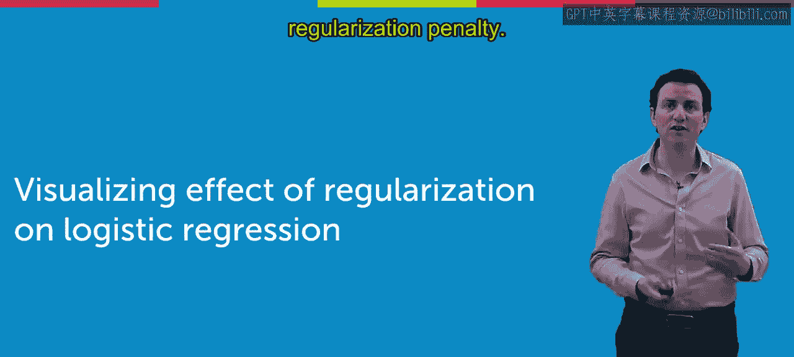
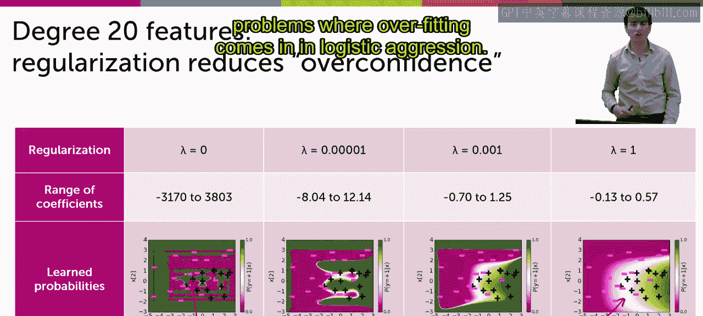

# 华盛顿大学《机器学习（分类，聚类和检索，第3-4课⧸共4课）｜Machine Learning》中英字幕 p54 53_可视化L2正则化在Logistic回归中的效果.zh_en -BV1Sr421F7N7_p54-

。

Now that we have seen how regularization can play a role in the classification setting。

 let's observe in our toy data set what happens to decision boundaries as we introduce a regularization penalty。

😊。

We're going to work with that degree 20 features， so fitting in a discretion model with features of polynomial degrees 20。

 which led us to this。Technical term that are called the crazy。Decision boundary。Boundary。

And the parameters had very large magnitude， in fact， it varied from minus 3，170 to 3，803。

 so they were very big。Now we're going to take the same setting， same number features， same features。

 same data， same everything， but just vary the parameteral lambda and see what happens。

And here we're showing the result of doing exactly that。 When lambda is equal to 0。

 we get very large coefficients。Well， when lambda is large， like 10 we get。嗯。You know。

 good size coefficients， let's say smaller coefficients。Okay， and so for La equals to0。

 we had that crazy decision boundary。Bundary。And for large lambs， we have a nicer。

Smooth their boundary。In fact， I trust the decision boundary with lambda equals 10 much more than I trust the one with lambda equals0。

And that decision under La de Cos1 looks a lot like like that really beautiful when I got with the parabola。

😊，And fit my data really well， but here I added tos， tons of more features， but nonetheless。

 having a little bit of regularization help us get that really nice separating plane that I can trust。

We can also look at the coefficient paths what happens to our coefficients as we increase the penalty lambda so in the beginning when we have an unregularized problem。

 the squ divisions tend to be large， but as we increase lambda。

 they tend to become smaller and smaller and smaller and go to zero。😊，I've used the review dataset。

 product review dataset here， and I picked a few words and fit a logistic regressional model just using those words with different levels of regularization。

 So， for example， the words that have positive coefficient tend to be associated with positive aspects of reviews。

 Well the ones with negative coefficient tend to be associated with negative aspects of reviews。

 What is the word in quotes that has most positive weight。 Well， if you look at the key here。

 you see the word that has most positive weight is。😊，Actually， an emotic gun smilingy face。😊，Well。

 the word that has most negative weight is another Monoticcon， which is。😊，With thrown fruit。And。

In the beginning， all of these words have pretty large coefficient。

 except for the words here near zero， which are words like this。And review。

 which are not associated with either positive things or negative things。

 although if the review the word review shows up is slightly correlated with a negative review。

 but in general these coefficients much smaller than the others and as I increase the regularization lambda。

 you see the coefficients can become smaller and smaller and if I were to keep drawing this。

 they will eventually go to zero。😊，And now if I were to use cross validation to pick the best Lada。

 I'll get a result kind of around here， and I'm going to call that Lambda star。

And so that's what you do use cross validation to find that point where it's fitting data pretty well。

 but it's not overfitting it too much。And as the last point。

 I'm going to show you something that is pretty exciting and really beautiful about regularization。

 Lo regression。 Regization doesn't only address the crazy Wily decision boundaries。

 but address some of those overconfidence problems that we saw with overfitting regularization。

 So I'm taking the same coefficients， same thing that I've learned you know。

 the lambda is increasing the range of coefficients decreasing they getting smaller。

 but I'm plot in the bottom here， the actual decision boundaries that we learned and the notions of uncertainty on our data。

 So if lambda is equal to0。 We have this。😊，Haili。Over confident predictions。If Lada is a1。

 not only do I get up more natural， the kind of parabo like the boundary。

 even though I'm using degree 20 features。Pnomous with the Gr20 is features。

 I get a very natural uncertainty region。So the reason where I don't know if it's positive or negative is really those points in the boundary。

 which are kind of between those clusters of positive points and the clusters of negative points。

 and you get this kind of beautiful smooth transition。So by introducing regularization。

 we've now addressed those two fundamental problems where overfitting comes in on logistic regression。

。