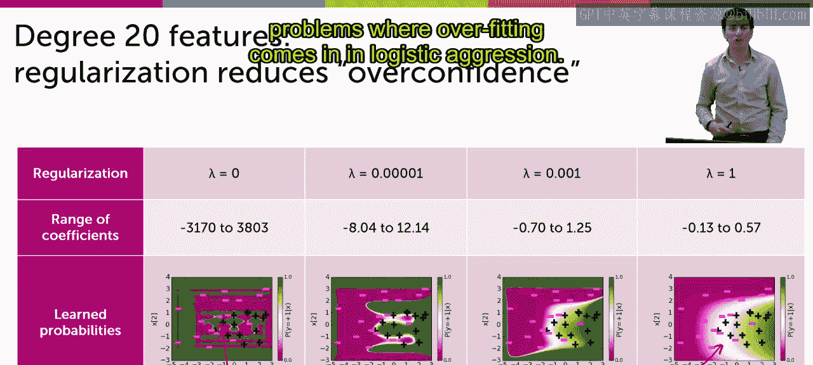

# 机器学习（分类，聚类和检索）：第3-4课：可视化L2正则化在逻辑回归中的效果

在本节课中，我们将学习L2正则化如何影响逻辑回归模型。我们将通过一个简单的数据集，观察随着正则化强度的变化，模型的决策边界和系数会发生怎样的改变。这有助于我们理解正则化如何防止过拟合，并提升模型的泛化能力。

## 观察正则化对决策边界的影响

上一节我们介绍了正则化的基本概念。本节中，我们来看看在一个具体的数据集上，引入正则化惩罚项后，决策边界会发生什么变化。

我们将使用一个包含20次多项式特征的数据集。在不使用正则化（λ=0）的情况下，拟合一个逻辑回归模型会得到一个非常复杂、不规则的决策边界，这通常被称为“疯狂”的决策边界。此时模型的参数值非常大，范围从-3170到3803。

现在，我们保持所有设置不变（相同的特征、相同的数据），只改变正则化参数λ的值，并观察结果。

以下是不同λ值下的结果对比：

*   当 **λ = 0** 时，我们得到非常大的系数和那个“疯狂”的决策边界。
*   当 **λ 较大**（例如 λ = 10）时，我们得到较小的系数和一个更平滑、更自然的决策边界。

事实上，相比λ=0的模型，我们更信任λ=10的模型所得到的决策边界。这个边界看起来很像之前用抛物线特征得到的漂亮边界，它很好地拟合了数据。尽管这里我们使用了大量（20次）多项式特征，但一点点的正则化帮助我得到了一个可信的、漂亮的分离平面。

## 观察正则化对系数的影响

我们也可以观察系数路径，即随着惩罚项λ的增加，我们的系数会发生什么变化。

在开始时（λ=0，无正则化），系数往往很大。但随着λ的增加，它们会变得越来越小，最终趋近于零。

我使用了一个产品评论数据集，挑选了几个词，并用不同强度的正则化拟合了一个逻辑回归模型。

以下是关于系数的观察：

*   具有**正系数**的词往往与评论的积极方面相关。
*   具有**负系数**的词往往与评论的消极方面相关。
*   初始时（λ很小），这些词的系数都相当大，除了那些与情感无关的词（如“this”、“review”），它们的系数接近零。
*   随着正则化强度λ的增加，所有系数都变得越来越小。如果继续增加λ，它们最终都会变为零。

## 通过交叉验证选择最佳λ

如果我使用交叉验证来选择最佳的λ，会得到一个大约在某个位置的结果，我们称之为 **λ***。

这就是实际操作：使用交叉验证找到那个既能很好拟合数据，又不会过度拟合的平衡点。

## 正则化解决过拟合的核心问题

最后，我想展示正则化一个非常激动人心且优美的特性。逻辑回归的正则化不仅能解决“疯狂”的决策边界问题，还能解决我们之前看到的因过拟合导致的“过度自信”预测问题。

我绘制了底部图像，展示了在不同λ下学到的实际决策边界以及模型对数据的不确定性估计。

以下是两种情况的对比：

*   如果 **λ = 0**，我们会得到这种高度“过度自信”的预测，模型对几乎所有点的预测概率都接近1或0。
*   如果 **λ = 1**，我不仅得到了一个更自然（类似抛物线）的边界（尽管使用了20次多项式特征），还得到了一个非常自然的**不确定性区域**。模型不确定是正类还是负类的区域，正好是那些位于正类数据簇和负类数据簇之间的边界点，你会看到这种平滑的过渡。

因此，通过引入正则化，我们解决了逻辑回归中过拟合带来的两个根本问题：不合理的复杂决策边界和过度自信的概率估计。

## 总结

本节课中，我们一起学习了L2正则化在逻辑回归中的可视化效果。我们看到，随着正则化强度λ的增加：
1.  模型的系数会缩小，极端的大系数得到抑制。
2.  决策边界从复杂、不规则变得平滑、自然。
3.  模型输出的概率估计从“过度自信”变得合理，在类别边界附近能够体现不确定性。
4.  通过交叉验证，我们可以找到一个最佳的λ*，在拟合能力和泛化能力之间取得平衡。正则化是控制模型复杂度、防止过拟合的强大工具。