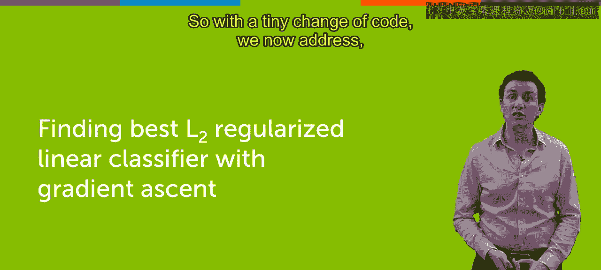
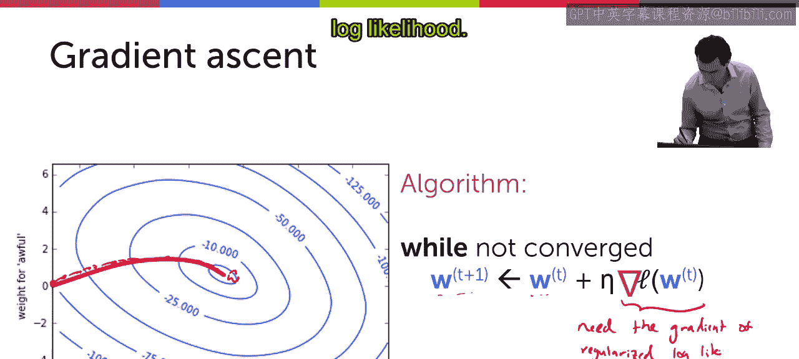
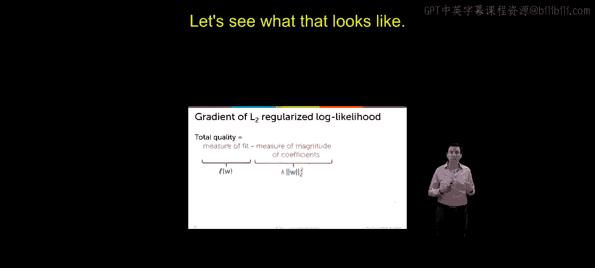
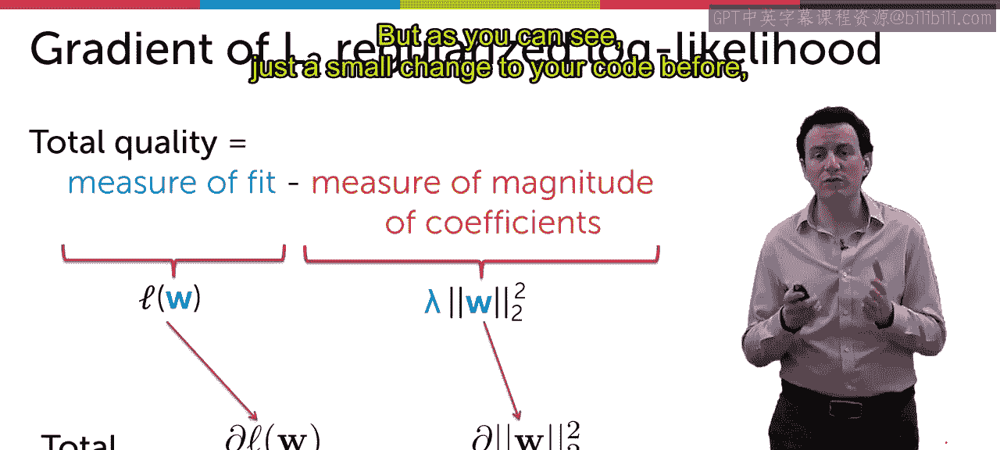
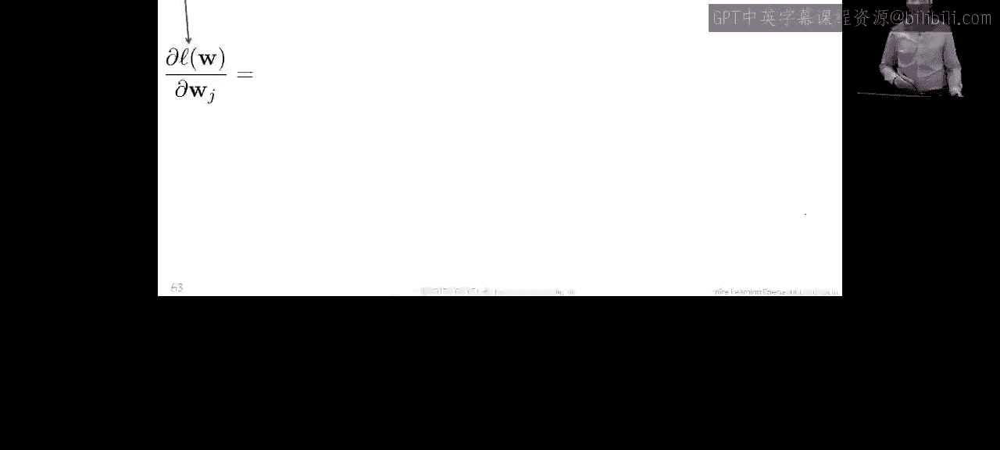
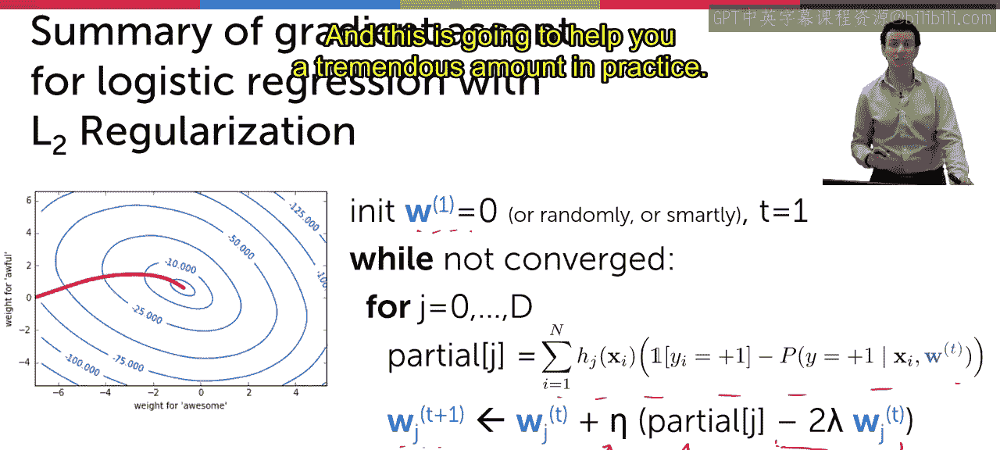

# 华盛顿大学《机器学习（分类，聚类和检索，第3-4课⧸共4课）｜Machine Learning》中英字幕 p55 54_使用梯度上升法学习L2正则化Logistic回归.zh_en -BV1Sr421F7N7_p55-

。

We've seen now how regularization can play a role logistic regression to find much better fits of data and better estimates of probability let's finally talk about how we can learn them from data。

 those coefficients using gradient asscent and it's just going to be a very。

 very tiny change on what we did for learning the coefficients in logistic regression so with like a tiny change of code we now address alleviate all those overfiing problems that you had before。

😊。

So again， same settings before training data features， same model。

 now we have L2 regularized logisticistic regression or log likelihood as our quality metric。

 and we're going to talk about emotional learning the algorithm to address it。

 to optimize it to get WHt。We're going to be using the same kind of gradient ascent algorithm that we don't used before。

 we start from some point and we take these little steps。

L ata steps until we get to our solution W hat and the same kind of approach where we're taking the old coefficients。

 adding ata times the gradient and getting the new coefficients W T plus1 and so the only thing that we have to ask ourselves is what is the gradient equal to now that we've added this extra regularization term So。

We somehow need。The gradient。Of。The regularized。Log。

Myli。Let's see what that looks like。

We've seen that our total quality is the sum of the log likelihood data。

 which is a measure for fit minus lambda times a regularization penalty。

 which is this L2 norm squared。And so what is the derivative of the thing。

 this is the thing that we need to be able to walk into that hill climbing direction。

So the derivative of the sum is the sum of the derivative。

 So the total derivative is the derivative of the first term derivative of the log likelihood。

 which thankfully weve seen in the previous module。😊。

Minus lambda times the derivative of the quadratic term here。😊。

And it turns out derivative of the quadratic term we already covered in the。Regression course。

 but we're going to do a quick review here， but as you can see just a small change to your code before。

 we just have to add this Lada times the derivative of the quadratic term。

So as a review， the derivative of the log likelihood is going to be the sum of my data points。😊。

Of the difference between the syn of whether it's a positive example and the probability of it being positive。

😊，weighed by the value of the feature and we talked about last module and interpreted this piece in quite a bit of detail。

 So we're not going to go over again， we're going to focus on the second part。

 which is the derivative of that L2 penalty。 So in other words。

 what's the partial derivative with respect to some parameter Wj of w0 squared。Plus。

 w1 squared plus W2 squared。Plus， da plus W J squared。Plus， w plus WD squared。Now。

 if you look at all of these terms。W0 squared， w R squared all those don't play any role in the derivative。

 the only thing that plays a role is Wj squared and what's the derivative of de J squared is just 2 Wj。

😊，So that's all we's going to change in our code section 2 WJ。So in fact。

 our total derivative is going to be the same derivative that we've implemented in past minus2 lambda times Wj。

So two times the regularization coefficient， the regularization penalty。

 the parameter lambda times the magnitude， the times the value of that coefficient。

So let's interpret what this extra term does for us。

 So what does the 2 lambda W J go to the derivative。 So if W J is positive。

 this minus lambda W J is a negative term， negative contribution to a derivative。

 which means that it decreases。Decreases。WJ， because you're going to add some negative term to it。

 it was positive， we're going to decrease it。 so since it was positive when you're decreasing it。嗯。

What happens is WJ。Becomes。Closer。To 0。So if W is positive， you add a negative number。

 it becomes less positive， closer to0 and in fact if lambda is bigger。

 then that thing becomes more negative and it going to0 faster that's what happens and if Wj is very positive that the decrement is also larger so it becomes again goes toward 0 even faster。

Now， if WJ is negative。Then-2 lambda WJ is going to be greater than 0 because lambda is also greater than 0。

 And what impact does that have， So you're adding something positive。 So you're increasing。WJ。

Which implies that WJ becomes。Again。Closer to。0。It was negative， I might add positive numbers to it。

 it goes a little close to  zero， so this is extremely intuitive。😊。

The regularization takes positive coefficients and decrease them a little bit。

 negative coefficients and increases them a little bit， so it tries to push coefficients to zero。

 that's what effects has on the gradient exactly what you expect。😊，Finally。

 this is exactly the code that we described in the last module to learn the coefficients of a logistic regression model。

😊，You start with some ws equal to zero or some other randomly initiated or sometimes kind manuallyly initiated parameters。

 and you go for each iteration， you go coefficient by coefficient。

 you compute a partial derivative which is this really long term here， some of our data points。

 the coefficient the feature value times the difference between what is a positive data point and the predicted value positive。

 so we call a partial J。And you have the same update。WJ T plus1 is WJT plus the step size。Saize。

That multiplies the partial derivative just as before。

Which is the derivative of the likelihood function with respect to WJ。

And all you need to change in your code。 There's only one little thing to change in the code。

You have this little thing here， which is our only change。In other words。

 take wherevo code you have for put minus2 Lada Wj in the computational derivative。

 and now you have a solver for L2 regularized logistic regression。

And this is going to help you a tremendous amount in practice。

