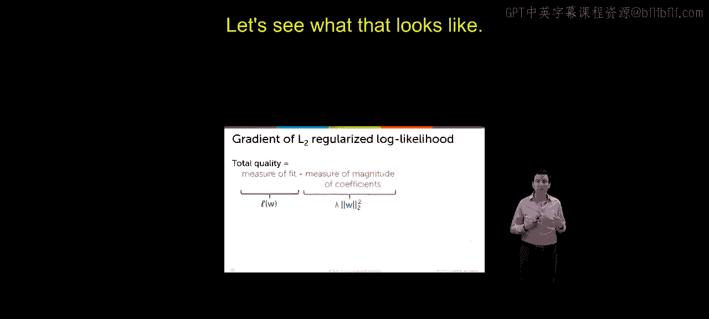
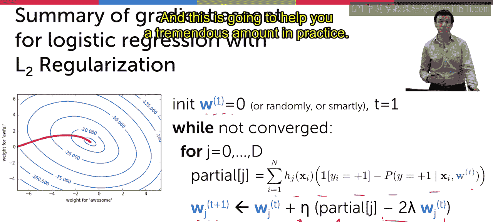

# 机器学习（分类，聚类和检索）：第3-4课：使用梯度上升法学习L2正则化Logistic回归

在本节课中，我们将要学习如何使用梯度上升算法来训练带有L2正则化的Logistic回归模型。我们将看到，只需对标准Logistic回归的学习代码进行微小的修改，就能有效缓解过拟合问题，获得更优的模型参数。

## 概述

我们已经了解了正则化如何在Logistic回归中发挥作用，帮助我们找到对数据更好的拟合以及更准确的概率估计。现在，让我们最终探讨如何从数据中学习这些系数。我们将使用梯度上升法，并且这仅仅是在学习标准Logistic回归系数的基础上进行一个非常微小的改动。通过这一点点代码变更，我们就能解决之前遇到的所有过拟合问题。

## 学习算法设置

与之前相同，我们拥有训练数据特征和相同的模型。但现在，我们的质量度量标准是**L2正则化的Logistic回归对数似然**。我们将讨论如何通过学习算法来优化它，从而得到最优参数 **W_hat**。

我们将使用之前用过的同类型梯度上升算法：从某个起点开始，沿着梯度方向以小步长（学习率）前进，直到达到解 **W_hat**。更新公式依然是：**W_{t+1} = W_t + η * 梯度**。

因此，我们现在需要问自己的唯一问题是：在添加了这个额外的正则化项之后，梯度等于什么？我们需要计算**正则化对数似然**的梯度。

## 计算正则化对数似然的梯度

我们已知总的质量函数是数据对数似然（衡量拟合度）与正则化惩罚项（L2范数的平方）的加权和：

**总质量 = 对数似然(数据) - λ * (L2范数)^2**

我们需要的是这个总质量函数关于参数 **W** 的导数，以便沿着梯度方向“爬山”。

总和的导数等于各项导数的和。因此，总导数是：

1.  对数似然的导数（幸运的是，我们在上一个模块中已经推导过）。
2.  减去 **λ** 乘以二次惩罚项的导数。

可以看到，这仅仅是在你原有代码上的一个小改动：我们只需要在计算梯度时加上 **λ** 乘以二次惩罚项的导数这一项。

## 回顾与分解梯度

首先，回顾一下对数似然的导数。它是所有数据点上的求和：

**对数似然的导数 = Σ_{数据点} [ (y_i - P(y_i=1|x_i, W)) * x_{ij} ]**

其中，**y_i** 是真实标签（1或0），**P(y_i=1|x_i, W)** 是模型预测的正类概率，**x_{ij}** 是第 **j** 个特征的值。我们在上一个模块中已经详细解释过这一项，因此这里不再赘述，我们将重点放在第二部分：L2惩罚项的导数。

换句话说，我们需要求某个参数 **W_j** 对于惩罚项 **W_0^2 + W_1^2 + ... + W_j^2 + ... + W_D^2** 的偏导数。

观察所有这些平方项，只有包含 **W_j** 的项 **W_j^2** 在求偏导时起作用。**W_j^2** 关于 **W_j** 的导数就是 **2 * W_j**。

这就是我们代码中唯一需要改变的部分：**2 * W_j**。

因此，我们总的导数（梯度）将是过去实现的导数（对数似然导数）减去 **2 * λ * W_j**：

**总梯度 = 对数似然导数 - 2λW_j**

## 理解正则化项的作用

现在，让我们解释一下这个额外的项 **-2λW_j** 对我们的梯度有什么影响。

*   如果 **W_j** 是**正数**：
    *   **-2λW_j** 是一个**负数**，它对梯度产生负贡献。
    *   这意味着在更新时，我们会**减小** **W_j** 的值（因为我们在正数上加了一个负数）。
    *   结果就是，**W_j** 变得更**接近0**。
    *   如果 **λ** 更大，这个减小的幅度就更大，**W_j** 趋向0的速度更快。
    *   如果 **W_j** 本身非常大，这个减量也相应更大，同样会更快地趋向0。

*   如果 **W_j** 是**负数**：
    *   **-2λW_j** 将是一个**正数**（因为负负得正）。
    *   这意味着在更新时，我们会**增加** **W_j** 的值（在负数上加一个正数）。
    *   结果同样是，**W_j** 变得更**接近0**。

这非常直观：**正则化会将正系数减小一点，将负系数增大一点，从而试图将所有系数向零推动**。这正是我们期望正则化在梯度上产生的效果。

## 算法实现代码

以下是我们在上一个模块中描述的学习Logistic回归模型系数的代码框架。

你从一些初始化的 **W** 开始（例如全零、随机初始化或手动设置），然后进行多次迭代。在每次迭代中，你逐个系数地更新：

1.  计算偏导数 **partial_j**，即上面提到的长公式：对所有数据点求和 `(特征值 * (真实标签 - 预测概率))`。
2.  执行相同的更新：**W_j_{t+1} = W_j_t + 步长 * partial_j**。

而你需要在代码中做出的**唯一改变**就在这里。换句话说，在你计算导数（`partial_j`）的任何地方，插入减去 **2λW_j** 这一项。

现在，你就拥有了一个**L2正则化Logistic回归**的求解器。这将在实践中对你产生巨大的帮助。

## 总结

本节课中，我们一起学习了如何通过梯度上升法训练L2正则化的Logistic回归模型。核心在于理解总目标函数（正则化对数似然）的梯度由两部分组成：原始对数似然的梯度和正则化惩罚项的梯度。正则化项的导数非常简单，就是 **2λW_j**。将这个项加入到梯度更新公式中，就能在优化过程中自动将系数向零收缩，从而有效控制模型复杂度，防止过拟合。最终，我们只需在标准Logistic回归的梯度计算代码中添加一行 `- 2 * lambda * W_j`，即可实现这一强大的正则化效果。