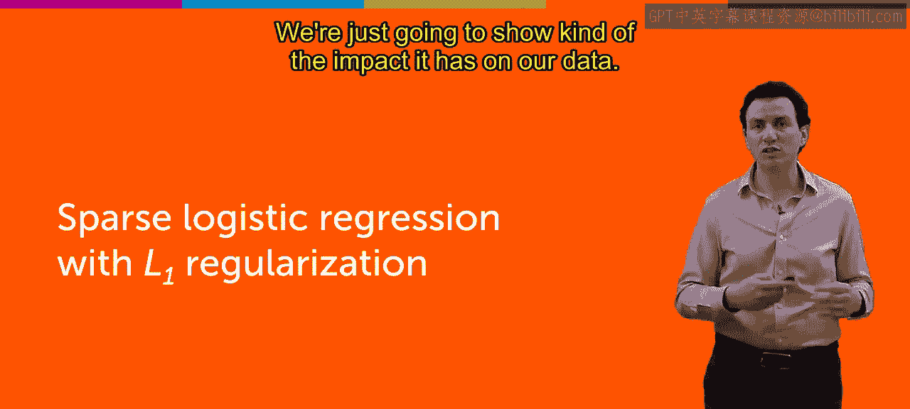
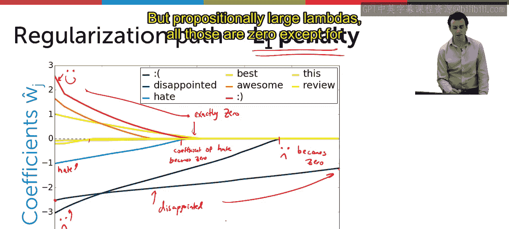
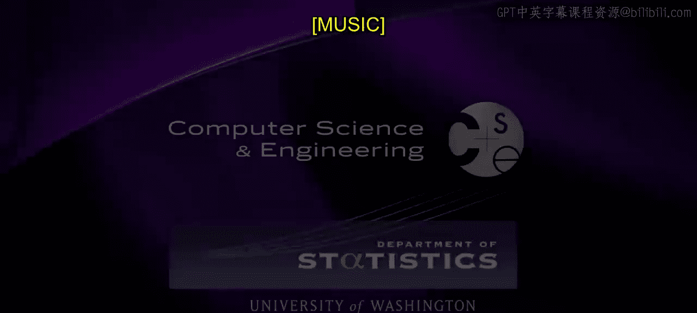

# 华盛顿大学《机器学习（分类，聚类和检索，第3-4课⧸共4课）｜Machine Learning》中英字幕 p56 55_L1正则化的稀疏Logistic回归.zh_en -BV1Sr421F7N7_p56-

。

So far， we've discussed L2 regularized logistic regression and we briefly mentioned what happens when you have L1 regularized logistic regression。

 let's talk about it in a little bit more detail。 And in the regression course。

 we're not going to derive the learning algorithm for L1 regularized logistic regression going to be the similar thing to what you did with Laso。

 we're just going to show kind of the impact it has on our data。😊。

On our learn models。So recall the notion of sparsity。

So a model path when many of those WJs are equal to zero and that can help us with both efficiency and interpretability of the models。

 as we saw in regression， so for example， let's say that we have a lot of data and a lot of features so the number of ws that you have can say be 100 billion00 billion possible values。

 X can happen in practice in all sorts of settings， for example。

 many of the span filters out there have hundreds of billions of parameters in there or coefficients that they learn from data。

😊，So this has a couple problems。Can be expensive to make a prediction。

 to go through 100 billion values。However， if I have a spae solution where many of these ws are actually equal to0。

 then when I'm trying to make a prediction， so I'm trying to compute the sine of Wj times the feature Hj of X。

 I only have to look at no zero coefficients Wj。Everything else can be ignored。

 so if I have 100 billion coefficients， but only say 100，000 of those are known zero。

 then it's going to be much faster to make a prediction this makes a huge difference in practice。😊。

The other impact this sparsity has having many zero coefficients being zero is that you can help you interpret the nonzero coefficients so you can look at the small number of nonzero coefficients and try to make an interpretation。

 oh， this is why a prediction gets made。😊，And such interpretations can be used for practice in many ways。

So how would you learn logistic regression classifier with sparseity in that sparseity reducingic penalty。

 So what we do is take the same log likelihood functionW， but we add extra L1 penalty。

 which is the sum of the absolute value W0 W1 all the way to the absolute value WD。

 So by just changing the square sum of squares to be sum of absolute values。

 we go into what's called L1 regularized logistic ratio which gives you sparse solutions。

 So that's small change these to sparse solutions。So just like we did with L2 regularization here。

 we're also going to have a parameter lambda， which controls how much regularization we introduce。

 so how much penalty we introduce and the objective becomes the log likelihood of data minus lambda times the sum of this absolute values。

 the L1 penalty when lambda equals to zero。We have no regularization。Which leads us to the standard。

And me solution。Soution。Just like we had in the case of L2 regularization。Now。

 when lambda is equal to infinity， we have only penalty， so。Wait。😔，Is on。Regularization。

And that's going to lead to W H being everything 0。 all0 coefficients。 Now。

 the case that we really care about was we landed somewhere between 0 and infinity， which leads to。

Were called Sp solutions。Moucutions。Where。Sm。WJs are not going to be equal to zero。But， hopefully。

Many女。Other。WJs。And this is an assessment。 So WJ hats are going to be as exactly0。

 So that's what we're going to try to aim for。So let's revisit those coefficient paths and here I'm showing a coefficient path with L2 penalty。

 you see that when the lambda parameter is low。😊，You have large coefficients learned。

And when the lambda parameters gets larger， you get smaller coefficients。

So they go from large to small， but they're never exactly zero。

So the coefficients never become exactly0。If you look， however， at the coefficient path。

 when the regularization is L 1， we get something much more interesting。 So， for example。

 in the beginning， the coefficient of the smiley face。 oops， that should be frown， that should be。😊。

Smiy face has a large， positive value。But eventually， becomes exactly0。From here on。And similarly。

 the coefficient for the frowning case for the frowning face is a large negative value。

 but eventually over here the frowning face。😊，Has a coefficient that becomes0。

And so it goes from large all the way to exactly zero。 and you see that for many of the other words。

 So for example， in the beginning， the coefficient of the word hate is pretty high and that' is a pretty important word where around here hate becomes irrelevant。

😊，And so just a quick reminder， these are product reviews and try to figure out whether it's a positive or negative review for the product and we can look at what coefficient stays not zero for the longest time and this is exactly this line over here where it never kind of hits zero and never stays exactly zero and this is a coefficient of the word disappointed。

😊，So you might be disappointed to learn that frowny face is not the one that becomes zero。

 but in the beginning， this is not as。The coefficient is not as large。

 so it's not as significant as a frownly face， but it's the one that stays negative for the longest。

 and so frownly face is not it might be the sp tone and friendly face is not as important as disappoint。

And disappointed， probably because it's prevalent in more reviews and when you say disappointed。

 you're really like in a negative review， that coefficient goes over a long time。

So you see this transitions。 So the coefficients of those small numbers like you used goes to zero early on。

 smiley face lasts for a while and then becomes zero。

 frowny face lasts for longer and then becomes exactly zero。

 but for sufficiently large lambdas all of those are zero except for the coefficient are disappointed。

。

